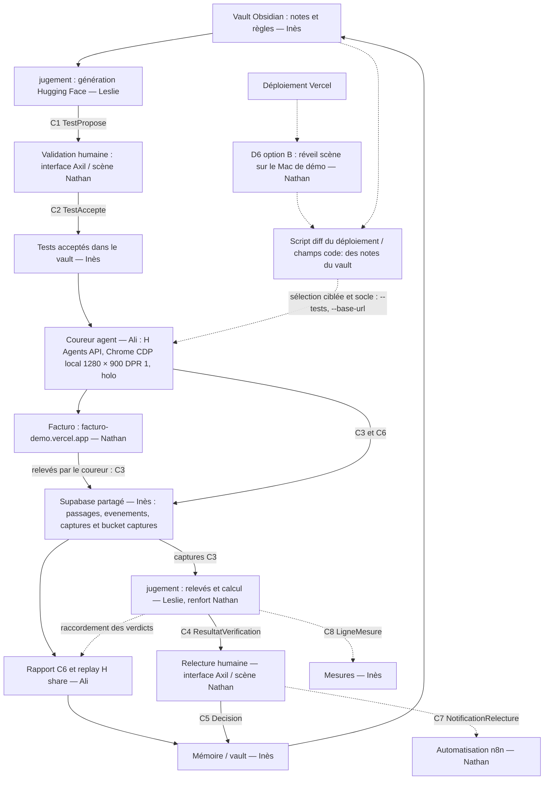

# Horama

**Votre documentation devient vos tests.**

Horama transforme un vault Obsidian produit — écrans, règles métier, notes de version — en tests proposés puis validés par un humain.
Un agent H joue les tests acceptés sur le logiciel ; les relevés alimentent une vérification par le calcul et une relecture humaine.
Les rapports et décisions alimentent la mémoire du vault pour garder documentation et tests cohérents.

Hackathon Eugenia « Build The Future », 16–20 novembre 2026, équipe 11. Horama prolonge la [démo QA de H Company](https://github.com/hcompai/agents-api-demos/tree/main/examples/software_qa), licence MIT, dont il reprend le format de test Markdown. [Cadrage produit](docs/cadrage.md).

## Architecture et responsabilités

Le schéma décrit les échanges ; les flèches pointillées signalent le raccordement visé, **pas une boucle intégralement validée**. Le SaaS n’écrit pas lui-même dans Supabase : les relevés sont déposés par le coureur/scène.



| Pôle | Responsable et périmètre |
|---|---|
| A — moteur | **Ali**, `agent/`, racine, gardien de `contrats/` : CLI, sessions H, C3 et C6 |
| B — écriture/vérification | **Leslie**, `jugement/` : génération C1, calcul et statuts C4 ; Nathan en renfort |
| C — données/mémoire | **Inès**, vault, mémoire, base, références, décisions C5 et mesures C8 |
| D — interface | **Axil**, `interface/` : proposition, validation, fil et relecture |
| E — automatisation | **Nathan**, `automatisation/`, scène, `faux-saas/`, n8n C7 ; renfort moteur et preuve |
| F — pilote/pitch | **Noé**, `pitch/` : pilote, rendus et récit de démonstration |

### Contrats gelés C1–C8

Définitions faisant foi : [`contrats/types.ts`](contrats/types.ts), [exemples](contrats/exemples/), gel `contrats-v1`. Les anciens commentaires « Nathan » des types reflètent les deux couloirs initiaux ; les responsabilités produit ci-dessus suivent les missions actuelles.

| Contrat | Échange |
|---|---|
| **C1** `TestPropose` | Génération → interface/validation humaine : proposition, règles, questions d’ambiguïté |
| **C2** `TestAccepte` | Validation/mémoire → fichier Markdown du vault → coureur ; contient notamment `url_depart`, relevés et règles |
| **C3** `Passage`, `EvenementFil`, `Capture` | Coureur → Supabase → fil, vérification et interface |
| **C4** `ResultatVerification` | Vérification → interface, mémoire et automatisation ; `PASS`, `SUSPECTED`, `VERIFIED_FAIL`, `INCONCLUSIVE` |
| **C5** `Decision` | Relecture humaine → mémoire/vault : bug ou voulu, portée limitée, éventuelle correction de note |
| **C6** `RapportPassage` | Coureur → base, interface et Markdown du vault ; `tests[].replay_url` facultatif |
| **C7** `NotificationRelecture` | Boucle de relecture → webhook n8n |
| **C8** `LigneMesure` | Résultats → mesures d’Inès ; aucune vérité de cas caché n’est exposée ici |

### État réel et D6 option B

La CLI lit C2, joue une session **chaînée** pour les tests sélectionnés, enregistre C3 et C6 et demande un partage H. Elle ne lance **pas** automatiquement le jugement métier : un passage `joue` et un test `termine` ne sont pas des verdicts `PASS`. Sans C4, le Markdown reste non concluant. Une session silencieuse est abandonnée après le seuil prévu par le coureur, puis relancée une fois ; les limites des essais sont dans les preuves, pas extrapolées.

[D6 option B, commentaire de Nathan sur PR 10](https://github.com/Hisseiny/Horama-/pull/10#issuecomment-6946965917) : Vercel réveille la scène sur le Mac de démo ; un script rapproche le diff des champs `code:` des notes d’écran, sélectionne les tests liés et un socle systématique, puis appelle la CLI. Ce README **ne livre pas ce déclencheur ni ce script**. Pas de GitHub Action pilotant Chrome local pour la démo ; commentaire de PR, mode cloud, graphe d’imports et explication LLM restent en roadmap. La comparaison d’images reste dans le P0.

## Comment tester

### Installer et vérifier sans H

Prérequis : Node.js avec exécution native TypeScript (environnement vérifié : Node 22.23.5), pnpm selon `packageManager` du dépôt ; shell POSIX pour `dev`. Depuis la racine :

```sh
pnpm install
pnpm -r check
pnpm --filter @horama/agent passage -- --help
```

Le check lance types et tests des paquets, dont le lint TypeScript d’Ali une seule fois. Il n’appelle pas les services H réels.

### Lancer l’interface et Facturo en mode factice

```sh
pnpm dev
```

Ouvrir l’interface sur `http://localhost:3000` et le faux SaaS sur `http://localhost:3100`. La commande fixe `USE_MOCKS=1`, ne lance ni session H ni Supabase et n’atteste pas les écritures partagées. Arrêter avec Ctrl-C. Pour un passage en ligne ci-dessous, le serveur Facturo local n’est pas nécessaire.

### Jouer réellement un test accepté sur Facturo en ligne

Ce passage consomme du quota/crédit H et **écrit dans le projet Supabase configuré**. Obtenir les accès autorisés auprès de l’équipe ; ne pas utiliser la clé de démo. Charger les secrets côté serveur, jamais dans Git, dans le vault ni dans une capture. La CLI lit aussi un éventuel `.env.local` racine (valeurs déjà présentes dans l’environnement prioritaires).

Variables requises : **`HAI_API_KEY`**, **`SUPABASE_URL`**, **`SUPABASE_SERVICE_ROLE_KEY`**. Pont : **`HOLO_BIN`** si `holo` n’est pas dans le PATH ; installer `hai-agents[cli,browser]` dans un environnement Python externe si nécessaire. Variables facultatives : **`FAUX_SAAS_URL`** (remplacée par `--base-url`), **`HAI_AGENT_MODEL`**, **`HAI_AGENT_REASONING`**. Aucun accès SQL direct n’est requis. Pour les lectures REST ci-dessous, **`PASSAGE_ID`** désigne l’identifiant imprimé par la CLI. Aucune valeur de clé n’est fournie ici.

Utiliser un **Chrome dédié**, jamais le navigateur personnel : le raccord garde un seul onglet. Chrome doit déjà écouter en CDP sur 9333, avec `--force-device-scale-factor=1` et une fenêtre permettant une zone de page 1280 × 900/DPR 1. Le coureur ajuste et vérifie ces dimensions, puis démarre `holo local browser` ; `--chrome-port` permet un autre port. Les journaux de pont sont dans `~/.horama/ponts/`. Le processus CLI doit rester vivant pour servir les outils jusqu’à la fin.

Depuis la racine, copier le vault complet hors dépôt **une fois, vers une destination encore absente**, puis jouer :

```sh
cp -R vault-horama "$HOME/horama-readme-vault"
pnpm --filter @horama/agent passage -- --logiciel facturo --version 13 --reference 12 --vault "$HOME/horama-readme-vault" --base-url https://facturo-demo.vercel.app --tests detail-facture-total-egal-liste
```

`--tests` accepte des identifiants séparés par des virgules ; sans option, tous les tests acceptés du logiciel sont sélectionnés. `--base-url` est **l’origine du SaaS**, pas un chemin de départ arbitraire : le chemin `/vXX/entrer?suite=…` provient du C2 et suit `--version`. Cette route établit la session Facturo sans formulaire de connexion. `--reference 12` renseigne le rapport mais ne lance pas à lui seul une comparaison calculée ni une promotion de référence. Les rapports sont écrits dans `<vault>/facturo/passages/` : garder ce vault hors dépôt.

La CLI imprime le passage puis attend la fin : sortie 0 si joué, 1 si échec. Le lien `share` est facultatif ; son absence produit un avertissement. Une URL accessible par curl peut être une trajectoire JSON publique, pas un lecteur HTML.

### Vérifier les lignes du Supabase partagé

Avec les variables serveur déjà chargées et `PASSAGE_ID` repris de la sortie, lectures **seulement** :

```sh
curl --fail --silent --show-error "${SUPABASE_URL}/rest/v1/passages?id=eq.${PASSAGE_ID}&select=id,etat,duree_s,cout_usd,rapport" -H "apikey: ${SUPABASE_SERVICE_ROLE_KEY}" -H "Authorization: Bearer ${SUPABASE_SERVICE_ROLE_KEY}"
curl --fail --silent --show-error "${SUPABASE_URL}/rest/v1/evenements?passage_id=eq.${PASSAGE_ID}&select=test_id,session_id,etape" -H "apikey: ${SUPABASE_SERVICE_ROLE_KEY}" -H "Authorization: Bearer ${SUPABASE_SERVICE_ROLE_KEY}"
curl --fail --silent --show-error "${SUPABASE_URL}/rest/v1/captures?passage_id=eq.${PASSAGE_ID}&select=test_id,ecran,vue,url,url_page,largeur,hauteur" -H "apikey: ${SUPABASE_SERVICE_ROLE_KEY}" -H "Authorization: Bearer ${SUPABASE_SERVICE_ROLE_KEY}"
```

Attendre une ligne de passage avec C6, uniquement les tests demandés et leurs événements/captures. Vérifier les URL de page, les dimensions, les objets du bucket `captures` et `tests[].replay_url`. Utiliser le coût/durée du passage, **ne pas sommer les métriques répétées par test**. Ne pas afficher la clé dans les logs, l’historique de commande, un lien ou une variable `NEXT_PUBLIC_*`.

## Preuves, limites et documentation

- [Preuve de ce README : commandes et validation Mermaid](docs/tests/2026-11-17-readme-architecture.md).
- [CLI ciblée et origine explicite](https://github.com/Hisseiny/Horama-/blob/a-tests-adresse-depart/docs/tests/2026-11-17-tests-adresse-depart.md) — branche indépendante, à intégrer séparément.
- [A6 et cinq A7 en ligne](https://github.com/Hisseiny/Horama-/blob/a7-facturo-en-ligne/docs/tests/2026-11-17-a7-facturo-en-ligne.md) — mesures réelles et limites, pas une promesse de performance.
- [Règles de contribution](AGENTS.md), [plan et propriétaires](docs/plan-de-travail.md), [missions](docs/missions/), [avancement](docs/checklist.md), [retours API H](docs/retours-api-h.md).

Les références v12 nécessitent une désignation explicite par leur propriétaire. Les tests automatiques ou l’exécution d’un parcours ne remplacent ni la preuve calculée ni la validation humaine de la boucle complète.
