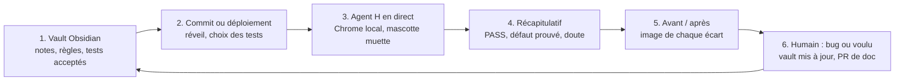
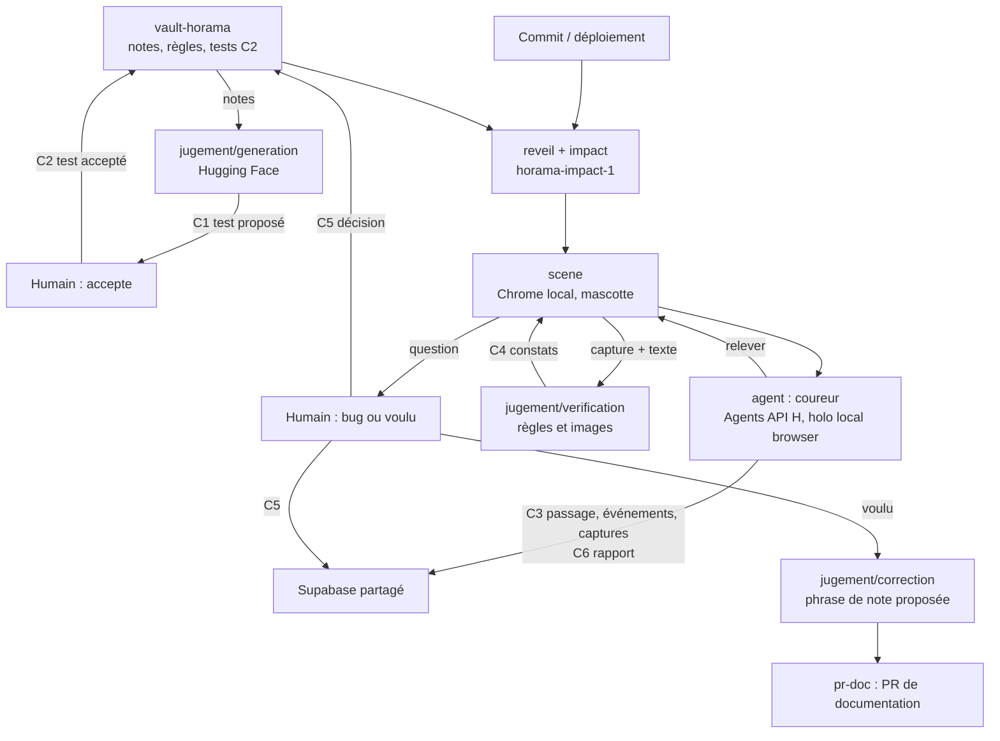
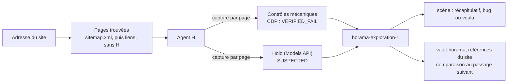

# Horama

**Votre documentation devient vos tests. Sans documentation, Horama regarde quand même.**

Horama teste un site web comme le ferait une personne : un agent H (Agents API de H Company) le parcourt en direct dans Chrome, le code vérifie ce qui se prouve, un humain tranche le reste, et chaque décision est gardée pour le passage suivant.

Hackathon Eugenia « Build The Future », 16 au 20 novembre 2026, équipe 11. Horama prolonge la [démo QA de H Company](https://github.com/hcompai/agents-api-demos/tree/main/examples/software_qa) (licence MIT), dont il reprend le format de test Markdown. Produit et fonctionnalités : [cadrage](docs/cadrage.md).

Ce document décrit l'architecture rendue le 18 novembre à 17 h, complétée le 19 : ce qui existe, ce qui a été mesuré, ce qui reste à construire. Chaque chiffre renvoie à son rapport dans `docs/tests/` ; une valeur non mesurée est écrite « à mesurer ».

## Essayer Horama

Pour le jury, à distance, sans terminal : Horama cherche les défauts d'un site public de votre choix. Tout passe par le service d'exploration en ligne (Railway, https://explorations-production-70bf5b38.up.railway.app) ; il suffit de Chrome.

1. **Ouvrir Horama.** Sans rien installer : https://horama-gold.vercel.app. Ou l'extension Chrome : téléchargez https://horama-gold.vercel.app/horama-extension.zip, dézippez-le, ouvrez `chrome://extensions`, activez le « Mode développeur », cliquez « Charger l'extension non empaquetée » et choisissez le dossier dézippé.
2. **Donner le site.** Sur la page d'accueil, collez l'adresse dans le champ. Avec l'extension, ouvrez le site puis cliquez sur l'icône Horama : l'adresse de l'onglet est déjà remplie.
3. **Lancer.** Cliquez « Envoyer Horama ». Le rapport s'ouvre dans un onglet. S'il y a déjà une exploration en cours, il affiche votre place dans la file.
4. **Regarder.** L'encadré « En direct » montre l'onglet que pilote l'agent H ; les pages visitées s'ajoutent une à une. Comptez **environ 6 minutes** : une exploration s'arrête au plus tard à 380 s (`HORAMA_MAX_SECONDS=380`), avec 8 pages au plus (`HORAMA_MAX_PAGES=8`) ; le passage de 8 pages sur la PR #16 du clone, en mode développeur sur une machine locale, a pris 343 s ; sur le service en ligne avec 380 s, à mesurer. Avec l'ancien plafond de 240 s, le 19/11, 3 à 7 pages sur 8 tenaient ([#208](https://github.com/Hisseiny/Horama-/issues/208)) ; les pages non atteintes sont marquées « non visitée », jamais comptées comme réussies.
5. **Lire le récapitulatif.**
   - Un **défaut prouvé** a été vérifié par le code (lien qui répond en erreur, texte qui déborde de sa boîte, image cassée, texte resté dans une autre langue…) : il vient avec sa capture entourée et sa mesure (« mesuré : … », « attendu : … »).
   - Un **doute** vient du regard du modèle visuel Holo : rien n'est prouvé, c'est à vous de trancher « bug » ou « voulu ».
6. **Revenir à vos passages.** La tour de contrôle, https://horama-gold.vercel.app/tour/, liste les explorations envoyées depuis votre navigateur et les passages du mode développeur (les PR du clone d'Eugenia School), chacun avec ses constats sur leur capture et les décisions déjà prises.

**Ce qui peut arriver**
- Un site qui bloque les robots (decathlon.fr répond 403) : l'exploration s'arrête tout de suite et le dit.
- Une page qui demande une connexion : Horama ne remplit aucun formulaire ; la page est notée « Connexion demandée », avec la raison.
- Un grand site : 8 pages au plus sont visitées (plafond du service, réglé dans Railway).
- Un service occupé : une exploration à la fois, 5 en file au plus ; 4 demandes par heure et par adresse IP, 12 par heure en tout. Au-delà, un message le dit.
- Une adresse privée, locale ou avec identifiants : refusée avant tout lancement.
- La langue : le Chrome du service est réglé en français (`fr-FR`) ; un site qui choisit sa langue d'après le navigateur sert sa version française, mais un site qui la choisit d'après l'adresse IP peut encore servir sa version néerlandaise (le service tourne aux Pays-Bas).

**Pour l'équipe : l'adresse du service et le `.zip`.** L'adresse est la constante `DEFAULT_SERVICE` de `extension/service.js` ; chaque utilisateur peut la changer dans les options de l'extension. Après un changement de l'extension : `sh extension/empaqueter.sh` produit `extension/dist/horama-extension.zip` et rappelle l'adresse qu'il contient ; le copier dans `accueil/horama-extension.zip` le publie avec la page d'accueil, au prochain redéploiement de horama-gold. Une release GitHub n'est téléchargeable par le jury que si le dépôt est public ; elle attend le go de Nathan.

## Fiche projet

1. **Problème.** Une équipe produit documente son logiciel (écrans, règles métier), puis la documentation et le site divergent : personne ne relit chaque page à chaque déploiement, et un test automatique classique ne voit ni un texte coupé ni une page restée dans la mauvaise langue. Sans documentation du tout, un site n'est jamais regardé.
2. **Solution.** Horama transforme la documentation en tests et les fait jouer par un agent H qui navigue comme une personne, en direct dans Chrome. Le code prouve ce qui se mesure (une règle calculée, un lien mort, un texte qui déborde, un bloc non traduit), le modèle visuel Holo signale le reste comme un doute, un humain tranche « bug » ou « voulu », et la décision est gardée pour le passage suivant. Deux modes : **développeur** (une PR GitHub réveille Horama, qui répond sur la PR) et **grand public** (une adresse suffit, depuis la page d'accueil ou l'extension Chrome).
3. **Stack.** Node 22 (TypeScript natif), pnpm. Agents API de H Company (agent H, pont local `holo` qui pilote Chrome par CDP, modèle visuel Holo). Chrome et son protocole de débogage (la scène, les captures). Vault Obsidian en Markdown (documentation, tests, décisions). Supabase (base des passages). Hugging Face, `openai/gpt-oss-120b` (génération des tests, correction de note). GitHub (API, réponses sur les PR, captures publiques). Vercel (page d'accueil, prévisualisations du clone), Railway (service d'exploration du grand public). Extension Chrome Manifest V3.
4. **Architecture.**

```
Mode développeur                                   Mode grand public
----------------                                   -----------------
PR GitHub du site + déploiement Vercel              Page d'accueil (horama-gold) ou extension Chrome
        |                                                   |  POST /explorations { url }
        v                                                   v
Réveil (automatisation/reveil)                      Service d'exploration (Railway, agent/scripts)
  lit la PR et le vault, choisit les tests           une exploration à la fois, file d'attente
        |                                                   |
        v                                                   v
Scène (automatisation/scene) : Chrome visible       Explorateur (agent/src/exploration) : Chrome
  agent H + mascotte, curseur, traits                 sans fenêtre, agent H, contrôles, Holo, direct
        |                                                   |
        v                                                   v
Jugement (jugement/) : règles calculées,            Rapport horama-exploration-1 : défauts prouvés,
  comparaison d'images ; Holo pour les doutes          doutes, pages, captures entourées
        |                                                   |
        v                                                   v
Humain : « bug » ou « voulu » dans la scène          Page de rapport (accueil/rapport, extension),
        |                                              suivie en direct
        v
Décisions dans le vault, réponse sur la PR avec captures, index public des passages (tour de contrôle)
```

5. **Repo.** https://github.com/Hisseiny/Horama- (ce dépôt) et le clone du site d'Eugenia School qui sert de terrain au mode développeur, https://github.com/Hisseiny/eugenia-school-website.
6. **Lien du proto.**
   - Page d'accueil, mode grand public : https://horama-gold.vercel.app
   - Extension Chrome : https://horama-gold.vercel.app/horama-extension.zip
   - Mode développeur en vrai : la PR #16 du clone (traduction en allemand) et la réponse d'Horama, https://github.com/Hisseiny/eugenia-school-website/pull/16#issuecomment-7010755513
   - Tour de contrôle (tous les passages et leurs constats) : https://horama-gold.vercel.app/tour/
   - Index public des passages (ses données pour le mode développeur) : https://raw.githubusercontent.com/Hisseiny/eugenia-school-website/horama/captures/index.json
7. **Comment tester.** Sans rien installer : la page d'accueil, une adresse, « Envoyer Horama » ; ou l'extension. Détail plus haut, « Essayer Horama » ; pour lancer le code, « Comment lancer ».

## Deux modes

Recadrés le 18/11 ([décision](docs/decisions/2026-11-18-recadrage-grand-public-et-dev.md)) ; ce qui reste à faire, par personne et par jour : [feuille de route](docs/feuille-de-route.md).

| | Mode développeur | Mode grand public |
|---|---|---|
| Pour qui | Une équipe produit qui documente son logiciel | N'importe qui, avec la seule adresse d'un site |
| Ce qu'Horama reçoit | Un vault Obsidian (une note par écran, des règles), le dépôt Git du site | Une adresse. Ni documentation, ni accès au code |
| Ce qui déclenche | Un déploiement Vercel : Horama lit la PR sur GitHub et le vault Obsidian, choisit les tests à rejouer, réécrit dans le vault où sont les erreurs et répond par une PR | Une demande : on colle l'adresse (extension Chrome ou page d'accueil) |
| Ce que l'agent H fait | Joue les tests acceptés par un humain, relève les écrans demandés | Visite toutes les pages trouvées (trois agents en parallèle à terme) |
| Ce qui est prouvé | Règles calculées (égalité, somme, filtre, format, présence, état) et comparaison d'images avec les références | Contrôles mécaniques (page en erreur, image cassée, texte qui déborde, lien mort, texte d'erreur affiché) |
| Ce qui reste un doute | Un écart d'image | Ce que Holo voit sur la capture, un écart d'image au passage suivant |
| Ce qui est gardé | Décisions bug ou voulu dans le vault, correction de note proposée par un modèle, PR de documentation | Captures de référence et décisions, pour comparer au passage suivant |
| État au 18/11 au soir | Construit, joué en réel sur le site d'Eugenia (voir « Chiffres mesurés ») ; vault du clone d'Ali et réveil par une PR du clone essayés à blanc (#71) | Construit et joué en réel avec l'agent H sur eugeniaschool.com : 8 pages sur 8, dont 4 atteintes par un vrai clic, et le lien « portes ouvertes » en 404 prouvé ([rapport](docs/tests/2026-11-18-a91-visite.md)) ; sites construits en JavaScript lus après rendu ([rapport](docs/tests/2026-11-18-a67-sites-js.md)) ; un site protégé par un anti-robot finit proprement avec sa raison, sans session H ([rapport](docs/tests/2026-11-18-a67-anti-robot.md)) |

Le mode grand public fait entrer un visiteur sans rien lui demander ; à la fin, Horama lui propose le mode développeur pour aller plus loin.

## Le site de la démo : Eugenia School

Facturo (notre faux SaaS de facturation, `faux-saas/`, en ligne sur `facturo-demo.vercel.app`) a servi de banc d'essai jusqu'au 17/11 ; il est abandonné pour la démo. La démo se joue sur le site de l'école : [déroulé validé par Nathan](docs/decisions/2026-11-17-deroule-demo-eugenia.md).

1. **D'abord le site en ligne**, https://www.eugeniaschool.com, en simple visiteur : aucun formulaire touché, un parcours à la fois, aucune écriture sur le site. Le vault `vault-horama/eugenia/` décrit 7 pages (accueil, Bachelor, MSc, processus d'admission, Notre ADN, campus de Paris, FAQ), avec leurs références d'image v1 prises sur le Mac de démo. Un changement du site y est simulé : l'écart est planté dans une copie du vault et la fiche de changement part dans un commit local jetable ([répétition](docs/demo/2026-11-17-repetition.md)).
2. **Puis le fork**, quand l'école l'accorde ([demandes faites à l'école](docs/decisions/2026-11-17-fork-eugenia.md)) : le vrai code du site, déployé à une adresse de l'équipe non indexée. Un vrai commit (la v2 : une nouveauté et une régression plantée) réveille Horama.

Il n'y a plus de copie locale du site.

## Mode développeur

### Le parcours, comme un spectateur le voit



1. **Le vault** (`vault-horama/<logiciel>/`) : une note par écran avec son adresse, les règles écrites dans la note (par exemple le même chiffre réel affiché sur deux pages), les tests au format de la démo QA de H. Un modèle ouvert propose les tests depuis les notes (`jugement/generation`, routeur Hugging Face) ; un humain les accepte ou les refuse.
2. **Le réveil** (`automatisation/reveil/`) surveille une branche ; à chaque commit, **l'impact** (`automatisation/impact/`) compare les fichiers modifiés aux champs `code:` des notes et aux fiches de changement, et écrit la liste des tests retenus et écartés, avec la raison de chacun (format `horama-impact-1`, [décision](docs/decisions/2026-11-17-format-impact.md)).
3. **La scène** (`automatisation/scene/`) ouvre Chrome en local, annonce la sélection, puis l'agent H joue les tests. Un curseur suit chaque clic de l'agent ; la mascotte se tait pendant le parcours et dessine des traits sur ce qu'elle voit. À chaque `relever(ecran, vue)`, la scène capture la page (1280 × 900, pointeur écarté pour éviter un survol) et la vérifie aussitôt.
4. **La vérification** (`jugement/verification`) est du code, sans modèle : chaque règle sort `PASS`, `VERIFIED_FAIL` (défaut prouvé, avec les valeurs lues et le calcul) ou `INCONCLUSIVE` (valeur illisible, avec la raison) ; chaque écart d'image avec la référence sort `SUSPECTED` (doute), avec sa zone. `SUSPECTED` et `INCONCLUSIVE` ne comptent jamais comme des réussites.
5. **Le récapitulatif** montre chaque écart avec l'image avant et après.
6. **L'humain tranche** bug ou voulu. La décision s'écrit dans le vault (`decisions/`) et en base ; pour un « voulu », un modèle propose la phrase de la note à corriger (`jugement/correction`), l'humain l'accepte ou la refuse, et une PR de documentation peut partir sur GitHub (`automatisation/pr-doc/`). Au passage suivant, l'écart tranché « voulu » n'est plus un doute.

### Les briques

| Dossier | Rôle | Responsable |
|---|---|---|
| `vault-horama/` | Le vault : notes d'écran, règles, tests acceptés, références d'image, décisions, rapports de passage | Inès |
| `memoire/` | Lire et écrire le vault (notes, règles, tests, décisions), sans base ni réseau | Inès |
| `base/` | Schéma de la base Supabase partagée : passages, événements, captures, résultats, décisions | Inès |
| `jugement/` | Génération des tests (Hugging Face), vérification d'un écran (règles et images), correction de note | Leslie |
| `agent/` | Le coureur : sessions de l'Agents API de H, pont `holo local browser` vers le Chrome local, relevés, écriture en base, rapport C6, lien de replay | Ali |
| `automatisation/scene/` | La scène en direct : Chrome visible, curseur, mascotte, récapitulatif, questions bug ou voulu | Nathan |
| `automatisation/impact/`, `automatisation/reveil/` | Choisir les tests à rejouer depuis un diff ; réveiller la scène à chaque commit | Nathan, Ali |
| `automatisation/pr-doc/` | Ouvrir une PR de documentation pour une correction de note acceptée | Ali |
| `automatisation/demo/` | Répétition de la démo de bout en bout (`repetition.sh`) | Nathan |
| `accueil/` | La landing « L'envoyé » (issue #70) : HTML statique et modules ES, sans bundler ; formulaire encore en maquette | Nathan |
| `interface/` | L'application web Horama (Next.js) : les 8 étapes de la boucle, encore sur données factices | Axil |
| `faux-saas/` | Facturo, le faux SaaS du banc d'essai (abandonné pour la démo) | Nathan |
| `contrats/` | Formats échangés entre les briques, gelés (`contrats-v1`, puis `contrats-v2` pour la règle `etat`) | Ali (gardien) |
| `pitch/` | Récit de la démonstration | Noé |

### Ce que les briques s'échangent



### Contrats

Définitions qui font foi : [`contrats/types.ts`](contrats/types.ts), [exemples](contrats/exemples/).

| Contrat | Échange |
|---|---|
| C1 `TestPropose` | Génération vers validation humaine : test proposé, règles, questions d'ambiguïté |
| C2 `TestAccepte` | Test accepté, fichier Markdown du vault, lu par le coureur |
| C3 `Passage`, `EvenementFil`, `Capture` | Coureur vers la base : le passage, son fil, ses captures |
| C4 `ResultatVerification` | Vérification : `PASS`, `SUSPECTED`, `VERIFIED_FAIL`, `INCONCLUSIVE`, avec valeurs, calcul, écarts d'image |
| C5 `Decision` | Humain vers vault et base : bug ou voulu, portée limitée, correction de note éventuelle |
| C6 `RapportPassage` | Rapport du passage, avec le lien de replay H facultatif |
| C7 `NotificationRelecture` | Vers n8n (non construit) |
| C8 `LigneMesure` | Vers les mesures |

Deux formats de fichier, hors contrats, relient les briques du couloir Nathan : `horama-impact-1` ([décision](docs/decisions/2026-11-17-format-impact.md)) et `horama-exploration-1` pour le mode grand public ([décision](docs/decisions/2026-11-17-format-exploration.md)).

## Mode grand public

Décidé par Nathan le 17/11 au soir (« mode visuel »), renommé et recadré le 18/11. Moteur à un agent fusionné (#64, `pnpm --filter @horama/agent explorer -- --url <adresse>`) ; marche sur n'importe quel site : #67 ; extension et service : #68 ; affichage dans la scène : #69.

### Le parcours, comme un spectateur le verra (validé par Nathan)

1. **L'adresse** : on colle l'adresse d'un site (par exemple eugeniaschool.com). Pas de documentation, pas d'accès au code.
2. **La visite** : Horama trouve les pages (plan du site, puis liens) ; un agent H les visite en direct, en commençant par la page de départ (l'onglet ouvert quand on lance Horama). Plusieurs agents en parallèle : après le hackathon (voir « Évolutions prévues »).
3. **Deux regards sur chaque page** : les contrôles automatiques donnent des défauts prouvés (page en erreur, image cassée, texte qui déborde de son bouton, lien mort, « undefined » affiché ; plus tard l'accessibilité chiffrée, issue [#55](https://github.com/Hisseiny/Horama-/issues/55)) ; Holo regarde la capture comme un humain et donne des doutes.
4. **Le récapitulatif** : chaque défaut avec sa capture entourée ; l'humain tranche bug ou voulu.
5. **Le passage suivant** : Horama a gardé les captures ; il compare et signale ce qui a bougé, puis propose le mode développeur (documentation et GitHub) pour aller plus loin.

### Architecture prévue



- Les pages sont trouvées sans H (sitemap, puis liens internes du même domaine, plafond de 15 par défaut) ; formulaires, PDF et pages de connexion exclus ; `robots.txt` respecté.
- Les agents H visitent ; c'est le code qui contrôle. Un constat de Holo n'est jamais un défaut prouvé.
- Le plan gratuit de H permet 3 sessions simultanées par organisation : le moteur vérifie qu'il y a 3 places libres avant de lancer et ferme toutes ses sessions à la fin (contraintes détaillées dans l'issue #57). Pendant la démo, personne d'autre ne lance d'agent sur le compte.
- La sortie (un fichier `horama-exploration-1`, plus un C4 par page) est fixée dans [`docs/decisions/2026-11-17-format-exploration.md`](docs/decisions/2026-11-17-format-exploration.md) ; aucun contrat ne change.

### Le service que le jury essaie seul (décidé le 18/11, issue [#68](https://github.com/Hisseiny/Horama-/issues/68))

Option A, décidée par Nathan : **un service sur notre serveur, dans un conteneur Docker hébergé sur Railway**. Le jury n'installe que l'extension Chrome ; elle appelle le service, qui fait tourner Chrome, le pont `holo` et le moteur `explorer`. Railway parce qu'il garde un processus qui tourne en continu, accepte une image Docker et déploie depuis une branche GitHub ; Render est écarté (son offre gratuite met le service en veille). Étapes, par Ali :

1. Un `Dockerfile` (Node, Chrome, `holo`, le moteur) et un passage réel sur eugeniaschool.com dans ce conteneur, avant tout déploiement.
2. Le service HTTP et sa file d'attente, décrits ci-dessous.
3. Le déploiement sur Railway, après deux conditions de sécurité : une clé H dédiée au service (supprimée après la démo de vendredi, jamais la clé de l'équipe) et Chrome sous un autre compte du conteneur que le moteur (ni la clé H ni les données du moteur ne lui sont visibles), prouvées par une commande dans le rapport.

L'extension (couloir Nathan) vient après la direction artistique.

#### Lancer le service en local

Depuis la racine, avec une clé H dédiée déjà dans l'environnement :

```sh
docker build -t horama-explorations .
docker run --rm --memory 1g -p 127.0.0.1:8787:8787 \
  -e HAI_API_KEY -e HORAMA_MAX_PAGES=3 horama-explorations
curl -fsS http://127.0.0.1:8787/sante
curl -sS http://127.0.0.1:8787/explorations -H 'Content-Type: application/json' \
  --data '{"url":"https://eugenia-school-website.vercel.app"}'
```

- `GET /sante` : état du serveur HTTP.
- `POST /explorations` avec `{"url":"…"}` : `202 {id, place}` (`0` si le travail démarre). Chaque demande acceptée a un nouvel identifiant. `400` pour une adresse refusée, `429` au-delà du quota et `503` si la file est pleine ou le service indisponible ; les erreurs contiennent `erreur`.
- `GET /explorations/:id` : `{id, etat: "en_file", place}` en attente, puis le rapport `horama-exploration-1` dès son écriture. `404` si l'identifiant est inconnu, `503` si le moteur s'arrête sans rapport final. Récupérer un PNG à `/explorations/:id/<capture>` (par exemple `captures/accueil.png`, chemin indiqué dans le rapport). CORS autorise `GET`, `POST` et `OPTIONS`.
- Un passage à la fois : chaque passage utilise le même port CDP local (`9333`), mais un profil Chrome neuf. Cinq passages peuvent attendre. Quotas proposés : 12 admissions par heure au total, 4 par IP de connexion. Derrière un proxy, cette IP peut être partagée ; le service ne fait pas confiance aux en-têtes d'IP fournis par le client.
- `HORAMA_MAX_PAGES` (1 à 8, défaut 8) et `HORAMA_MAX_SECONDS` (1 à 420, défaut 240, réglé à 380 sur Railway, puis jusqu'à 5 s pour arrêter le moteur) fixent les plafonds, non modifiables par la requête. Le proxy Chrome et les fetchs du moteur refusent les destinations privées après résolution. Le parcours H n'envoie aucun formulaire : il visite le site en simple visiteur.
- Le mode CLI est conservé : `docker run --rm horama-explorations --help`.

#### Préparer Railway (pas encore déployé)

Dans Railway, relier le dépôt **Hisseiny/Horama-** après fusion sur `main`, conserver la commande par défaut du Dockerfile, indiquer `/sante` comme chemin de santé, et ajouter `HAI_API_KEY` comme variable secrète propre au service. Le serveur écoute sur `0.0.0.0:$PORT` (8787 sans variable `PORT`) ; ne pas publier le port CDP. Utiliser une seule réplique : la file et les quotas sont en mémoire.

Les sorties sont sous `/data` et expirent une heure après la fin (nettoyage lors des demandes). Les identifiants ne survivent pas au redémarrage, même avec un volume ; un volume est nécessaire pour conserver les fichiers bruts au-delà de la vie du conteneur, et il faut alors gérer le nettoyage après arrêt brutal.

L'image exécute Chromium sous `horama-chrome` et le moteur sous `node`. Le compte Chrome n'a accès ni à l'environnement du moteur ni à `/data`. Si un volume est monté, conserver `/data` accessible en écriture uniquement par `node` (mode `0700`). Avant de publier le domaine, vérifier ces conditions et la mémoire dans Railway ; voir [le rapport de test du service](docs/tests/2026-11-18-service-explorations.md) pour l'essai Docker local. Pas de passage sur une offre payante sans accord de Nathan.

## Chiffres mesurés

Tous sur le Mac de démo sauf mention, du 17 au 19/11. Les durées et coûts de l'agent H sont ceux rendus par l'API pour un passage.

| Mesure | Résultat | Preuve |
|---|---|---|
| Tour complet du site d'Eugenia en ligne par l'agent H (7 pages, menu burger compris) | 3 tours sur 3 en code 0 ; 21 relevés sur 21 ; 21 règles `etat` PASS ; 0 pixel d'écart avec les références sur les 7 pages à chaque tour ; 0 relance ; 115 à 152 s par tour ; 0,0716 à 0,0739 $ par tour | [tour du site en réel](docs/tests/2026-11-17-tour-du-site-reel.md) |
| Premier parcours réel sur Eugenia (accueil, Bachelor, MSc) | Code 0 ; 2 clics sur 2 sur l'élément attendu, dont un lien de pied de page après défilement ; 63,4 s ; 0,0229 $ ; règle « hackathons par an » PASS entre deux pages (« 3-5 » et « 3 À 5 ») | [Eugenia en ligne](docs/tests/2026-11-17-eugenia-en-ligne.md) |
| Stabilité des captures | Trois captures par page à des moments différents : 0 pixel d'écart sur 6 pages ; la photo du haut de l'accueil change d'une visite à l'autre (252 128 pixels) et est déclarée zone ignorée | [tour du site en réel](docs/tests/2026-11-17-tour-du-site-reel.md) |
| Répétition de la démo en scripté (sans agent H, gratuit) | Code 0, 54 à 71 s de bout en bout : sélection (1 test retenu, 1 écarté), parcours, doute, question, correction de note proposée et acceptée, décision en base | [mode d'emploi](docs/demo/2026-11-17-repetition.md), journal du 17/11 18 h 27 à 19 h 20 |
| Génération des tests par un modèle ouvert (`openai/gpt-oss-120b`, Hugging Face) | 9 passes sur 9 au format C1 valide avec les règles justes, temps médian 1,6 s (3 notes de Facturo, 3 passes chacune) | [T4](docs/tests/2026-11-17-t4-generation-rapide-3.md) |
| Correction de note proposée après un « voulu » | 11 sur 15 justes sur 5 cas de Facturo (un cas raté aux 3 passes) ; sur le cas d'Eugenia, 5 sur 6 avec les textes de la zone donnés au modèle, et le modèle varie d'un appel à l'autre à température 0 | [correction](docs/tests/2026-11-17-correction.md), journal du 17/11 18 h 53 |
| Réveil par commit | Impact écrit à 0,21 s du commit, scène lancée à 0,23 s (Linux, site d'essai synthétique, sans agent H ni base) | [réveil local](docs/tests/2026-11-17-reveil-local.md) |
| Coureur seul sur Facturo, 3 passages de suite | 3 sur 3 joués ; 64 à 88 s ; 0,026 à 0,034 $ | [A5](docs/tests/2026-11-17-a5-trois-passages-agent-h.md) |
| Mode grand public à un agent, sur eugeniaschool.com en ligne | 15 pages trouvées et visitées par H, 174 à 237 s, environ 0,07 $ par passage ; 8 constats relus à la main : 2 vrais (lien « portes ouvertes » en 404, chapô d'article coupé), 6 faux, tous venus de Holo ; second passage : 15 captures sur 15 identiques aux références | [mode grand public](docs/tests/2026-11-18-mode-visuel.md) |
| Mode développeur de bout en bout sur la PR #16 du clone (traduction en allemand), 19/11 | Réveil par la PR, page d'attente, exploration de la prévisualisation : 8 pages (6 par un clic de H, 1 par son adresse), 343 s, 0,22 $ ; 3 défauts prouvés, vrais d'après les captures : « Zertifikatskurs » qui déborde, « Studienjahr » qui déborde (3 éléments), et le bloc laissé en français exprès sur `/ecole` (contrôle « texte non traduit ») ; 2 doutes de Holo sur des titres coupés, celui d'`/admissions` vrai (« Studienzulassung »), celui de `/programmes` à relire ; décisions prises par Nathan dans la scène, réponse publiée sur la PR avec les captures entourées, index des passages publié | [passage final](docs/tests/2026-11-19-langue-et-lecture.md), [réponse](https://github.com/Hisseiny/eugenia-school-website/pull/16#issuecomment-7010755513) |
| Passages filmés de la scène, nuit du 18 au 19/11 et 19/11 (relus image par image) | Clone allemand, 6 passages : 140 à 343 s, 0,08 à 0,22 $ ; Albert School, site jamais réglé : 8 pages sur 8 par un clic de H, 198 et 278 s, 0,10 et 0,13 $, après correction d'une panne (lien ouvert dans un nouvel onglet) ; louvre.fr : 8 pages sur 8 par clic, 287 s, 0,15 $, mais 6 « défauts prouvés » faux (textes coupés exprès par des points de suspension, texte réservé aux lecteurs d'écran), corrigés depuis dans les contrôles (#186) | [Albert School](docs/tests/2026-11-19-albert-1.md), [passage 1](docs/tests/2026-11-19-passage-1.md), [passage 2](docs/tests/2026-11-19-passage-2.md) |
| Banc « site au hasard » sur le service en ligne (Railway, 2 Go, 8 pages au plus, plafond de 240 s), 19/11 | vercel.com : 7 pages sur 8, 11 défauts prouvés et 1 doute, **tous faux** (un lien répond 404 sans en-têtes de navigateur mais 200 dans Chrome ; des cartes d'illustration coupées exprès) ; apple.com : 3 pages, 1 doute (troncature voulue) ; hcompany.ai : 4 pages, 3 doutes (texte sous le bandeau de cookies, voulu) ; decathlon.fr : bloqué par l'anti-robot (403), fini proprement ; nike.com : arrêt sans rapport, mémoire à 1,98 Go sur 2 Go. **0 défaut réel prouvé sur les 5 sites ; aucun site à 8 pages** (plafond de 240 s) | [#208](https://github.com/Hisseiny/Horama-/issues/208) |

Ce qui n'est pas mesuré : la boucle complète d'une correction (un commit qui corrige les défauts de la PR #16, puis une réponse d'Horama sans défaut), le taux de faux constats sur un banc stable après les corrections en cours, l'accessibilité.

## Ce qui n'est pas fait

- **Mode grand public en ligne** : le plafond de temps du service passe de 240 s (6 pages sur 8 environ) à 380 s (#208, #219) ; une exploration de 8 pages sur le service en ligne avec ce plafond est à mesurer. Sur des sites inconnus, les contrôles donnent encore des faux positifs, en cours de correction (#208) : lien jugé mort parce que le site refuse les requêtes sans en-têtes de navigateur, illustrations coupées exprès prises pour du texte rogné, texte sous un bandeau de cookies. nike.com fait tomber le service par la mémoire (1,98 Go sur 2 Go) ; un site protégé par un anti-robot (decathlon.fr) ou qui redirige vers une autre adresse (www.hcompany.ai) finit sans page, avec sa raison.
- **Temps morts pendant une exploration** : l'agent H met 8 à 10 s par étape ; deux creux mesurés au passage final, des défilements sans effet sur une page courte et l'étape « terminer » de H en fin de visite (environ 17 s), sont confiés à l'explorateur (#208).
- **Contrôle « texte non traduit »** : il ne juge que les blocs d'au moins 8 mots, dont 3 mots outils de la langue étrangère (`agent/src/exploration/controles.ts`) ; un titre, un bouton ou un menu court resté dans une autre langue que celle déclarée par la page n'est pas relevé (sur la PR #16 du clone, deux titres de `/ecole` restés en français).
- **Holo** : des faux doutes répétés (un logo très petit pris pour un logo masqué, sur albertschool.com) ; consignes spécialisées par sorte de doute à venir.
- **Mode développeur** : joué de bout en bout sur la PR #16 du clone ; reste la boucle d'une correction (un commit qui corrige les défauts, puis une réponse sans défaut). Quand une PR change la langue du site, les tests écrits du vault sont écartés et seule l'exploration est jouée.
- **Tour de contrôle** (#149) : les données sont publiques (index des passages du mode dev, explorations du service) ; l'écran attend la maquette d'Axil.
- **Interface web** (`interface/`) : sur données factices ; la démo se joue dans la scène et la page de rapport.
- **n8n** (C7, notification « cas à relire ») : non construit.
- **Limites connues** : le mode scripté (sans agent H) ne sait pas cliquer un lien hors de l'écran ni ouvrir le menu burger ; la correction de note varie d'un appel à l'autre.

## Évolutions prévues

Après le hackathon, dans cet ordre de dépendance :

- **Plusieurs agents H en parallèle** (décision de Nathan, 18/11) : le moteur et le format `horama-exploration-1` sont prévus pour 1 à 3 agents qui se partagent les pages, mais la démo de vendredi tourne avec un seul agent. Pourquoi attendre : le plan gratuit de H plafonne à 3 sessions simultanées par organisation, et le mode à un agent doit d'abord être stable sur le banc de sites (#67).
- **Des consignes de Holo spécialisées**, une par sorte de doute (texte coupé, chevauchement, élément décalé, image déformée, contraste) au lieu d'une consigne générale, quand la base sera stable : aujourd'hui, la plupart des faux constats viennent de Holo (6 sur 8 sur eugeniaschool.com le 17/11), et une consigne ne s'affine qu'en mesurant ses faux constats sur un banc qui ne bouge plus.
- Le reste de la feuille de route (entrée « message d'un client », correction du code par Devin, autres sources de documentation et autres sorties que GitHub, accessibilité mesurée, notification par n8n) : [`docs/feuille-de-route.md`](docs/feuille-de-route.md).

## Comment lancer

Prérequis : Node 22 avec exécution native de TypeScript, pnpm (version de `packageManager`), Google Chrome, shell POSIX. Pour un passage réel : `holo` (paquet `hai-agents[cli,browser]`, dans un environnement Python à part) et un `.env.local` à la racine avec `HAI_API_KEY`, `SUPABASE_URL`, `SUPABASE_SERVICE_ROLE_KEY`, `HF_TOKEN`. Les clés ne vont jamais dans Git ; `HAI_API_KEY_DEMO` est réservée à la démo.

Installer et tout vérifier (types, lint et tests sans réseau, n'appelle ni H ni la base) :

```sh
pnpm install
pnpm --dir automatisation/scene install --ignore-workspace
pnpm -r check
```

Répéter la démo du mode développeur sur le site d'Eugenia en ligne, sans agent H (gratuit, environ 60 s ; écrit dans `.orchestrateur/repetition/`, jamais dans le vault du dépôt) :

```sh
bash automatisation/demo/repetition.sh
```

Avec le vrai agent H, ajouter `--agent` (quelques centimes par parcours). Mode d'emploi, ce qu'on voit à chaque seconde et pièges : [répétition](docs/demo/2026-11-17-repetition.md). Tour complet du site en réel : commande dans le [rapport du tour](docs/tests/2026-11-17-tour-du-site-reel.md).

Voir la landing en local (les modules ES ne se chargent pas en `file://`), puis ouvrir http://127.0.0.1:4190/ :

```sh
cd accueil && python3 -m http.server 4190
```

Lancer l'interface en données factices (http://localhost:3000) et Facturo (http://localhost:3100) :

```sh
pnpm dev
```

Le coureur seul, en ligne de commande (couloir Ali) : `pnpm --filter @horama/agent passage -- --help`. Chrome doit écouter en CDP (port 9333 par défaut), lancé avec `--force-device-scale-factor=1` sur un écran Retina, sinon les clics tombent à côté. Commandes vérifiées et lectures de la base : [preuve du coureur](docs/tests/2026-11-17-readme-architecture.md).

## Pour aller plus loin

- [Règles communes aux IA de l'équipe](AGENTS.md), [plan de travail](docs/plan-de-travail.md), [avancement](docs/checklist.md), [missions](docs/missions/).
- [Feuille de route](docs/feuille-de-route.md) ; [décisions](docs/decisions/), une par fichier daté ; [rapports de test](docs/tests/), un par mesure.
- [Retours sur l'API de H](docs/retours-api-h.md).
- [Charte graphique](docs/da/charte-graphique.md) de la direction « L'envoyé » (marque, couleurs, polices, mascotte, signes de preuve).
