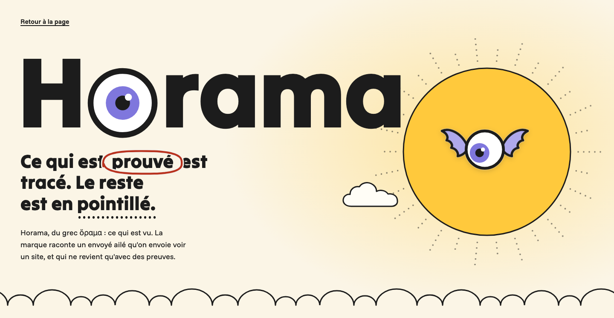
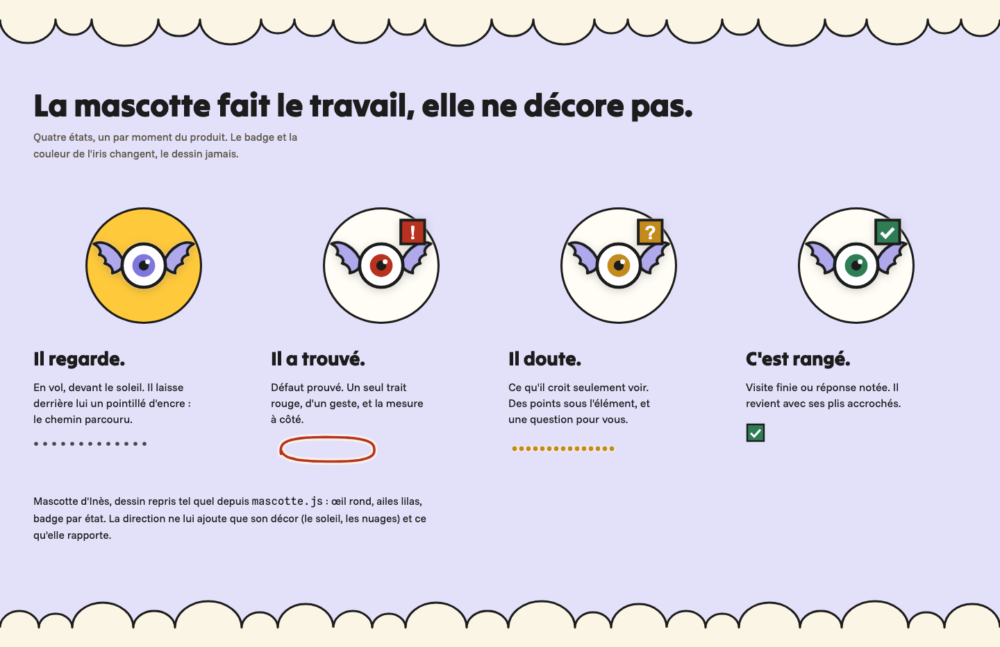
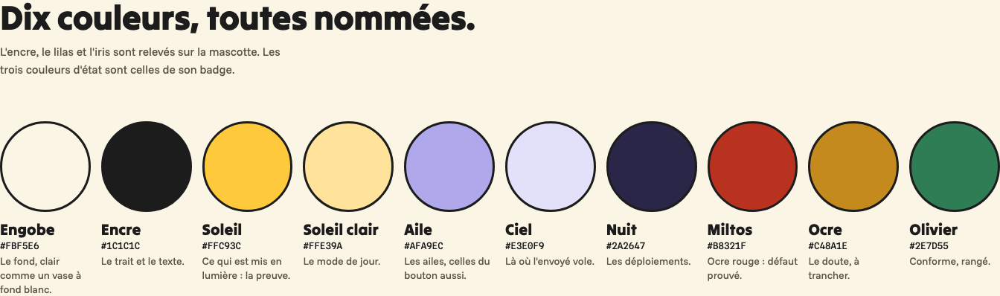
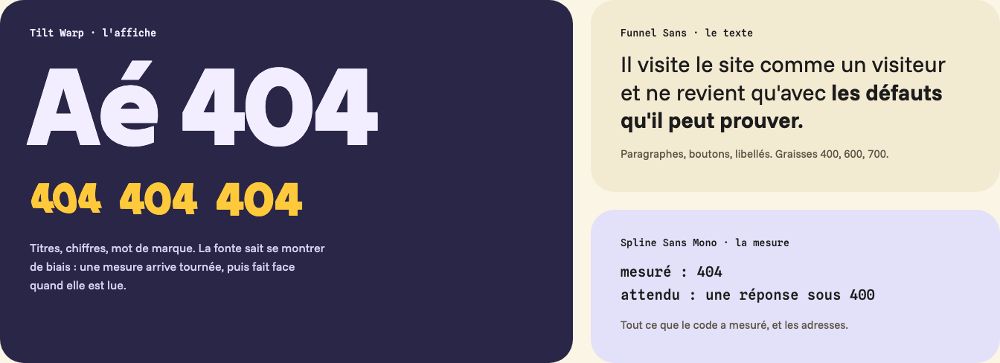
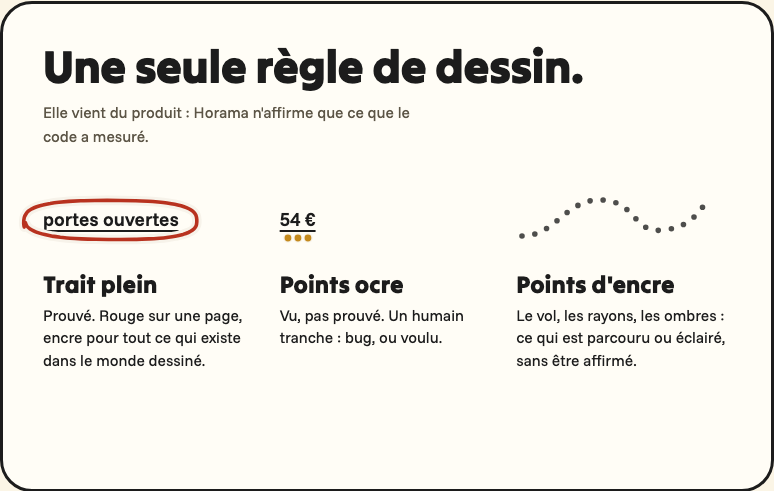
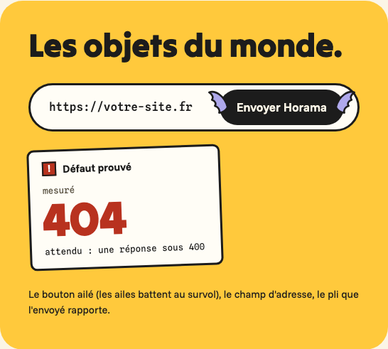
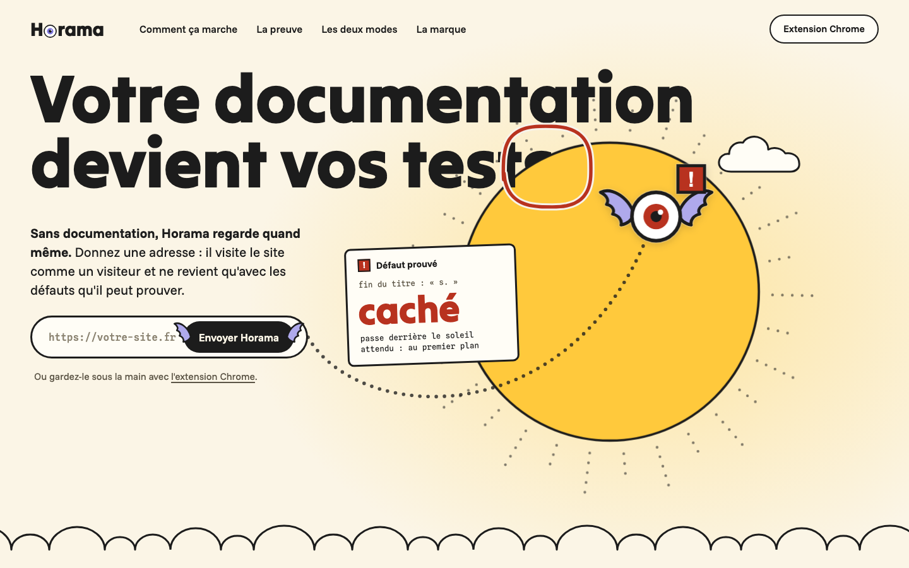
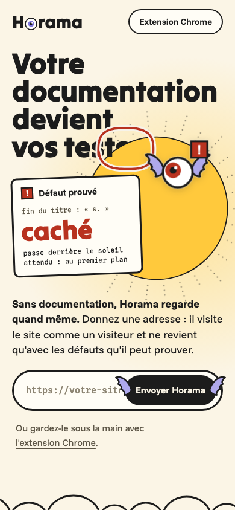
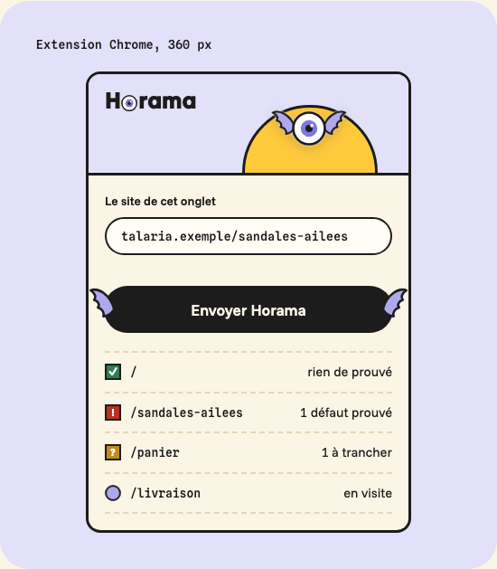
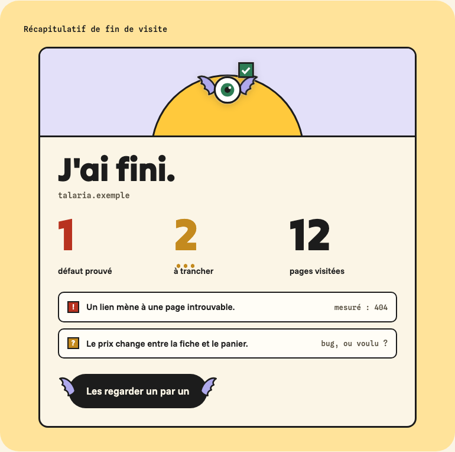

# Charte graphique d'Horama : « L'envoyé »

Version du 18/11/2026, tirée de la landing retouchée par Nathan. Elle vaut pour les trois surfaces du produit : la page d'accueil, l'extension Chrome et la scène (le parcours de l'agent sur le site, puis le récapitulatif).

La planche de marque vivante est `marque.html`, dans ce dossier : la mascotte y bouge, les traits s'y tracent. Les images de `images/` en sont des captures.

## 1. L'idée en une phrase

Horama, du grec ὅραμα, « ce qui est vu ». Horama est un envoyé ailé qu'on envoie voir un site : il part au soleil, survole les pages, entoure ce qu'il peut prouver et revient avec la preuve.

Tout le dessin découle d'une seule règle, qui vient du produit : **ce qui est prouvé est tracé d'un trait plein ; le reste est en pointillé.** Horama n'affirme que ce que le code a mesuré.

## 2. Le logo

- Le logo est le mot « Horama » en Tilt Warp, l'œil de la mascotte à la place du « o ».
- L'œil fait 0,7 fois la hauteur du texte, posé sur la ligne de base, et garde l'iris de repos (`#7F77DD`).
- Une seule fonte, une seule graisse (400), espacement des lettres -0,01 em.
- Encre `#1C1C1C` sur fond clair ; engobe `#FBF5E6` sur fond encre ou nuit.

| Endroit | Taille du mot |
|---|---|
| Barre de navigation de la landing | 30 px |
| Pied de page | 24 px |
| En-tête de l'extension | 26 px |
| Planche de marque, en affiche | 236 px (bureau), entre 84 et 170 px (téléphone) |

Code (SVG de l'œil compris) : `<a class="mot">H<svg class="o"><use href="#oeil"/></svg>rama</a>`, classe `.mot` dans `envoye.css`.

## 3. La mascotte d'Inès et ses états

L'œil ailé est le dessin d'Inès (CDO), repris tel quel dans `mascotte.js`. **Le dessin ne change jamais** : seuls la couleur de l'iris et le badge changent selon l'état. La direction ne lui ajoute que son décor (le soleil, les nuages) et ce qu'il rapporte (le pli).

| État | Quand | Iris | Badge | Signe associé |
|---|---|---|---|---|
| `regarde` | Au repos, en vol, pendant la visite | `#7F77DD` | aucun | pointillé d'encre : le chemin parcouru |
| `trouve` | Un défaut vient d'être prouvé | `#B8321F` | « ! » rouge | trait plein rouge autour du défaut ; les ailes battent vite |
| `doute` | Il croit voir quelque chose sans pouvoir le prouver | `#C48A1E` | « ? » ocre | points ocre sous l'élément |
| `fini` | Visite finie, ou réponse notée | `#2E7D55` | coche verte | les plis accrochés sous lui |

Utilisation : `const m = creerMascotte(taille); m.etat("trouve"); m.regarder(dx, dy);` (la pupille suit la direction donnée).

| Endroit | Taille |
|---|---|
| Hero de la landing | 184 px (118 px sur téléphone) |
| En vol le long de la page | 104 px (78 px sur téléphone) |
| Arrivée en bas de page | 136 px (104 px) |
| Extension | 84 px |
| Récapitulatif | 104 px |

La mascotte fait le travail, elle ne décore pas : elle est toujours dans un état qui dit quelque chose, et elle regarde ce dont on parle.

## 4. La palette

| Nom | Code | Rôle |
|---|---|---|
| Engobe | `#FBF5E6` | Le fond, clair comme un vase à fond blanc |
| Encre | `#1C1C1C` | Le trait et le texte |
| Soleil | `#FFC93C` | Ce qui est mis en lumière : la preuve |
| Soleil clair | `#FFE39A` | Le mode de jour |
| Aile | `#AFA9EC` | Les ailes, celles du bouton aussi |
| Ciel | `#E3E0F9` | Là où l'envoyé vole (fonds de section) |
| Nuit | `#2A2647` | Les déploiements (mode développeur) |
| Miltos | `#B8321F` | Ocre rouge : défaut prouvé |
| Ocre | `#C48A1E` | Le doute, à trancher |
| Olivier | `#2E7D55` | Conforme, rangé |

Teintes de service, dans `envoye.css` : papier `#FFFDF6` (feuilles, plis, champs), engobe foncé `#F3EAD2` (surface posée sur le fond), filet `#E2D6B8`, encre secondaire `#5C5546` (texte secondaire, contraste 6,9:1 sur l'engobe), iris `#7F77DD`.

Règles :
- Miltos, ocre et olivier sont **réservés aux états** : jamais pour décorer, jamais pour un bouton ordinaire.
- Le soleil marque ce qui est éclairé (la preuve, l'action principale) ; ce n'est pas une couleur de fond générale.
- Toutes les couleurs passent par les variables CSS (`--engobe`, `--encre`, `--miltos`…), jamais un code en dur dans un composant.

## 5. Les polices et leurs tailles

Trois voix, chargées depuis Google Fonts (lien en tête de `envoye.css`) :

| Police | Rôle | Graisses |
|---|---|---|
| Tilt Warp | L'affiche : titres, chiffres, mot de marque | 400 |
| Funnel Sans | Le texte : paragraphes, boutons, libellés | 400, 600, 700 |
| Spline Sans Mono | La mesure : tout ce que le code a mesuré, et les adresses | 400, 500, 600 |

Tilt Warp sait se montrer de biais (axes `XROT` et `YROT`) : une mesure peut arriver tournée, puis faire face quand elle est lue.

| Élément | Bureau | Téléphone (sous 1100 px) |
|---|---|---|
| Titre du hero (h1) | 108 px, interligne 0,95 (92 px sous 1240 px) | entre 47 et 84 px |
| Titre de section (h2) | 68 px, interligne 0,98 (58 px sous 1240 px) | entre 40 et 58 px |
| Titre d'étape (h3) | 46 px, interligne 1 | 32 px |
| Chapeau du hero | 21 px, interligne 1,42 | 18 px |
| Texte courant | 18 px, interligne 1,55 | 17 px |
| Navigation | 16,5 px, graisse 500 | masquée |
| Bouton | 17 px, graisse 600 (15 px en petit) | 15,5 px |
| Champ d'adresse | Spline Sans Mono 16 px, graisse 500 | 15 px |
| Chiffre d'un pli | Tilt Warp 60 à 66 px, rouge miltos | 44 px |
| Mesure d'un pli | Spline Sans Mono 12,5 px | 11,5 px |

Titres : espacement des lettres -0,012 em, `text-wrap: balance`.

## 6. Les deux signes de preuve

| Signe | Sens | Comment |
|---|---|---|
| **Trait plein rouge** | Prouvé : le code l'a mesuré | Un seul trait miltos, d'un geste, comme la ligne d'un peintre de vase ; liseré clair dessous pour rester lisible sur n'importe quel site. `tracerDefaut(svg, rect)` dans `trait.js` |
| **Points ocre** | Vu, pas prouvé : un humain tranche (bug, ou voulu) | Une rangée de points sous l'élément, le point souscrit des épigraphistes. `poserDoute(svg, rect)` dans `trait.js` |

Un troisième signe n'affirme rien : le **pointillé d'encre** (le vol de la mascotte, les rayons du soleil, les ombres). Il montre ce qui est parcouru ou éclairé.

Un trait rouge s'accompagne toujours de sa mesure, dans un pli : « mesuré : 404 », « attendu : une réponse sous 400 ».

## 7. Les objets du monde

- **Le bouton ailé** : pilule encre, texte engobe, deux ailes lilas qui dépassent et battent au survol. Réservé à l'action « envoyer Horama » et aux actions principales.
- **Le champ d'adresse** : pilule papier, bord encre de 3 px, texte en Spline Sans Mono.
- **Le pli** : la carte que l'envoyé rapporte. En-tête avec le badge de l'état, la mesure en très grand, l'attendu en mono. Légèrement tourné (2 à 3 degrés).
- **La feuille** : une vraie page (capture) posée dans le monde dessiné, bord encre, barre d'adresse en mono.
- **Le décor** : soleil à rayons en pointillé, nuages papier cernés d'encre, bancs de nuages entre les sections.
- Tous les contours sont en encre, de 2,5 à 3 px. Coins arrondis : 999 px (pilules), 10 à 16 px (cartes), 24 à 40 px (blocs de section).

## 8. Le ton des textes

- **On vouvoie le lecteur. Horama est « il »** : « Il visite le site comme un visiteur. »
- Des phrases courtes, des verbes concrets, ce qu'on voit faire : visiter, cliquer, mesurer, entourer, revenir.
- On n'affirme que ce qui est prouvé, dans les textes aussi : « Il ne reviendra qu'avec ce qu'il peut prouver. »
- Les mesures s'écrivent en mono, au format « mesuré : … » puis « attendu : … ».
- Le doute se pose en question fermée : « bug, ou voulu ? », boutons « C'est un bug » et « C'est voulu ».
- Pas de jargon : « une page introuvable » plutôt que « une erreur HTTP » ; le seul nom technique assumé est « l'agent computer use de H Company ».
- **Jamais de tiret cadratin ni demi-cadratin** : une virgule, deux-points ou un point à la place.
- Les exemples inventés sont étiquetés comme tels (`talaria.exemple`, « site de démonstration »). Un défaut réel d'un site tiers ne se montre qu'avec l'accord de son propriétaire, mentionné sur la page.

Exemples tirés de la landing :
- « Votre documentation devient vos tests. Sans documentation, Horama regarde quand même. »
- « Il y va à votre place, et vous le regardez faire. »
- « Seul ce qui est mesuré devient un défaut. »
- « Quand il n'est pas sûr, il vous demande. »

## 9. À faire, à ne pas faire

| À faire | À ne pas faire |
|---|---|
| Un trait rouge, d'un seul geste, avec sa mesure | Un gribouillis de feutre à double trait, ou un trait rouge sans mesure |
| Points ocre pour ce qui n'est que vu | Un doute en rouge, ou un défaut affirmé sans preuve |
| La mascotte dans l'état qui correspond au moment | Une mascotte décorative, ou un dessin modifié (couleurs d'ailes, forme, expression ajoutée) |
| Les couleurs d'état réservées aux états | Miltos, ocre ou olivier comme couleurs de décor |
| Le titre du hero lisible dès la première image | Un voile sur une image, un titre qui n'apparaît qu'après une animation |
| Défilement natif du navigateur | Lenis, `scroll-behavior: smooth`, défilement détourné |
| Contours encre de 2,5 à 3 px partout | Ombres portées floues à la place des contours, dégradés « IA » violet-bleu |
| Les trois polices, chacune dans son rôle | Une quatrième police, du texte courant en Tilt Warp |
| Tester à 1440 et 390 px : aucun débordement | Un composant qui déborde horizontalement sur téléphone |

## 10. Exemples sur les trois surfaces

### La landing

Le hero montre l'outil en marche sur la page elle-même : **le « s. » de « tests. » passe exprès derrière le soleil** (un défaut de mise en page voulu, le reste du titre est au premier plan). L'œil, posé sur le soleil, tourne la pupille vers lui, passe en `trouve`, le trait rouge l'entoure et le pli rapporte la mesure : « fin du titre : « s. » », « caché », « passe derrière le soleil », « attendu : au premier plan ». Le titre reste lisible (« tests » se lit).

Sur téléphone, le pli passe juste sous le titre, à gauche du soleil, pour que la démonstration tienne dans le premier écran.

Plus bas, la mascotte descend la page en laissant son pointillé : « Comment ça marche » (quatre étapes), « La preuve » (le vrai lien mort d'eugeniaschool.com, montré avec l'accord de l'école), « Quand il n'est pas sûr, il vous demande » (une question bug ou voulu à cliquer), « Deux façons de l'envoyer » (grand public de jour, développeur de nuit), puis l'arrivée.

### L'extension Chrome

Fenêtre de 360 px : un bandeau ciel avec le soleil, le mot de marque et la mascotte (84 px) ; l'adresse de l'onglet en mono ; le bouton ailé « Envoyer Horama » ; la liste des pages visitées, chacune avec le carré de son état (coche olivier, « ! » miltos, « ? » ocre, rond lilas qui bat pour « en visite »). Les adresses de la capture sont celles d'un site de démonstration.

### La scène

Pendant le parcours, sur le vrai site, il n'y a que trois choses : **le curseur** (flèche encre cernée de blanc, lisible sur n'importe quel fond), **la mascotte** dans un coin, qui change d'état, et **le trait** rouge tracé d'un geste au moment où un défaut est trouvé, ou les points ocre pour un doute. Aucun texte, aucune bulle, aucun arrêt.

Tout le texte arrive à la fin, dans le récapitulatif : bandeau ciel avec le soleil et la mascotte en `fini`, le titre « J'ai fini. » en Tilt Warp, trois chiffres (défauts prouvés en miltos, à trancher en ocre souligné de points, pages visitées), puis un relevé par défaut avec sa mesure, et le bouton ailé « Les regarder un par un ». Chaque doute se tranche ensuite avec « C'est un bug » ou « C'est voulu ». Les chiffres de la capture sont des exemples.

## 11. Points encore ouverts

- Les deux petits badges accrochés sous la mascotte quand elle vole (les plis « ! » et « ? » qu'elle rapporte) sont un ajout de la direction : à faire valider par Inès.
- Les dessins de « Comment ça marche » sont simples ; la section est longue.
- Le ciel lilas peut se lire comme un « violet d'IA » : à surveiller, ne pas l'étendre au-delà des fonds de section.

## 12. Ce que contient ce dossier

| Fichier | Contenu |
|---|---|
| `charte-graphique.md` | Ce document |
| `marque.html` | La planche de marque vivante (à ouvrir par un serveur local, elle charge des modules) |
| `envoye.css` | Variables de couleur, polices, objets communs (bouton ailé, champ, pli, feuille) |
| `mascotte.js` | La mascotte d'Inès et ses quatre états, à ne pas redessiner |
| `trait.js` | Les deux signes de preuve : `tracerDefaut` et `poserDoute` |
| `images/` | Captures de la version finale (landing à 1440 et 390 px, planche de marque) |
