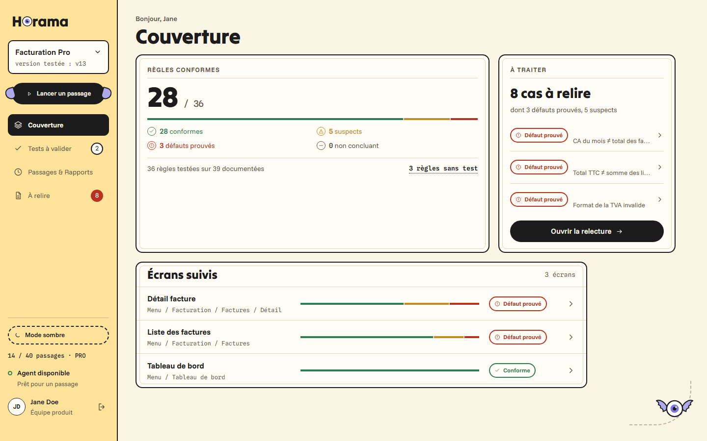
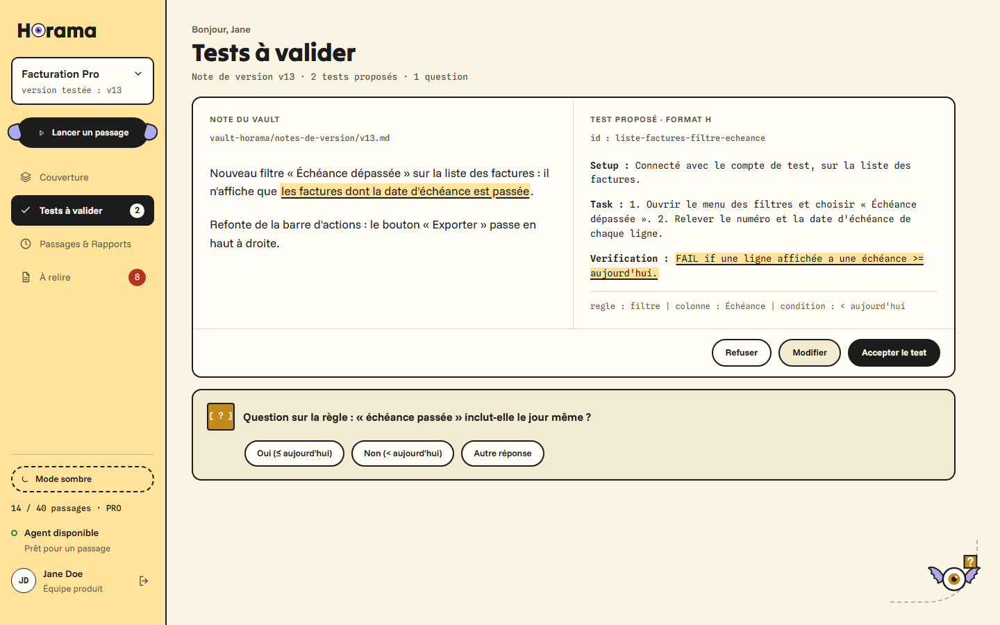
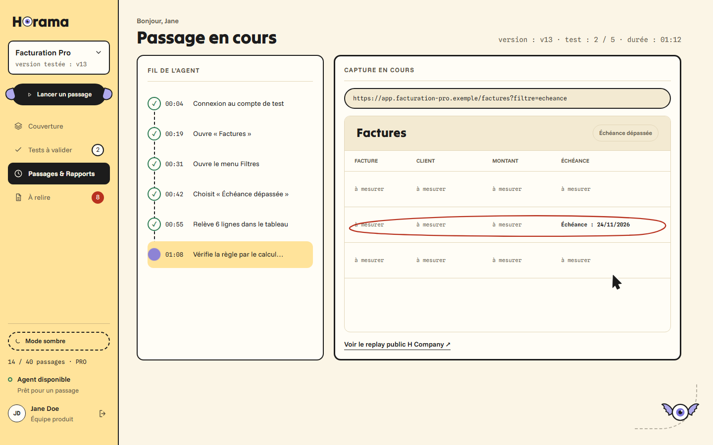
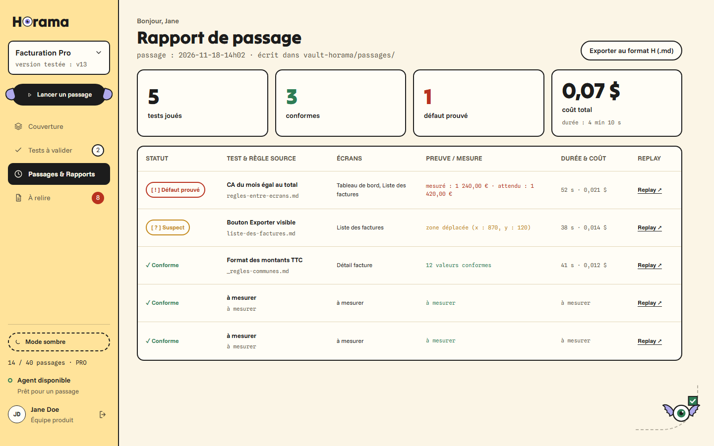
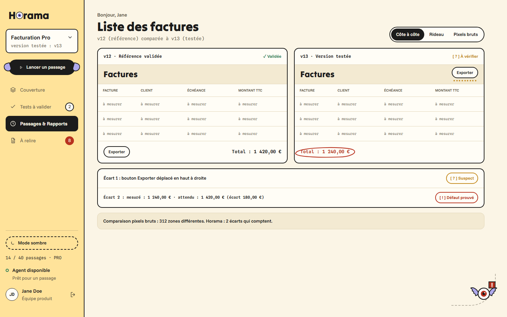
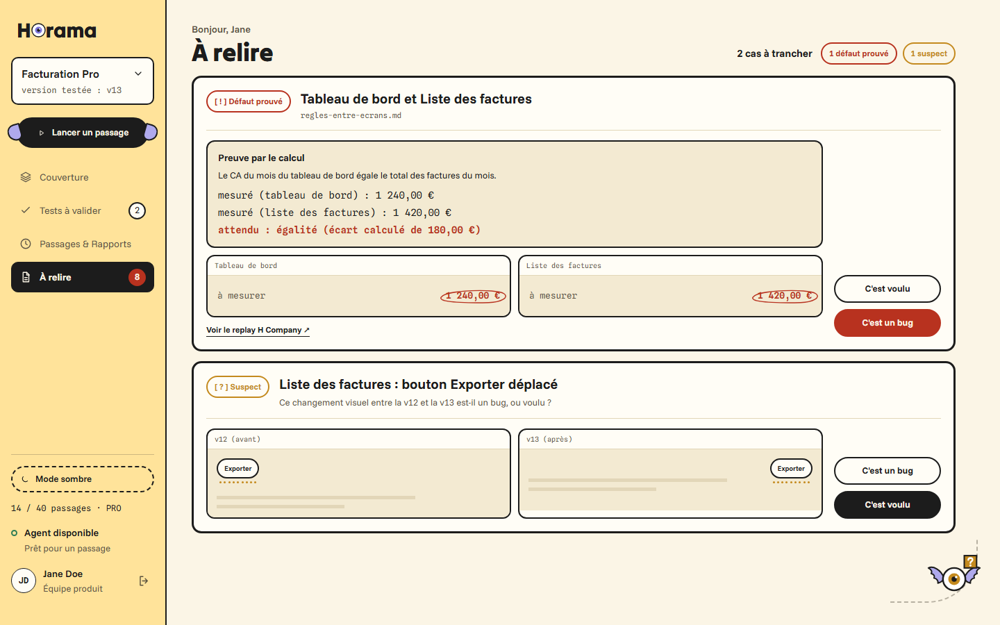
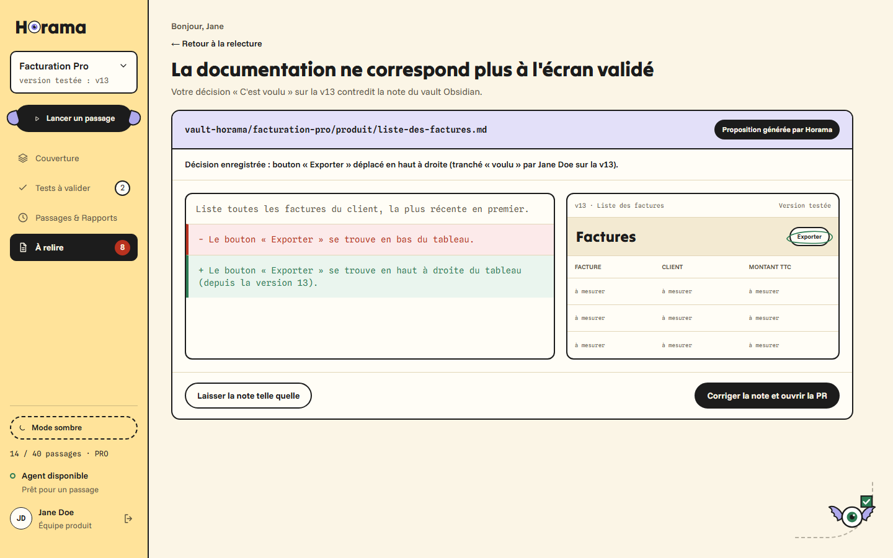

# Les 7 écrans de Horama : à quoi sert chacun

Horama lit la documentation d'une équipe produit (un vault Obsidian) et en tire des tests. Un humain valide ces tests. L'agent H les joue sur le vrai logiciel, et le code vérifie les valeurs relevées. Chaque décision humaine met ensuite le vault à jour.

Les 7 écrans suivent ce chemin, dans l'ordre : **voir où on en est → valider les tests → regarder le passage → lire le rapport → comparer → trancher → corriger la doc.**

Ils sont tous dans le fichier Figma Make principal ([lien](https://www.figma.com/make/95kAUa9u4Rg2A525f5OHtf)), et on passe de l'un à l'autre par le menu de gauche. La source est `docs/cadrage.md`, section 11.

| # | Écran | La question à laquelle il répond | Mascotte |
|---|---|---|---|
| 11.1 | Couverture | Où en est la qualité du logiciel ? | regarde |
| 11.2 | Tests à valider | Ce test dit-il bien ce que dit la doc ? | doute |
| 11.3 | Passage en cours | Que fait l'agent en ce moment ? | regarde |
| 11.4 | Rapport de passage | Qu'a donné le passage ? | fini |
| 11.5 | Comparaison des versions | Qu'est-ce qui a changé entre deux versions ? | trouve |
| 11.6 | À relire | C'est un bug, ou c'est voulu ? | doute |
| 11.7 | Dérive documentaire | La doc est-elle encore juste ? | fini |

---

## 11.1 Couverture : le tableau de bord

**À quoi il sert.** C'est la page d'accueil. En un coup d'œil, on voit combien de règles de la documentation sont testées et conformes (28 sur 36), et ce qui reste à traiter (8 cas à relire). On voit aussi l'état de chaque écran suivi du logiciel.

**Ce qu'on y fait.**
- On repère ce qui ne va pas : défauts prouvés en rouge, suspects en ocre.
- On ouvre la relecture.
- On lance un passage avec le bouton ailé.

**Pourquoi c'est important.** C'est la promesse du produit : savoir quelle part de la documentation est réellement vérifiée sur le logiciel.

## 11.2 Tests à valider : de la note au test

**À quoi il sert.** Horama vient d'écrire un test à partir d'une note du vault, ici la note de version v13. Avant de le jouer, un humain vérifie qu'il dit bien la même chose que la note.

**Ce qu'on y fait.**
- On regarde les deux côtés : la note à gauche, le test au format H à droite. La règle est surlignée en jaune des deux côtés, pour qu'on voie d'où vient chaque vérification.
- On accepte, on modifie ou on refuse le test.
- Si la note est ambiguë, on répond à la question posée en bas, par exemple : « échéance passée » inclut-elle le jour même ?

**Pourquoi c'est important.** Aucun test n'est joué sans validation humaine. L'IA propose, l'humain décide.

## 11.3 Passage en cours : l'agent en direct

**À quoi il sert.** On suit l'agent H pendant qu'il utilise le vrai logiciel : il se connecte, ouvre les factures, applique un filtre, relève les valeurs.

**Ce qu'on y fait.**
- On regarde le fil des étapes à gauche, chacune avec son heure.
- On regarde la capture en cours à droite, où ce que l'agent vérifie est entouré.
- On peut ouvrir le replay public de H Company.

**Pourquoi c'est important.** L'attente devient la démonstration : on voit que c'est un vrai agent sur un vrai logiciel, sans animation truquée.

## 11.4 Rapport de passage : le résultat

**À quoi il sert.** Une fois le passage fini, il résume tout : combien de tests ont été joués, combien sont conformes, combien de défauts sont prouvés, le coût et la durée. Les tests sont classés du plus grave au moins grave.

**Ce qu'on y fait.**
- On lit chaque ligne : la règle d'origine, les écrans visités et la preuve chiffrée (« mesuré » / « attendu »).
- On ouvre le replay d'un test.
- On exporte le rapport au format H.
- On clique sur une ligne suspecte pour la comparer en détail (11.5).

**Pourquoi c'est important.** C'est la trace écrite du passage. Elle est aussi enregistrée dans le vault (`vault-horama/passages/`).

## 11.5 Comparaison des versions : avant / après

**À quoi il sert.** On met côte à côte un écran de la version de référence (v12) et de la version testée (v13). Horama y marque seulement les écarts qui comptent.

**Ce qu'on y fait.**
- On change de vue : côte à côte, rideau (un curseur qu'on fait glisser) ou pixels bruts.
- On lit les écarts. Le bouton déplacé est marqué de points ocre : c'est un suspect. Le total faux est entouré en rouge : c'est un défaut prouvé.

**Pourquoi c'est important.** Une comparaison pixel par pixel classique trouve 312 différences. Horama n'en garde que 2, celles qui comptent. C'est ce qui évite de noyer l'humain.

## 11.6 À relire : bug, ou voulu ?

**À quoi il sert.** On y trouve tous les cas que la machine ne peut pas trancher seule. L'humain dit pour chacun si c'est un bug ou un changement voulu.

**Ce qu'on y fait.**
- **Défaut prouvé** : la preuve par le calcul est affichée (1 240,00 € contre 1 420,00 €, soit 180,00 € d'écart). On clique « C'est un bug » ou « C'est voulu ».
- **Suspect** : on voit l'avant et l'après de la zone qui a changé, et on tranche de la même façon.

**Pourquoi c'est important.** Horama garde la décision et ne repose pas la question au passage suivant. Si la réponse est « voulu », c'est la documentation qui doit changer (11.7).

## 11.7 Dérive documentaire : corriger la doc

**À quoi il sert.** On vient de dire « C'est voulu » sur un changement, mais la note du vault décrit encore l'ancien comportement. Horama propose la correction de la note.

**Ce qu'on y fait.**
- On lit la modification proposée : la ligne retirée en rouge, la ligne ajoutée en vert.
- On clique « Corriger la note et ouvrir la PR », ou « Laisser la note telle quelle ».

**Pourquoi c'est important.** La documentation reste vraie toute seule : chaque décision humaine la tient à jour.

---

## Et en dehors de l'application

D'autres surfaces existent dans le dépôt. Ce sont des pages web et une extension, pas des écrans de l'application Figma. Elles sont tenues par le CAO :

| Surface | Où | À quoi elle sert |
|---|---|---|
| Page d'accueil | `accueil/` | Présenter Horama et le faire essayer sur un site (mode grand public) |
| Rapport de la page d'accueil | `accueil/rapport/` | Montrer les défauts trouvés après un essai |
| Extension Chrome | `extension/` | Lancer Horama depuis l'onglet ouvert, suivre la progression, voir le récapitulatif |
| Scène | `automatisation/scene/` | Montrer l'agent qui parcourt le site, avec le curseur, la mascotte et les traits |

Le cadrage ne prévoit pas d'autre écran d'application que ces 7.

## Couleurs de la barre latérale

En mode clair, la barre latérale est en Soleil clair `#FFE39A`, pour qu'on la distingue du fond et des cartes. En mode sombre, elle est en Encre `#1C1C1C`. Elle n'est jamais violette. Le détail est dans `barre-laterale.md`.
