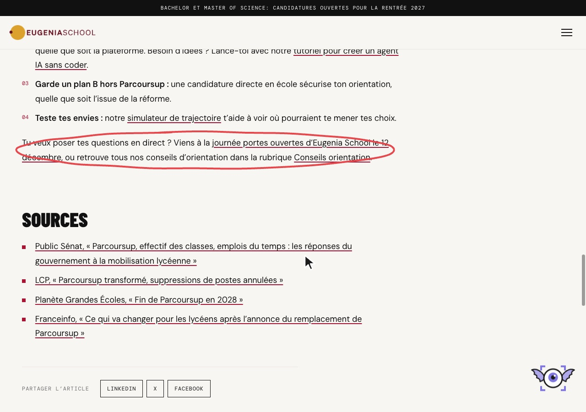
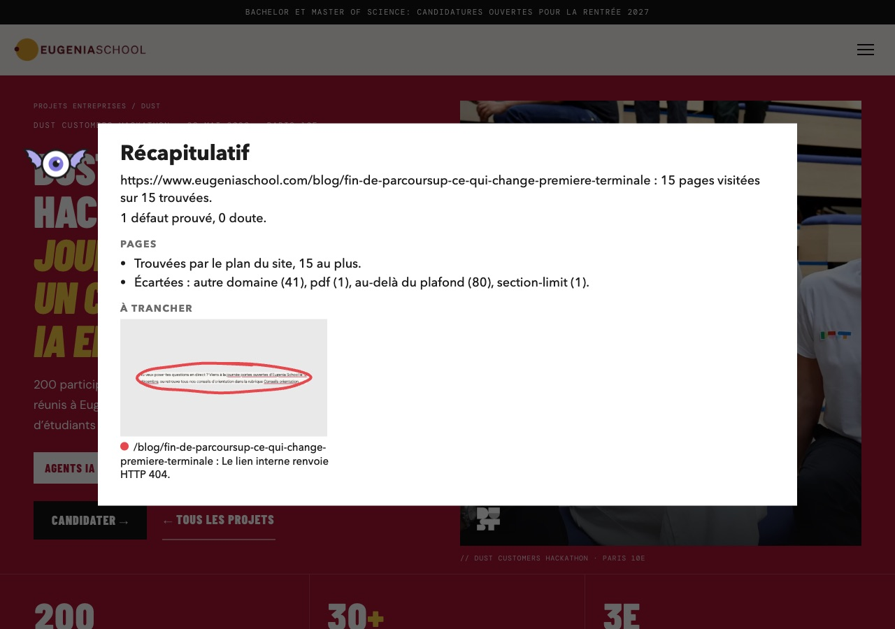
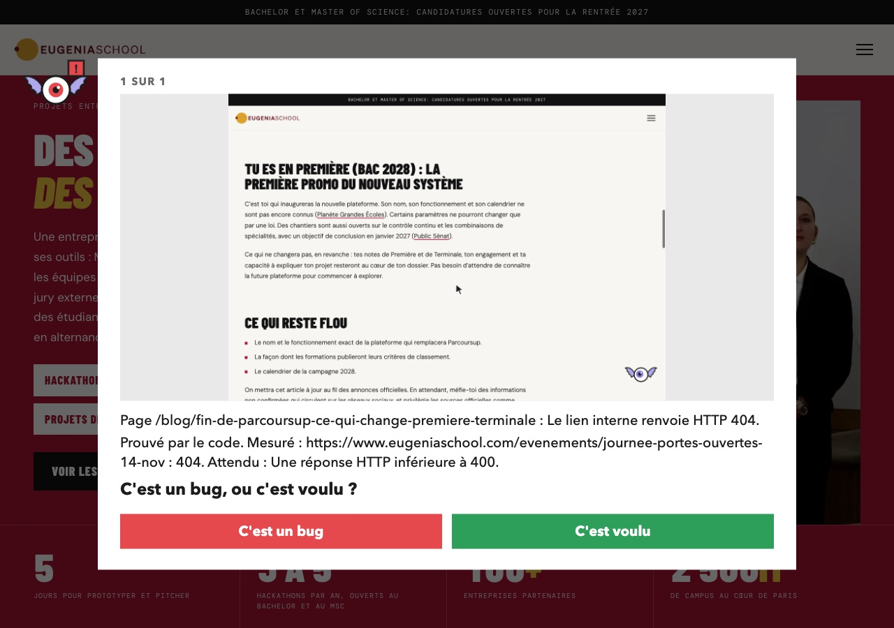

# Départ depuis l'onglet ouvert, PR de documentation branchée dans la scène, 18 novembre 2026

Couloir Nathan. Sans l'agent H ni Holo : **aucun coût**. Les essais écrivent dans des copies du vault. Aucune PR réelle n'a été ouverte sur GitHub.

## 1. Le mode grand public lancé depuis l'article de blog

Décision de démo de Nathan (18/11) : la démo part de l'onglet ouvert sur l'article, puis explore le reste du site, 15 pages. Commande, depuis un arbre qui contient la scène de `dev-nathan` :

```
node automatisation/scene/exploration.mjs --url https://www.eugeniaschool.com/blog/fin-de-parcoursup-ce-qui-change-premiere-terminale \
  --max 15 --sans-agent --sans-holo --rythme 3 --choix bug,bug,bug,bug,bug,bug --vault <copie> --sortie <dossier>/sortie --temoins <dossier>/temoins --fermer-chrome
```

| Moteur d'exploration | Code | Durée | Article visité | Lien 404 en direct | Vignette au récapitulatif |
|---|---|---|---|---|---|
| `dev` (9ea7428), `--max 10` | 0 | 79 s | **non** : la découverte repart de l'accueil et du plan du site (accueil, alternance, approche pédagogique, puis le blog par ordre alphabétique) | non (page non visitée) | aucun constat |
| `dev` + PR #81 (`a-67-decouverte`) | 0 | 142 s | **oui, en premier**, puis 14 pages (Bachelor, Notre ADN, entreprises, admission, événements…) | oui, entouré | oui, capture entourée |
| `dev` + PR #85 (`a-67-assemblage`) + PR #81 | 0 | 157 s | oui, en premier, 15 pages sur 15 | oui, entouré (par le sélecteur du contrôle) | **non** : capture non centrée sur le lien, sans zone, avec le curseur et la mascotte de la scène dessus |

Les deux défauts de la PR #85 sont dans `captureDefect` (`agent/src/exploration/cdp.ts`), signalés à la coordination pour Ali :
1. eugeniaschool.com déclare `scroll-behavior: smooth` dans son CSS. Le `window.scrollTo(0, y)` de `captureDefect` est donc animé, et la capture est prise en cours de défilement. La zone, recalculée sur la position lue à ce moment, sort de l'image : `zone: undefined`.
2. La capture passe par la connexion CDP du moteur, sans masquer la couche de la scène : le curseur et la mascotte sont dessus.

| Avec la PR #81 : le trait en direct | Avec la PR #81 : récapitulatif | Avec la PR #85 : vignette en grand |
|---|---|---|
|  |  |  |

Côté scène, rien n'a changé pour ces essais : elle lit le même format et trouve le lien par le sélecteur du contrôle.

## 2. La PR de documentation après une correction acceptée (`--pr-doc`)

`parcours.mjs` appelle `ouvrirPrDoc` (`automatisation/pr-doc/`) après chaque correction de note **acceptée**, puis écrit l'adresse de la PR (ou la raison de l'échec) dans la note du passage. Un échec est dit dans le terminal et dans la bulle de la mascotte. Il n'arrête pas la scène et ne change pas son code de sortie.

Montage de l'essai, entièrement local, dans le dossier temporaire de la session :
- un dépôt Git nu `doc.git`, branche `dev`, qui contient `vault-horama/eugenia/produit/` de la copie du vault (avec la phrase « le bouton « POSTULER → » est à côté ») ;
- un faux module de correction (`--correction`) qui propose « POSTULER → » devient « CANDIDATER → », sans appel à un modèle ;
- un faux `gh` placé en tête du `PATH`, qui note ses arguments et rend une adresse d'essai (`https://example.invalid/…`) : aucune écriture sur GitHub.

```
PATH=<faux gh>:$PATH node automatisation/scene/parcours.mjs --sans-agent --sans-presentation --base-url https://www.eugeniaschool.com \
  --logiciel eugenia --version 1 --reference 1 --impact <impact.json> --choix voulu --correction <faux module> --correction-choix accepter \
  --pr-doc essai/vault-local --pr-doc-remote <doc.git> --vault <copie> --sortie <dossier>/passage --fermer-chrome
```

- **Cas nominal** : code 0. Correction acceptée, puis « PR de documentation ouverte ». Dans `doc.git`, une branche `docs/note-<uuid>` porte un seul commit (« docs : correction acceptée du passage … »), qui ne change qu'une ligne de `vault-horama/eugenia/produit/bachelor.md` (« POSTULER → » devient « CANDIDATER → »). Le faux `gh` a reçu `pr create --repo essai/vault-local --base dev --head docs/note-… --title Documentation : correction du test accueil-vers-bachelor --body-file …`. La note du passage se termine par `- PR de documentation (produit/bachelor.md) : https://example.invalid/essai/vault-local/pull/1`.
- **Cas d'échec** (dépôt distant absent) : code 0, la scène continue jusqu'à la fin. La décision est écrite, puis la base passe à `verifie`. La note porte `- PR de documentation non ouverte (produit/bachelor.md) :` suivi de la dernière ligne de l'erreur de Git (`fatal: repository '…' does not exist`). Le message complet reste dans le terminal.

## Ce qui n'est pas testé

- Une vraie PR sur GitHub (attend le go de Nathan dans la session du couloir), et le dépôt de documentation à viser (`--pr-doc`).
- La PR de documentation après un « voulu » corrigé par le vrai modèle.
- Un passage avec l'agent H.
