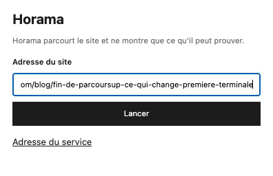
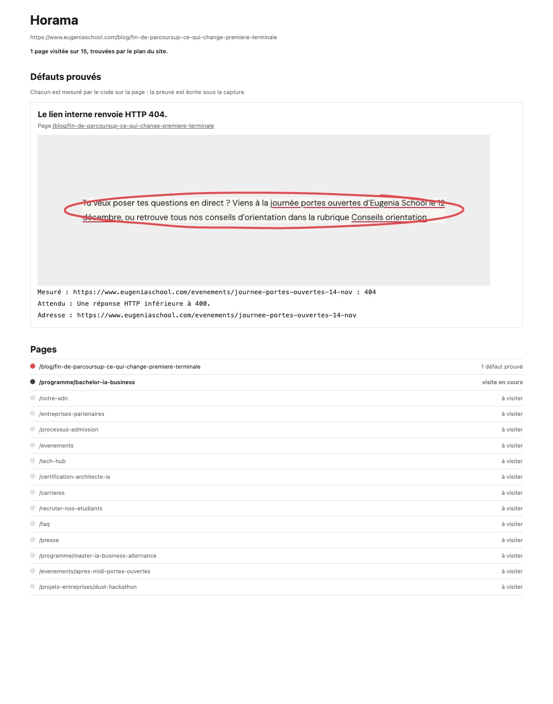
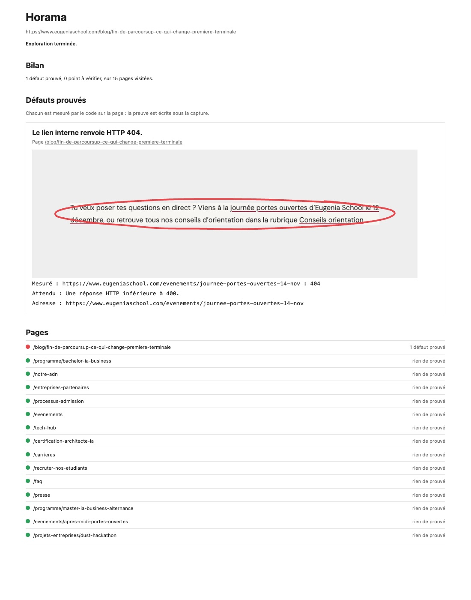
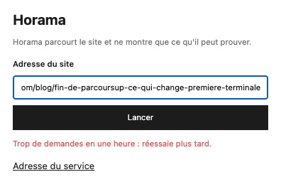
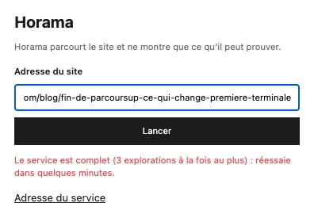
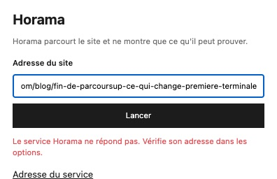
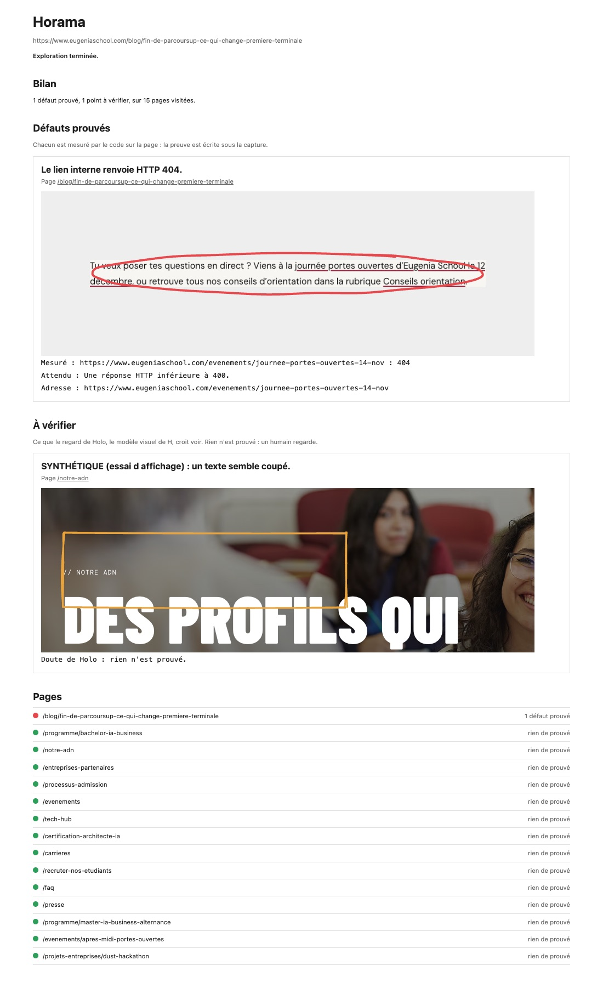

# Squelette de l'extension Chrome (issue #68, étape 3), 18 novembre 2026

Couloir Nathan. Essayé contre le faux service local (`extension/faux-service/serveur.mjs`) : ni H, ni Holo, **aucun coût**. Le service réel d'Ali n'existe pas encore.

## Montage

- Un Chrome séparé, lancé par le script d'essai, avec un profil jetable (supprimé à la fin) et le port 9335 ; jamais le Chrome de Nathan.
- Chrome 157 de marque refuse `--load-extension` depuis la version 137 : l'extension est chargée par CDP (`Extensions.loadUnpacked`, avec `--enable-unsafe-extension-debugging`). Identifiant obtenu : `mlpgchbepcjlocnclhakaiabdcggbpjc`.
- La fenêtre du bouton est ouverte comme une page (`chrome-extension://…/popup.html`) et l'adresse y est collée. **Le préremplissage par l'onglet ouvert (`activeTab`) n'est pas exercé** : il n'est donné que par un vrai clic sur le bouton de la barre d'outils, que l'essai ne fait pas.
- Faux service : `node extension/faux-service/serveur.mjs --rythme 2 --file 2`, qui rejoue l'exploration réelle de la scène lancée depuis l'article de blog d'Eugenia (15 pages, un lien en 404 prouvé).

## Résultats

| Essai | Ce qui s'est passé |
|---|---|
| Exploration complète | Adresse collée, « Lancer » ; l'onglet du rapport s'ouvre ; « En attente : 2 explorations passent avant celle-ci. » ; puis la progression page par page ; le lien en 404 apparaît avec sa capture entourée et sa preuve **5,9 s** après l'ouverture, pendant que les pages suivantes sont encore « à visiter » ; « Exploration terminée. » à **34,2 s** ; bilan « 1 défaut prouvé, 0 point à vérifier, sur 15 pages visitées. » ; le trait est dessiné (SVG présent dans la carte) |
| Refus 429 (`--refuser 429`) | La fenêtre affiche « Trop de demandes en une heure : réessaie plus tard. » |
| Refus 503 (`--refuser 503`) | La fenêtre affiche « Le service est complet (3 explorations à la fois au plus) : réessaie dans quelques minutes. » |
| Service absent | La fenêtre affiche « Le service Horama ne répond pas. Vérifie son adresse dans les options. » |
| Section « À vérifier » | **Constat synthétique**, écrit à la main dans une copie du rapport hors du dépôt, pour l'affichage seulement : aucun rapport réel enregistré sur ce Mac ne contient de doute de Holo. La carte apparaît sous « À vérifier », à part des défauts prouvés, avec son cadre orangé ; bilan « 1 défaut prouvé, 1 point à vérifier ». Ce n'est pas une mesure |

Faux service, aussi vérifié par `curl` : en-têtes CORS sur `OPTIONS`, 400 pour une adresse `ftp://`, 202 `{ id, place }`, `en_file` puis rejeu, capture servie en `image/png`, 404 pour un chemin qui sort du dossier enregistré.

Clip de l'exploration complète (une image toutes les 0,5 s environ) : [extension-essai.mp4](captures/2026-11-18-extension/extension-essai.mp4).

| Fenêtre du bouton | En file | Défaut prouvé pendant l'exploration | Récapitulatif |
|---|---|---|---|
|  |  |  |  |

| Refus 429 | Refus 503 | Service absent | « À vérifier » (constat synthétique) |
|---|---|---|---|
|  |  |  |  |

## Paquet

`sh extension/empaqueter.sh` : `extension/dist/horama-extension.zip`, 14 entrées, 27 449 octets. Il contient le manifeste, la fenêtre, le rapport, les options, `service.js`, `commun.css` et `lib/` (rough-notation et sa licence). Il ne contient ni le faux service ni le README.

## Ce qui n'est pas testé

- Le vrai clic sur le bouton de la barre d'outils, et donc l'adresse de l'onglet préremplie par `activeTab`.
- Le service réel d'Ali (contrat proposé, à confirmer dans #68), et donc l'agent H et Holo.
- Une installation depuis le `.zip` sur une machine propre.
- Un vrai doute de Holo dans « À vérifier ».
