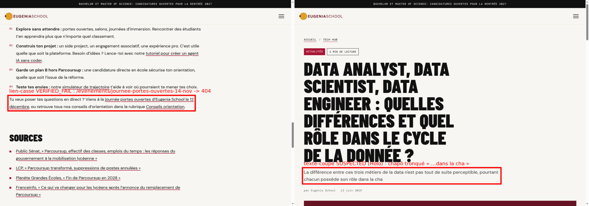

# #67 — Banc grand public du 18 novembre 2026

## Périmètre et correctifs dans la même PR

Branche `a-67-banc`. Les mesures de la section « avant correction » sont
**antérieures au correctif `7233ce3`**, inclus dans la même PR :

- faux `texte-erreur` sur la documentation Python : des mots techniques
  `null`, `undefined`, `NULL` ont été qualifiés de défauts ; le contrôle
  ignore désormais `code, pre, kbd, samp, var` et leurs descendants ;
- bannière SKEMA non fermée, rapportée `cookies: aucune`, qui pollue les
  captures et provoque **44 écarts de comparaison bruts en p2** : priorité au
  refus explicite, sinon fermeture générique visible dans le consentement,
  jamais une acceptation. Revérification après stabilisation et avant PNG.

`agent/src/exploration/explorer.ts` est touché minimalement pour la
revérification du consentement avant capture et son repli `INCONCLUSIVE`.
Le callback facultatif de `agent/src/browser.ts` permet cette vérification
après les polices et transitions, juste avant le PNG.
**Consigne H de `construireExploration` et budget d'étapes inchangés.**
Aucun domaine ni sélecteur fournisseur ajouté, aucune dépendance, aucun
changement de `horama-exploration-1` ; valeurs cookies existantes conservées.

Vérification du correctif : `CHROME_BIN="$HOME/.local/bin/google-chrome" pnpm -r --if-present run check`,
sortie 0, agent : 206 tests, 206 réussis, 0 échec, 0 ignoré.
Régressions locales sans réseau externe : code imbriqué et vrai message
normal, refus prioritaire, fermeture par texte/aria-label/title, acceptation
interdite, fermeture hors bannière exclue, apparition tardive et erreur CDP.
Recherche des domaines du banc dans `agent/src` : aucune correspondance.
Le diagnostic Chrome hors H reproduit une bannière visible dont la croix
porte `aria-label="Fermer"`, sans refus explicite ; l'ancienne fonction
retourne `aucune`, la nouvelle clique la fermeture et la bannière disparaît.
L'instant exact d'apparition lors des passages historiques n'a pas été établi.

## Sources, sites et robots

Sources locales : `~/a67-banc/resume.md` (journal de procédure de l'étape 3)
et les **16** `~/a67-banc/<site>/p<n>/exploration.json` avant correction, y compris
les deux passages racine Eugenia de l'étape 2, puis **4 JSON après correction**
sous `python-fix/` et `skema-fix/`. Les JSON sont la source des mesures et
comptages, pas la relecture vrai/faux. Les qualifications avant correction
ont été faites à la main par Devin (session A) en ouvrant chaque capture ;
la vérification comparative Grant Thornton a également été faite pour ce rapport.

Deux genres complémentaires ont été retenus :
- **Boutique : https://librairie-quilombo.org/**, librairie francophone SPIP,
  catalogue, panier et contenus éditoriaux, taille bornée par le passage.
- **Documentation : https://docs.python.org/fr/3/**, documentation publique
  francophone, exemples de code et navigation structurée.

Tous les passages sont en simple visiteur, sans connexion, aucun formulaire
soumis, aucune action d'achat. Robots vérifiés avant les sites ; aucune URL de
départ explicitement interdite parmi les politiques lisibles :

| Site | Extraits pertinents de robots.txt observés avant lancement |
|---|---|
| Eugenia | `User-agent: *`, `Allow: /`, `Disallow: /studio` |
| Albert | `User-agent: *`, `Content-Signal: search=yes,ai-train=no,use=reference`, `Allow: /` ; autre groupe générique : `Allow: /`, `Disallow: /studio` |
| KPMG | `User-agent: *`, `Allow: /` ; exclusions de recherche dont `/*/misc/search*.html`, pas de `/fr/fr.html` |
| SKEMA | HTTP 200 mais HTML Incapsula, `noindex,nofollow`, script `/_Incapsula_Resource` : **politique robots indéterminable**, pas une autorisation vérifiée |
| Grant Thornton | `User-agent: *`, `Allow: /`, `Disallow: /search/`, `Disallow: /*GetVCard` |
| Quilombo | `User-agent: *`, `Allow: /local/cache-css/`, `Allow: /local/cache-js/` ; `Disallow: /ecrire/`, `/lib/`, `/oembed.api/`, `/spip.php?action=*`, `/spip.php?page=login*` |
| Python | `User-agent: *`, exclusions `/dev`, `/release`, anciennes versions `/2/` à `/3.10/` ; pas de `/fr/3/` |

SKEMA présente des protections Incapsula/hCaptcha : aucun contournement, aucun
changement d'user-agent ni résolution de captcha. Les 13 pages marquées visitées
ne garantissent pas que tout contenu protégé ait été accessible.

## Méthode, Chrome et sessions

Chrome for Testing 156.0.8078.47 sur la VM, fenêtre visible `DISPLAY=:0`,
CDP 9333, facteur d'échelle 1, captures 1280 × 900. Profil neuf **à chaque
passage**, même vault p1/p2 d'un site ; vaults séparés pour les deux articles.
Commande Chrome de l'étape 3, avec `<site>`, `<n>`, `<url>` correspondant
aux commandes détaillées ci-dessous :

```sh
DISPLAY=:0 "$HOME/.local/bin/google-chrome" --remote-debugging-port=9333 --force-device-scale-factor=1 --user-data-dir="$HOME/a67-banc/<site>/profil-p<n>" --no-first-run --window-size=1280,900 <url>
```

Pour Eugenia racine, la commande employait `--user-data-dir="$HOME/a67-banc/profil"`
sans URL finale ; après fermeture, le profil p1 a été déplacé vers
`~/a67-banc/eugenia/profil-p1`, puis un profil neuf créé pour p2.

Clé de développement liée exclusivement par `exec.env`
(`secret:org:HORAMA_HAI_API_KEY`), jamais inscrite dans les fichiers.
Une seule session H de ce lot à la fois, `queue: false` vérifié dans
`agent/src/session.ts`. GET quota avant/après chaque passage ; en cas
d'indisponibilité, attente sans forcer. Contrôle individuel des sessions après
chaque passage et fermeture avant relance. Les sessions d'autres couloirs
n'ont pas été fermées ; une activité partagée ponctuelle ne signifie donc pas
une session de notre passage restée ouverte.

```sh
curl -sS -H "Authorization: Bearer $HAI_API_KEY" https://agp.eu.hcompany.ai/api/v2/sessions/quota
```

Après le lot : toutes nos sessions terminales, **0 running propre au lot**,
dernier quota `{"scope":"org","limit":3,"active":0,"available":3}`.
Dernière fin Python p2 : `2026-11-18T12:02:49.693Z`, soit **13:02:49 à Paris**.
Aucun lancement après 13:05, aucune session H pendant **13:15–14:30** ;
aucune session H relancée avant 14 h 30. État git vide après chaque
passage, aucun code changé pendant les mesures.

Commandes moteur (depuis la racine du dépôt, clé liée par l'environnement) :

```sh
HOLO_BIN="$HOME/.venvs/holo/bin/holo" pnpm --filter @horama/agent explorer -- --url https://www.eugeniaschool.com/ --sans-base --max 15 --chrome-port 9333 --sortie "$HOME/a67-banc/eugenia/p1" --vault "$HOME/a67-banc/eugenia/vault"
HOLO_BIN="$HOME/.venvs/holo/bin/holo" pnpm --filter @horama/agent explorer -- --url https://www.eugeniaschool.com/ --sans-base --max 15 --chrome-port 9333 --sortie "$HOME/a67-banc/eugenia/p2" --vault "$HOME/a67-banc/eugenia/vault"
HOLO_BIN="$HOME/.venvs/holo/bin/holo" pnpm --filter @horama/agent explorer -- --url https://www.eugeniaschool.com/blog/fin-de-parcoursup-ce-qui-change-premiere-terminale --sans-base --max 15 --chrome-port 9333 --sortie "$HOME/a67-banc/eugenia-article-portes/p1" --vault "$HOME/a67-banc/eugenia-article-portes/vault"
HOLO_BIN="$HOME/.venvs/holo/bin/holo" pnpm --filter @horama/agent explorer -- --url https://www.eugeniaschool.com/blog/data-analyst-data-scientist-data-engineer-quelles-differences-et-quel-role-dans-le-cycle-de-la-donnee --sans-base --max 15 --chrome-port 9333 --sortie "$HOME/a67-banc/eugenia-article-chapo/p1" --vault "$HOME/a67-banc/eugenia-article-chapo/vault"
HOLO_BIN="$HOME/.venvs/holo/bin/holo" pnpm --filter @horama/agent explorer -- --url https://www.albertschool.com/fr/ --sans-base --max 15 --chrome-port 9333 --sortie "$HOME/a67-banc/albert/p1" --vault "$HOME/a67-banc/albert/vault"
HOLO_BIN="$HOME/.venvs/holo/bin/holo" pnpm --filter @horama/agent explorer -- --url https://www.albertschool.com/fr/ --sans-base --max 15 --chrome-port 9333 --sortie "$HOME/a67-banc/albert/p2" --vault "$HOME/a67-banc/albert/vault"
HOLO_BIN="$HOME/.venvs/holo/bin/holo" pnpm --filter @horama/agent explorer -- --url https://kpmg.com/fr/fr.html --sans-base --max 15 --chrome-port 9333 --sortie "$HOME/a67-banc/kpmg/p1" --vault "$HOME/a67-banc/kpmg/vault"
HOLO_BIN="$HOME/.venvs/holo/bin/holo" pnpm --filter @horama/agent explorer -- --url https://kpmg.com/fr/fr.html --sans-base --max 15 --chrome-port 9333 --sortie "$HOME/a67-banc/kpmg/p2" --vault "$HOME/a67-banc/kpmg/vault"
HOLO_BIN="$HOME/.venvs/holo/bin/holo" pnpm --filter @horama/agent explorer -- --url https://www.skema.edu/fr --sans-base --max 15 --chrome-port 9333 --sortie "$HOME/a67-banc/skema/p1" --vault "$HOME/a67-banc/skema/vault"
HOLO_BIN="$HOME/.venvs/holo/bin/holo" pnpm --filter @horama/agent explorer -- --url https://www.skema.edu/fr --sans-base --max 15 --chrome-port 9333 --sortie "$HOME/a67-banc/skema/p2" --vault "$HOME/a67-banc/skema/vault"
HOLO_BIN="$HOME/.venvs/holo/bin/holo" pnpm --filter @horama/agent explorer -- --url https://www.grantthornton.fr/fr/ --sans-base --max 15 --chrome-port 9333 --sortie "$HOME/a67-banc/grantthornton/p1" --vault "$HOME/a67-banc/grantthornton/vault"
HOLO_BIN="$HOME/.venvs/holo/bin/holo" pnpm --filter @horama/agent explorer -- --url https://www.grantthornton.fr/fr/ --sans-base --max 15 --chrome-port 9333 --sortie "$HOME/a67-banc/grantthornton/p2" --vault "$HOME/a67-banc/grantthornton/vault"
HOLO_BIN="$HOME/.venvs/holo/bin/holo" pnpm --filter @horama/agent explorer -- --url https://librairie-quilombo.org/ --sans-base --max 15 --chrome-port 9333 --sortie "$HOME/a67-banc/quilombo/p1" --vault "$HOME/a67-banc/quilombo/vault"
HOLO_BIN="$HOME/.venvs/holo/bin/holo" pnpm --filter @horama/agent explorer -- --url https://librairie-quilombo.org/ --sans-base --max 15 --chrome-port 9333 --sortie "$HOME/a67-banc/quilombo/p2" --vault "$HOME/a67-banc/quilombo/vault"
HOLO_BIN="$HOME/.venvs/holo/bin/holo" pnpm --filter @horama/agent explorer -- --url https://docs.python.org/fr/3/ --sans-base --max 15 --chrome-port 9333 --sortie "$HOME/a67-banc/python/p1" --vault "$HOME/a67-banc/python/vault"
HOLO_BIN="$HOME/.venvs/holo/bin/holo" pnpm --filter @horama/agent explorer -- --url https://docs.python.org/fr/3/ --sans-base --max 15 --chrome-port 9333 --sortie "$HOME/a67-banc/python/p2" --vault "$HOME/a67-banc/python/vault"
```

`--sans-base` évite les écritures Supabase mais conserve le vault.
Rapport : `<sortie>/exploration.json` ; captures :
`<sortie>/captures/<ecran>.png`, ou `<id>.png` pour un défaut centré.
p2 charge les références p1 du même vault, version 2 contre version 1.

Enregistrement du seul Eugenia racine p1 (écran `:0` vérifié par
`xdpyinfo`, 2560 × 1920) :

```sh
ffmpeg -f x11grab -framerate 10 -video_size 2560x1920 -i :0 -c:v libx264 -preset veryfast -pix_fmt yuv420p "$HOME/a67-banc/eugenia/passage1.mp4"
```

Arrêt propre par `q`, sortie 0 ; durée vidéo 219,6 s.
Vidéo `~/a67-banc/eugenia/passage1.mp4` : **pièce jointe à la PR, non
committée** ; dépôt/téléversement de la pièce jointe à effectuer par l'humain.

## Mesures avant correction

Coûts USD H / Holo / total, tous champs connus dans les JSON, sommes des agents
et pages ; coûts rapportés/calculés, non vérifiés sur facture. Durées moteur
en secondes. NV = non visitée. VF = `VERIFIED_FAIL`, S = `SUSPECTED`,
I = `INCONCLUSIVE` ; S inclut les comparaisons. La colonne C isole ces dernières.

| Passage | Durée s | H USD | Holo USD | Total USD | Trouvées / visitées / NV | Agents H | VF / S / I | C |
|---|---:|---:|---:|---:|---|---:|---|---:|
| Eugenia racine p1 | 202,717 | 0,0746138 | 0,0091266 | 0,0837404 | 15 / 15 / 0 | 1 | 0 / 1 / 0 | 0 |
| Eugenia racine p2 | 208,769 | 0,0731790 | 0,0091266 | 0,0823056 | 15 / 15 / 0 | 1 | 0 / 1 / 0 | 0 |
| Eugenia portes p1 | 182,235 | 0,0736218 | 0,0091322 | 0,0827540 | 15 / 15 / 0 | 1 | 1 / 1 / 0 | 0 |
| Eugenia chapô p1 | 200,331 | 0,0770628 | 0,0092416 | 0,0863044 | 15 / 15 / 0 | 1 | 0 / 2 / 0 | 0 |
| Albert p1 | 262,844 | 0,0728268 | 0,0092036 | 0,0820304 | 15 / 15 / 0 | 1 | 0 / 0 / 0 | 0 |
| Albert p2 | 331,712 | 0,0701810 | 0,0092036 | 0,0793846 | 15 / 15 / 0 | 2 | 0 / 0 / 0 | 0 |
| KPMG p1 | 239,385 | 0,0830534 | 0,0091122 | 0,0921656 | 15 / 15 / 0 | 1 | 22 / 1 / 0 | 0 |
| KPMG p2 | 232,714 | 0,0888160 | 0,0091122 | 0,0979282 | 15 / 15 / 0 | 1 | 22 / 1 / 0 | 0 |
| SKEMA p1 | 462,258 | 0,1936778 | 0,0077548 | 0,2014326 | 15 / 13 / 2 | 2 | 0 / 0 / 2 | 0 |
| SKEMA p2 | 395,061 | 0,1278080 | 0,0085408 | 0,1363488 | 15 / 13 / 2 | 2 | 0 / 47 / 3 | 44 |
| Grant Thornton p1 | 347,656 | 0,1022316 | 0,0092496 | 0,1114812 | 15 / 15 / 0 | 2 | 0 / 0 / 1 | 0 |
| Grant Thornton p2 | 353,302 | 0,0984526 | 0,0092496 | 0,1077022 | 15 / 15 / 0 | 2 | 0 / 3 / 1 | 3 |
| Quilombo p1 | 420,532 | 0,0795836 | 0,0095052 | 0,0890888 | 15 / 15 / 0 | 2 | 0 / 2 / 0 | 0 |
| Quilombo p2 | 410,112 | 0,0712872 | 0,0096192 | 0,0809064 | 15 / 15 / 0 | 2 | 0 / 4 / 0 | 1 |
| Python p1 | 217,588 | 0,0826646 | 0,0088776 | 0,0915422 | 15 / 15 / 0 | 1 | 6 / 0 / 0 | 0 |
| Python p2 | 224,740 | 0,0870884 | 0,0088776 | 0,0959660 | 15 / 15 / 0 | 1 | 6 / 0 / 0 | 0 |

Sortie CLI 0 et état `fini` partout sauf SKEMA : sortie 1,
`interrompu`, deux sessions partial/partial à chaque passage.
Albert p2 : premier agent interrupted, second success. Grant Thornton et
Quilombo : premier partial puis second success aux deux passages.
Les autres passages : un agent success. Aucun plantage moteur à corriger
pendant les passages. Propositions Holo écartées faute de zone : **0 partout**.

Cookies : `aucune` partout où le champ est renseigné ; absent pour le podcast
SKEMA non atteint. Ce champ est **faux négatif sur SKEMA p2**, pas une preuve
d'absence de bannière. Sur Albert, aucune bannière visible selon la relecture.

## Relecture manuelle des défauts

### Eugenia : couverture racine limitée, deux vrais défauts ciblés

Les deux passages racine plafonnés à **15 pages** ne découvrent/visitent pas
les deux articles ciblés : ils ne pouvaient donc pas trouver leurs défauts.
C'est une limite de couverture, pas une preuve que ces pages sont saines.

- Article `/blog/fin-de-parcoursup-ce-qui-change-premiere-terminale` :
  `lien-casse` VF **VRAI**, cible
  `https://www.eugeniaschool.com/evenements/journee-portes-ouvertes-14-nov`.
  Vérification HTTP indépendante lors de la rédaction :
  ```sh
  curl -sS -o /dev/null -w '%{http_code}' https://www.eugeniaschool.com/evenements/journee-portes-ouvertes-14-nov
  ```
  Sortie exacte : `404`.
- Article `/blog/data-analyst-data-scientist-data-engineer-quelles-differences-et-quel-role-dans-le-cycle-de-la-donnee` :
  chapô tronqué « …dans la cha », `texte-coupe` **VRAI**, mais statut
  **SUSPECTED**, donc **pas une réussite au sens strict**.
- `/programme/master-ia-business-alternance` : texte en arrière-plan derrière
  la tête de l'homme, `texte-coupe` **FAUX**, choix graphique, présent dans les
  quatre passages mais un seul constat distinct.

### Albert

0 constat aux deux passages. Chaque passage visite **14 URL /fr et 1 /en** :
préférence de langue respectée, sans prétendre une analyse linguistique du texte.
`en-blog-3` n'est pas visité : l'image grise n'est **pas revérifiée**.
Pas de bannière cookies visible dans les captures selon la relecture fournie.
p2 montre une **relance H réelle** : premier agent interrompu, second agent
terminé, les 15 pages finalement visitées. Aucun constat ne signifie pas
absence de défaut dans les pages exclues ou plus bas dans la page.

### KPMG

Les **22 erreur-console VF par passage sont VRAIES** : erreurs JS effectivement
émises et enregistrées dans la preuve (notamment `_satellite is not defined`
et des TypeError), sans effet visible dans les captures.
Avec la clé imposée page+sorte+description, plusieurs erreurs différentes
d'une même page fusionnent : **15 constats console distincts**, pas 22.
Le `texte-coupe` sur `xx-en`, « titre coupé en bas », est **FAUX** :
le titre entier est visible. Total distinct : 15 vrais + 1 faux.

### SKEMA

Protections Incapsula/hCaptcha non contournées. Les deux mêmes URL restent
`non_visitee` en p1 et p2 ; raisons copiées exactement :

| URL | Raison |
|---|---|
| `https://www.skema.edu/` | Page non atteinte après 2 essais : https://www.skema.edu/ |
| `https://www.skema.edu/fr/podcasts/dark-vador-aurait-il-pu-invoquer-la-legitime-defense` | Page non atteinte après deux sessions (budget d'étapes ou erreur). |

Qualifications des trois propositions Holo p2 :
- accueil `/fr`, texte en arc : **FAUX**, texte décoratif ;
- `/fr/events/virtual-career-fair`, « bouton masqué par barre cookies » :
  **FAUX**, bouton entier visible ;
- `fr-executive-education-programmes-courts-seminaires-intensif`,
  section « Public » masquée par la barre cookies : **VRAI**, contenu réellement
  masqué par la bannière non refusée, mais reste `SUSPECTED`.

Les **44 comparaisons p2 sont FAUSSES comme alertes de défaut/régression du
site** : bannière apparue en p2 et non fermée, absente en p1. Le changement de
pixels existe mais provient de l'état du consentement laissé par le moteur.
Ces 44 zones concernent 12 pages ; leur dédoublonnage imposé donne 12 constats.
Défaut moteur corrigé dans 7233ce3, effet des nouveaux passages à mesurer.

### Grant Thornton

Un `INCONCLUSIVE` Holo sur la page
`fr-insights-articles-et-publications-2021-la-mise-en-qualite`, présent en p1/p2 :
> Le regard visuel n'a pas abouti : H Models network error or non-conforming response (expected JSON d0…d4 with valid findings).

Les trois comparaisons p2 sont **FAUSSES comme défauts**. Vérification des
six captures p1/p2 effectuée pour ce rapport : le contenu visible est identique,
et le bas du curseur de défilement change dans la bande de droite.
Les zones JSON se situent **x=1268, largeur=9** :
- accueil `fr` : y=123, hauteur=11 ;
- `fr-insights-ifrs-insight-into-ifrs-18` : y=245, hauteur=46 ;
- `fr-insights-les-videos-2023-satisfaction-client-2022` : y=237, hauteur=46.

Il s'agit bien de la **barre de défilement**, pas du contenu éditorial.
Une différence de hauteur totale de page explique la taille du curseur ;
cette hauteur historique n'a pas été enregistrée/mesurée, donc la cause précise
de son changement reste une explication cohérente, pas une mesure DOM confirmée.

### Quilombo

- Contraste « Déjà inscrit ? » : **FAUX**, gris foncé sur turquoise,
  gros texte gras ; ratio **estimé par la relecture ≈3,9:1**, supérieur au
  seuil AA 3:1 pour gros texte. Ce n'est pas une mesure colorimétrique automatisée.
- « AUTRES COUP DE PROJO' » : `texte-coupe` **FAUX**, abréviation voulue.
- Accueil p2, couverture coupée au bord du carrousel : `texte-coupe`
  **FAUX**, débord de carrousel voulu.
- Comparaison accueil p2 : **changement réel expliqué, pas un défaut**,
  le carrousel a tourné.

### Python

Les **6 texte-erreur VF** sur `/fr/3/whatsnew/3.15.html` à chaque passage sont
**FAUX** : `null`, `undefined`, `NULL` appartiennent au contenu technique
et aux exemples, pas à un message d'erreur du produit. Ils donnent **un seul
constat distinct** avec la clé demandée. Correctif générique d'exclusion du
code livré dans 7233ce3 ; disparition de tous les faux positifs en passage
réel **à mesurer**, non déduite des seuls tests locaux.

## Taux de faux : calcul explicite

Clé d'unicité : **(URL de la page, sorte, description exacte)**, sans la preuve,
la zone ou l'ID. Union p1∪p2 par site ; Eugenia regroupe en plus les deux
passages ciblés, sans recompter le master. Aucun regroupement sémantique
supplémentaire. Seuls VF et S hors source `comparaison` entrent dans (a).
Les qualifications vrai/faux sont humaines ; elles ne changent pas les
statuts JSON : un vrai S ne devient jamais VF ni réussite stricte.

### (a) Constats de défaut hors comparaisons

| Site | Distincts | Vrais | Faux | Taux de faux = faux / distincts |
|---|---:|---:|---:|---|
| Eugenia, racine + articles | 3 | 2 | 1 | 1/3 = 33,33 % |
| Albert | 0 | 0 | 0 | non défini (0/0) |
| KPMG | 16 | 15 | 1 | 1/16 = 6,25 % |
| SKEMA | 3 | 1 | 2 | 2/3 = 66,67 % |
| Grant Thornton | 0 | 0 | 0 | non défini (0/0) |
| Quilombo | 3 | 0 | 3 | 3/3 = 100 % |
| Python | 1 | 0 | 1 | 1/1 = 100 % |
| **Total** | **26** | **18** | **8** | **8/26 = 30,77 %** |

Calcul : distincts = 3+0+16+3+0+3+1 = 26 ;
faux = 1+0+1+2+0+3+1 = 8 ; vrais = 2+0+15+1+0+0+0 = 18.
Parmi les 18 vrais distincts, **16 sont VF** (15 console KPMG + 1 lien Eugenia)
et **2 sont S** (chapô Eugenia + contenu SKEMA masqué), non réussites strictes.
KPMG : 22 occurrences console/passage → 15 clés ;
Python : 6 occurrences/passage → 1 clé. Ces taux décrivent les alertes émises,
**pas le rappel ni un taux de sites sains**.

### (b) Comparaisons de second passage, séparées

| Site | Zones brutes p2 | Constats distincts | Fausses alertes | Changement réel expliqué | Taux de fausses alertes |
|---|---:|---:|---:|---:|---|
| Eugenia racine | 0 | 0 | 0 | 0 | non défini (0/0) |
| Albert | 0 | 0 | 0 | 0 | non défini (0/0) |
| KPMG | 0 | 0 | 0 | 0 | non défini (0/0) |
| SKEMA | 44 | 12 | 12 | 0 | 12/12 = 100 % |
| Grant Thornton | 3 | 3 | 3 | 0 | 3/3 = 100 % |
| Quilombo | 1 | 1 | 0 | 1 | 0/1 = 0 % |
| Python | 0 | 0 | 0 | 0 | non défini (0/0) |
| **Total** | **48** | **16** | **15** | **1** | **15/16 = 93,75 %** |

Calcul : 44+3+1=48 zones → 12+3+1=16 clés ;
**15/16=93,75 % de fausses alertes**, **1/16=6,25 % de changement réel
expliqué**, aucun défaut du site confirmé par comparaison.
Si « faux » signifie tout signal ne désignant pas un défaut à corriger,
y compris le carrousel voulu, le taux est **16/16=100 %**.
Pas de comparaison pour les articles, chacun n'a qu'un passage avec vault propre.

Écarts expliqués : SKEMA, état cookies ; Grant Thornton, curseur de défilement ;
Quilombo, carrousel. Pour Eugenia racine, Albert, KPMG, Python : zéro écart
émis par le comparateur, pas une garantie d'identité de tous les pixels.

### INCONCLUSIVE, hors dénominateurs et jamais des réussites

- SKEMA : **2 en p1, 3 en p2, 3 distincts** : les deux non-visites ci-dessus
  et Holo sur `fr-press-releases-skema-business-school-entre-en-negociation` :
  > Le regard visuel n'a pas abouti : H Models network error or non-conforming response (expected JSON d0…d4 with valid findings).
- Grant Thornton : **1 en p1, 1 en p2, 1 distinct**, raison citée plus haut.
- Total : **7 occurrences, 4 distincts**, exclus des taux de faux.

## Défauts manqués, points #67 et limites

- **Bannière SKEMA non refusée**, `cookies: aucune` trompeur : échec du
  refus de vraie bannière avant correctif, et contamination de la comparaison.
  Le masquage « Public » est proposé par Holo mais pas le problème de
  consentement comme tel. Refus/fermeture et absence de pollution à remesurer.
- **Découverte Eugenia limitée à 15 pages** : les deux défauts des articles
  n'apparaissent qu'avec départ ciblé (« depuis l'onglet ouvert »).
- **Albert en-blog-3 non revu** : image grise historique non évaluée.
- **Capture centrée sur un défaut : vue sur passage réel**. Le moteur a produit
  `~/a67-banc/eugenia-article-portes/p1/captures/blog-fin-de-parcoursup-ce-qui-change-premiere-terminale--controle--1.png`.
  Les passages Python produisent chacun les six
  `captures/fr-3-whatsnew-3-15-html--controle--1.png` à `--6.png`.
  Dans ces passages CLI, le runtime ne fournit pas `capturerZone` :
  c'est le repli **captureDefect** qui produit les PNG centrés.
- **Relance H vue sur sites réels** : Albert p2, SKEMA p1/p2,
  Grant Thornton p1/p2 et Quilombo p1/p2, toujours séquentielle.
- Pas d'autre défaut visuel établi lors de la vérification ciblée Grant Thornton.
  Aucune prétention de relecture exhaustive de toutes les captures, ni du contenu
  hors viewport ; certaines pages sous protection ou avec regard Holo en échec
  restent non évaluées.
- Ce banc porte sur un échantillon public à un instant donné, sans vérité terrain
  exhaustive. L'absence d'alerte ne permet pas de compter des vrais négatifs.

## Captures et pièces jointes

Convention existante `docs/tests/captures/<date>-<sujet>/` reprise.
La capture fournie montrant les deux défauts Eugenia est copiée sans modification :



Sources complètes (JSON, toutes les captures, journal) conservées hors dépôt
sous `~/a67-banc/`. Les six captures vérifiées Grant Thornton sont
`grantthornton/{p1,p2}/captures/fr.png`,
`fr-insights-ifrs-insight-into-ifrs-18.png` et
`fr-insights-les-videos-2023-satisfaction-client-2022.png`.
Vidéo Eugenia p1 à joindre à la PR comme indiqué plus haut, **pas dans Git**.

## Après correction (passages du 18/11 après 14 h 30)

### Procédure et horaires effectivement observés

Attente sans aucune session H jusqu'à `TZ=Europe/Paris date` =
`Wed Nov 18 14:30:08 CET 2026`. Code mesuré : branche à `b840d84`, contenant
7233ce3 sans changement moteur depuis. **Les mesures précèdent la fusion
d'origin/dev demandée en fin d'étape**, ce qui préserve l'attribution au correctif.
Profils Chrome neufs pour **chaque passage**, vault propre à chaque site corrigé,
commun à ses p1/p2 ; même Chrome visible, simple visite sans formulaire,
une seule session H de ce lot à la fois et `queue: false`.

Robots revérifiés avant les sites : Python conserve `User-agent: *`,
`Disallow: /dev`, `/release`, versions anciennes ; `/fr/3/` non interdit.
SKEMA renvoie encore le HTML Incapsula (`noindex,nofollow`,
`/_Incapsula_Resource`) : autorisation robots toujours **indéterminable**, aucune
interdiction lisible ni contournement. Réponses conservées sous
`~/a67-banc/{python,skema}-fix-robots.txt` et `*-headers.txt`.

Heure de Paris contrôlée avant **chaque** démarrage du moteur :

| Passage | Contrôle juste avant lancement | Début / fin moteur (Paris) | Quota avant → après (active / available) |
|---|---|---|---|
| Python p1 | 14:30:15 | 14:30:16 → 14:34:02 | 0 / 3 → 1 / 2 |
| Python p2 | 14:34:05 | 14:34:06 → 14:37:49 | 1 / 2 → 1 / 2 |
| SKEMA p1 | 14:38:05 | 14:38:05 → 14:39:11 | 1 / 2 → 1 / 2 |
| SKEMA p2 | 14:39:15 | 14:39:15 → 14:40:08 | 1 / 2 → 1 / 2 |

L'activité restante appartient à **un autre couloir** : nos quatre sessions
ont été contrôlées individuellement `completed/success`, aucune `running` ni
fermeture incertaine. Aucun besoin de DELETE, aucun autre couloir modifié.
Git vide après chacun des quatre passages ; Chrome dédié fermé après chacun.
Métadonnées, IDs, quotas et commandes : `~/a67-banc/<site>-fix/p<n>-meta.json`.

| Passage | Session H |
|---|---|
| Python p1 | `5646368a-55d3-4f1a-87a9-1bb4e9e1abf4` |
| Python p2 | `3658edad-536f-4745-b6e5-f361e99ceec4` |
| SKEMA p1 | `dbb6a3ff-6979-4564-9397-5e5105ccfec5` |
| SKEMA p2 | `1fe5f671-b588-444a-9f55-23388b0d7b3f` |

Commandes moteur exactes, avec la même liaison de clé de développement :

```sh
HOLO_BIN="$HOME/.venvs/holo/bin/holo" pnpm --filter @horama/agent explorer -- --url https://docs.python.org/fr/3/ --sans-base --max 15 --chrome-port 9333 --sortie "$HOME/a67-banc/python-fix/p1" --vault "$HOME/a67-banc/python-fix/vault"
HOLO_BIN="$HOME/.venvs/holo/bin/holo" pnpm --filter @horama/agent explorer -- --url https://docs.python.org/fr/3/ --sans-base --max 15 --chrome-port 9333 --sortie "$HOME/a67-banc/python-fix/p2" --vault "$HOME/a67-banc/python-fix/vault"
HOLO_BIN="$HOME/.venvs/holo/bin/holo" pnpm --filter @horama/agent explorer -- --url https://www.skema.edu/fr --sans-base --max 15 --chrome-port 9333 --sortie "$HOME/a67-banc/skema-fix/p1" --vault "$HOME/a67-banc/skema-fix/vault"
HOLO_BIN="$HOME/.venvs/holo/bin/holo" pnpm --filter @horama/agent explorer -- --url https://www.skema.edu/fr --sans-base --max 15 --chrome-port 9333 --sortie "$HOME/a67-banc/skema-fix/p2" --vault "$HOME/a67-banc/skema-fix/vault"
```

Commande Chrome identique au protocole précédent, avec profils
`~/a67-banc/python-fix/profil-p1`, `profil-p2`, puis
`~/a67-banc/skema-fix/profil-p1`, `profil-p2`. Logs de supervision :
`~/a67-banc/fix-batch-{python,skema}.log` ; logs moteur dans chaque dossier de site.

### Mesures et couverture

Coûts USD tous connus, calculés depuis les JSON avec les mêmes règles qu'avant.
S inclut les comparaisons ; C les isole.

| Passage | Durée s | H USD | Holo USD | Total USD | Trouvées / visitées / NV | Agents H | VF / S / I | C |
|---|---:|---:|---:|---:|---|---:|---|---:|
| Python corrigé p1 | 226,212 | 0,0855100 | 0,0088776 | 0,0943876 | 15 / 15 / 0 | 1 | 2 / 0 / 0 | 0 |
| Python corrigé p2 | 222,683 | 0,0796192 | 0,0088776 | 0,0884968 | 15 / 15 / 0 | 1 | 2 / 0 / 0 | 0 |
| SKEMA corrigé p1 | 66,128 | 0,0279568 | 0,0006980 | 0,0286548 | 2 / 1 / 1 | 1 | 0 / 1 / 1 | 0 |
| SKEMA corrigé p2 | 52,873 | 0,0235528 | 0,0005900 | 0,0241428 | 2 / 1 / 1 | 1 | 0 / 1 / 1 | 1 |

Python : CLI 0, moteur `fini`, un agent H fini par passage, aucune relance.
SKEMA : CLI **1**, moteur **interrompu**, sans exception ; H `completed/success`
mais agent moteur `tombe`, raison exacte **« Des pages n'ont pas été visitées. »**.
Ce n'est ni un succès du passage ni une fermeture H manquée. Pas de relance H
dans ces deux passages. Holo écarté faute de zone : **0** sur les quatre passages.

La découverte SKEMA est réduite à **2 URL** (source `liens`), contre 15 avant.
Seule `/fr` est visitée. La cause précise de cette réduction n'a pas été isolée ;
le robots est protégé, mais cela ne suffit pas à prouver chaque lien causal.
Pas de nouvelle tentative pour élargir le périmètre ou contourner la protection.
Aux deux passages, `/` reste `non_visitee` :
**« Page non atteinte après 2 essais : https://www.skema.edu/ »**.
Le podcast antérieurement non atteint n'est **plus découvert**, donc pas validé.

### Cookies par page (valeurs JSON p1 et p2)

| Site | Écran / page | p1 | p2 |
|---|---|---|---|
| Python | `fr-3` | aucune | aucune |
| Python | `3` | aucune | aucune |
| Python | `fr-3-download-html` | aucune | aucune |
| Python | `fr-3-genindex-html` | aucune | aucune |
| Python | `fr-3-py-modindex-html` | aucune | aucune |
| Python | `fr-3-whatsnew-3-15-html` | aucune | aucune |
| Python | `fr-3-whatsnew-index-html` | aucune | aucune |
| Python | `fr-3-tutorial-index-html` | aucune | aucune |
| Python | `fr-3-builtins-index-html` | aucune | aucune |
| Python | `fr-3-library-index-html` | aucune | aucune |
| Python | `fr-3-reference-index-html` | aucune | aucune |
| Python | `fr-3-using-index-html` | aucune | aucune |
| Python | `fr-3-howto-index-html` | aucune | aucune |
| Python | `fr-3-installing-index-html` | aucune | aucune |
| Python | `fr-3-extending-index-html` | aucune | aucune |
| SKEMA | `fr` (visitée) | aucune | aucune |
| SKEMA | `accueil` (`/`, non visitée) | aucune | aucune |

Aucun `refusee` rapporté. Les deux captures SKEMA `/fr` ne montrent **pas de
bannière cookies**. Ce résultat n'établit **pas** qu'une bannière effectivement
apparue a été fermée par le moteur : elle n'est ni observée ni attestée cliquée
dans ces passages. Le bandeau « Journée Portes Ouvertes » en haut reste présent,
normalement : ce n'est pas un consentement cookies. La section Public et la page
career-fair ne sont pas revisitées ; leur validation reste à faire.

### Relecture des constats et de la comparaison restante

Relecture visuelle effectuée pour cette étape par l'assistant, non assimilée à
une validation humaine. Chemins ci-dessous relatifs à `~/a67-banc/`.

**Python : attendu zéro, observé deux `texte-erreur` VF par passage.**
Les quatre captures centrées p1/p2 ont été ouvertes. Les deux occurrences
restantes sont `undefined` dans des paragraphes normaux (`p`), hors des balises
exclues, sur `/fr/3/whatsnew/3.15.html` :

- section typing : « their exact semantics remain undefined in the
  specification » ;
- section urllib.parse : « distinguish between empty and undefined URI
  components ».

Ce sont **deux FAUX positifs** techniques, pas des erreurs affichées du site.
Le correctif élimine quatre occurrences de code sur six, **pas ces deux usages
lexicaux en prose**. Ne pas étendre le filtre ni changer le moteur pendant ce
banc. Captures : `python-fix/{p1,p2}/captures/fr-3-whatsnew-3-15-html--controle--1.png`
et `--2.png`. Avec page+sorte+description, ces deux alertes fusionnent en
**un distinct faux**, comme les six anciennes alertes.

**SKEMA p1 :** `fr--holo--1`, `contraste-illisible`, S, phrase :
« Le texte circulaire du bouton de lecture est difficile à lire sur l'image. »
Qualification visuelle **VRAI, à valider humainement** : portions de lettres
blanches sur le fond clair au bas du bouton circulaire « En savoir plus ».
Il s'agit d'un doute de contraste local, pas d'un texte tronqué ; aucun ratio
WCAG mesuré, aucune réussite stricte. Capture : `skema-fix/p1/captures/fr.png`.
Le constat n'est pas réémis en p2 ; l'orientation du texte a changé.

**SKEMA p2 : une seule comparaison**, `fr--comparaison--1`, S, zone
`x=583, y=678, largeur=102, hauteur=92`, sur `/fr`.
Les deux captures `skema-fix/{p1,p2}/captures/fr.png` ont été ouvertes :
**le texte circulaire « En savoir plus » a tourné autour du bouton de lecture**.
Changement réel expliqué par l'animation, **pas un défaut de régression**.
Pas d'écart de bannière cookies sur cette page ; **44 → 1 écarts bruts**,
mais sur **12 → 1 pages comparées porteuses d'écarts**, avec forte réduction de
couverture : ne pas attribuer cette baisse entière au correctif de consentement.
Python p2 : aucune comparaison. Les seuls autres constats sont les
`INCONCLUSIVE` SKEMA pour `/`, exclus des taux et jamais des réussites.

### Taux après correction — seulement les deux sites remesurés

Même clé page+sorte+description et union p1∪p2. Les anciennes mesures et
qualifications restent dans les sections précédentes. Pas de total global
« après » mélangeant cinq anciens sites et deux nouveaux passages.

| Site | Défauts distincts avant / faux | Défauts distincts après / faux | Taux faux après |
|---|---|---|---|
| Python | 1 / 1 | 1 / 1 | 1/1 = 100 % |
| SKEMA | 3 / 2 | 1 / 0 | 0/1 = 0 % |
| **Total remesuré** | **4 / 3** | **2 / 1** | **1/2 = 50 %** |

Calcul avant sur ces deux sites : (1+2)/(1+3)=3/4=75 % ; après :
(1+0)/(1+1)=1/2=50 %. Le taux distinct Python reste 100 % malgré la baisse
de 6 à 2 occurrences par passage. SKEMA n'a plus la même couverture ; cette
différence interdit de conclure à une amélioration globale de précision.
Le vrai de contraste après correction reste S et sa qualification est visuelle
provisoire, à valider humainement. **Aucun vrai VF** dans le lot corrigé.

| Site | Comparaisons brutes / distinctes après | Fausses alertes | Changement réel expliqué |
|---|---|---|---|
| Python | 0 / 0 | 0 (taux non défini) | 0 |
| SKEMA | 1 / 1 | 0/1 = 0 % | 1/1 = 100 % |
| **Total remesuré** | **1 / 1** | **0/1 = 0 %** | **1/1 = 100 %** |

Lecture large « tout signal sans défaut de régression » : **1/1=100 %**,
le seul changement étant l'animation. Avant, sur ces deux sites, 44 zones,
12 distincts, 12 fausses alertes de bannière. Après : 1 zone, 1 distinct,
0 fausse alerte non expliquée, 1 changement voulu expliqué.
`INCONCLUSIVE` après : **2 occurrences, 1 distinct** SKEMA `/` ; aucun Python.

### Vérification après fusion de dev

Après les quatre passages et leur relecture : `git fetch origin`, puis
`git merge --no-edit origin/dev`, fusion automatique sans conflit de
`origin/dev` à **50115c7**, commit de fusion **f4a543b**. Les évolutions amont
sont conservées ; le diff propre à cette branche dans `explorer.ts` reste limité
à la vérification de consentement, sans modification propre de consigne H ni de
budget. **Aucun passage H supplémentaire sur le moteur fusionné** : les mesures
ci-dessus portent bien sur 7233ce3 avant cette fusion.

```sh
CHROME_BIN="$HOME/.local/bin/google-chrome" pnpm -r --if-present run check
```

Sortie 0, fin exacte :

```text
agent check: 1..210
agent check: # tests 214
agent check: # suites 0
agent check: # pass 214
agent check: # fail 0
agent check: # cancelled 0
agent check: # skipped 0
agent check: # todo 0
agent check: # duration_ms 16509.410598
agent check: Done
```

Sortie complète conservée dans `~/a67-banc/etape6-check.log`.

```sh
grep -riE "eugenia|albertschool|kpmg|skema|grantthornton|quilombo|python\.org" agent/src
```

Sortie **vide**, code **1** : aucune correspondance, aucun domaine du banc
introduit dans les sources. `git diff --check` : sortie vide.

## Ce qui reste à un humain

- Valider les nouvelles qualifications visuelles, notamment le contraste local
  SKEMA et les deux usages `undefined` Python ; décider si le contrôle doit être
  affiné pour la prose technique sans perdre les vrais messages d'erreur.
- Remesurer la fermeture d'une bannière réellement apparue sur les pages SKEMA
  concernées, si elles sont accessibles sans contournement ; ce lot ne la prouve pas.
- Joindre la vidéo hors Git à la PR et rendre accessibles les preuves locales
  nécessaires aux relecteurs (la vidéo du passage Eugenia est remise à Ali hors Git).
- Décider la suite pour la découverte plafonnée, la comparaison des barres de
  défilement/animations et les faux visuels, sans réglage propre à un site.
- Revoir en-blog-3 et les pages non atteintes/INCONCLUSIVE si une validation
  complète est nécessaire, sans contourner une protection.

## Banc 15 sites × 2 environnements (18/11, 17 h 11 – 19 h 20, heure de Paris)

Point 3 du contrat du mode grand public (#67). Branche `a-67-banc-15`, après la
fusion de #115 et #117 dans `dev`. Chaque site a été lancé deux fois avec
`--sans-base --max 8 --pages-cliquees 4` : en local (Chrome avec fenêtre,
`--force-device-scale-factor=1`, fenêtre 1280×900) et dans le conteneur du
`Dockerfile` (Chromium sans fenêtre, `--memory=2g --cpus=2`, comme Railway).
Les passages se sont enchaînés un par un, local puis conteneur pour chaque site,
avec une seule session H à la fois (`queue: false`). Après chaque passage,
l'API indiquait la session `completed` ou `interrupted` et le quota de
l'organisation à `active: 0`. Clé : `HORAMA_HAI_API_KEY`, passée comme
`HAI_API_KEY` à l'exécution, jamais écrite dans l'image ni dans un fichier.

### Choix des sites

| Site | Adresse | Raison du choix |
|---|---|---|
| Eugenia, Albert School, KPMG, Grant Thornton | adresses du banc précédent | les 7 sites du banc actuel |
| SKEMA | https://www.skema.edu/fr | site protégé (Incapsula) : doit finir proprement sans contournement |
| Quilombo | https://librairie-quilombo.org/ | la boutique déjà choisie |
| Docs Python | https://docs.python.org/fr/3/ | la documentation déjà choisie |
| EFREI | https://www.efrei.fr/ | autre école, sans anti-robot (demande de Nathan) |
| RealWorld | https://demo.realworld.show/ | site construit en JavaScript (rendu côté navigateur, cas de #115) |
| GOV.UK | https://www.gov.uk/ | site en anglais, très grand |
| Apple France | https://www.apple.com/fr/ | site très lourd (images, animations) |
| Louvre | https://www.louvre.fr/ | site culturel riche en carrousels |
| Debian | https://www.debian.org/ | site statique ancien, pages longues |
| BnF | https://www.bnf.fr/fr | site institutionnel français |
| NASA | https://www.nasa.gov/ | second site anglais, WordPress chargé en scripts |

`robots.txt` a été relu avant chaque passage (copie conservée hors Git). Il
autorise la racine pour tous les sites. Debian n'en publie pas (HTTP 404), ce
qui vaut autorisation. Aucun site ne demande de connexion. Aucun formulaire
n'a été soumis. Le passage Quilombo a ouvert la page « Mon compte », sans la
remplir.

### Défauts génériques corrigés pendant le banc

Le premier essai (Eugenia, avant correction) ne passait dans aucun des deux
environnements :

- **Conteneur :** 8 pages sur 8 relevées, mais passage `interrompu`. H a coupé
  la session à 251 s parce que `max_time_s` était fixé à 240 s. L'erreur est
  arrivée après le dernier relevé et le moteur a classé tout le passage en échec.
- **Local :** 3 pages, puis un défilement resté sans réponse pendant 60 s
  (« connection error » du pont). Le moteur a abandonné la session après 45 s et
  demandé son arrêt. H n'applique l'arrêt qu'à la fin de l'outil en cours, soit
  environ 15 s plus tard. `confirmStopped` n'attendait qu'environ 3 s : il a
  conclu « fermeture non confirmée » et a refusé la relance.

Corrections dans `agent/`, sans rien de propre à un site :

1. `session.ts` accepte `maxTimeS` (240 s par défaut, inchangé pour les autres
   usages). Le délai interne suit cette valeur (+90 s).
2. `explorer.ts` calcule `explorationTimeBudget` : 8 s par étape du budget
   (8 à 10 s mesurés par étape dans AGENTS.md), au moins 240 s et au plus 600 s.
   Pour 8 pages dont 4 par clic : 57 étapes, soit 456 s.
3. `confirmStopped` attend maintenant jusqu'à environ 63 s : trois lectures à
   1 s d'intervalle avec DELETE, comme avant, puis douze lectures à 5 s. Le
   nombre de DELETE ne change pas.
4. Si toutes les pages sont `visitee`, une erreur H arrivée après le dernier
   relevé ne rend plus le passage `interrompu`. La session concernée reste
   marquée `tombe` avec sa raison. Une page manquante donne toujours
   `interrompu`.

Tests ajoutés ou ajustés : `agent/session.test.ts` et
`agent/exploration-explorer.test.ts`. Tous les passages ci-dessous ont été
rejoués après ces corrections, Eugenia compris.

### Résultats

Durée : `duree_s` du rapport JSON. Coût : `cout_usd` en USD (sessions H ; le
coût Holo n'est pas compté). « Clic / adresse » : pages atteintes par clic et
par ouverture d'adresse, hors page de départ. « Défauts » : constats
`VERIFIED_FAIL`. « Doutes » : constats `SUSPECTED`, qui ne comptent jamais
comme réussites. Mémoire : pic de `/sys/fs/cgroup/memory.peak` du conteneur.

| Site | Env. | Allé au bout (pages) | Durée | Coût USD | Clic / adresse | Sessions H | Défauts relus | Doutes relus | Mémoire max | Raison d'arrêt |
|---|---|---|---|---|---|---|---|---|---|---|
| Eugenia | local | oui (8/8) | 220 s | 0.0931 | 4 / 3 | 1 | 0 : 0 vrais, 0 faux | 0 : 0 vrais | — | — |
| Eugenia | conteneur | oui (8/8) | 233 s | 0.0959 | 4 / 3 | 1 | 0 : 0 vrais, 0 faux | 0 : 0 vrais | 1020 Mio | — |
| Albert School | local | oui (8/8) | 309 s | 0.0989 | 4 / 3 | 1 | 0 : 0 vrais, 0 faux | 0 : 0 vrais | — | — |
| Albert School | conteneur | oui (8/8) | 397 s | 0.0502 | 0 / 8 | 2 | 0 : 0 vrais, 0 faux | 0 : 0 vrais | 1176 Mio | La session est restée sans réponse. |
| KPMG | local | oui (8/8) | 298 s | 0.1175 | 4 / 3 | 1 | 14 : 14 vrais, 0 faux | 1 : 0 vrais | — | — |
| KPMG | conteneur | oui (8/8) | 261 s | 0.1591 | 4 / 3 | 1 | 14 : 14 vrais, 0 faux | 1 : 0 vrais | 963 Mio | — |
| SKEMA (protégé) | local | oui (0/1) | 2 s | 0.0000 | 0 / 0 | 0 | 0 : 0 vrais, 0 faux | 0 : 0 vrais | — | ce site bloque les robots (_Incapsula_Resource). |
| SKEMA (protégé) | conteneur | oui (0/1) | 1 s | 0.0000 | 0 / 0 | 0 | 0 : 0 vrais, 0 faux | 0 : 0 vrais | 254 Mio | ce site bloque les robots (_Incapsula_Resource). |
| Grant Thornton | local | oui (8/8) | 219 s | 0.0911 | 0 / 7 | 1 | 0 : 0 vrais, 0 faux | 0 : 0 vrais | — | — |
| Grant Thornton | conteneur | oui (8/8) | 197 s | 0.0928 | 0 / 7 | 1 | 0 : 0 vrais, 0 faux | 0 : 0 vrais | 701 Mio | — |
| Quilombo (boutique) | local | oui (8/8) | 226 s | 0.0861 | 4 / 3 | 1 | 0 : 0 vrais, 0 faux | 1 : 0 vrais | — | — |
| Quilombo (boutique) | conteneur | oui (8/8) | 237 s | 0.0868 | 4 / 3 | 1 | 0 : 0 vrais, 0 faux | 2 : 0 vrais | 606 Mio | — |
| Docs Python (documentation) | local | oui (8/8) | 148 s | 0.0812 | 3 / 4 | 1 | 2 : 0 vrais, 2 faux | 0 : 0 vrais | — | — |
| Docs Python (documentation) | conteneur | oui (8/8) | 204 s | 0.1196 | 3 / 4 | 1 | 2 : 0 vrais, 2 faux | 0 : 0 vrais | 645 Mio | — |
| EFREI (école) | local | oui (8/8) | 328 s | 0.1009 | 4 / 3 | 1 | 18 : 1 vrais, 17 faux | 0 : 0 vrais | — | — |
| EFREI (école) | conteneur | oui (8/8) | 341 s | 0.1134 | 4 / 3 | 1 | 18 : 1 vrais, 17 faux | 0 : 0 vrais | 1237 Mio | — |
| RealWorld (JavaScript) | local | oui (8/8) | 185 s | 0.0569 | 4 / 3 | 1 | 0 : 0 vrais, 0 faux | 0 : 0 vrais | — | — |
| RealWorld (JavaScript) | conteneur | oui (8/8) | 160 s | 0.0585 | 4 / 3 | 1 | 0 : 0 vrais, 0 faux | 0 : 0 vrais | 500 Mio | — |
| GOV.UK (anglais) | local | oui (8/8) | 498 s | 0.0924 | 4 / 3 | 1 | 0 : 0 vrais, 0 faux | 0 : 0 vrais | — | — |
| GOV.UK (anglais) | conteneur | oui (8/8) | 486 s | 0.0803 | 4 / 3 | 1 | 0 : 0 vrais, 0 faux | 0 : 0 vrais | 1480 Mio | — |
| Apple France (lourd) | local | oui (8/8) | 322 s | 0.1206 | 4 / 3 | 1 | 1 : 0 vrais, 1 faux | 1 : 0 vrais | — | — |
| Apple France (lourd) | conteneur | oui (8/8) | 306 s | 0.0962 | 4 / 3 | 1 | 1 : 0 vrais, 1 faux | 1 : 0 vrais | 1338 Mio | — |
| Louvre | local | oui (8/8) | 264 s | 0.1036 | 4 / 3 | 1 | 6 : 0 vrais, 6 faux | 2 : 0 vrais | — | — |
| Louvre | conteneur | oui (8/8) | 250 s | 0.1287 | 4 / 3 | 1 | 6 : 0 vrais, 6 faux | 2 : 0 vrais | 787 Mio | — |
| Debian | local | oui (8/8) | 183 s | 0.0801 | 2 / 5 | 1 | 1 : 0 vrais, 1 faux | 0 : 0 vrais | — | — |
| Debian | conteneur | oui (8/8) | 196 s | 0.0852 | 2 / 5 | 1 | 1 : 0 vrais, 1 faux | 0 : 0 vrais | 572 Mio | — |
| BnF | local | oui (8/8) | 302 s | 0.0705 | 0 / 7 | 1 | 9 : 9 vrais, 0 faux | 4 : 0 vrais | — | — |
| BnF | conteneur | oui (8/8) | 316 s | 0.0898 | 0 / 7 | 1 | 9 : 9 vrais, 0 faux | 8 : 0 vrais | 892 Mio | — |
| NASA (anglais) | local | oui (8/8) | 212 s | 0.0871 | 3 / 4 | 1 | 26 : 26 vrais, 0 faux | 1 : 0 vrais | — | — |
| NASA (anglais) | conteneur | oui (8/8) | 223 s | 0.1216 | 4 / 3 | 1 | 26 : 26 vrais, 0 faux | 2 : 0 vrais | 1209 Mio | — |

**Allés au bout : 15 sur 15 en local, 15 sur 15 en conteneur.** SKEMA va au
bout au sens du contrat : il finit tout de suite, sortie 0, sans session H, avec
la raison « ce site bloque les robots ». Les 14 autres relèvent 8 pages sur 8.

Mémoire maximale du conteneur : **1480 Mio** (GOV.UK), sous la limite de 2 Gio.
Aucun conteneur n'a été arrêté pour manque de mémoire.

Coût total : 1,2799 USD en local et 1,3782 USD en conteneur. Durée cumulée :
3717 s en local et 3809 s en conteneur.

Seul Albert School en conteneur a eu besoin d'une relance. La première session
n'a plus répondu pendant 45 s (« La session est restée sans réponse. »). Le
moteur l'a fermée, a vérifié la fermeture, puis la relance unique a ouvert les
8 pages par adresse. Le passage finit donc 8/8, mais avec 0 clic.

Grant Thornton et BnF : 0 page par clic dans les deux environnements. Leur
sitemap fournit des pages profondes (articles, services) qui ne sont pas
reliées à l'écran de départ. H a essayé des clics, puis le moteur a ouvert ces
pages par adresse, comme prévu. Ce n'est pas un échec, mais la couverture par
clic reste limitée.

### Relecture à la main des constats

Relecture faite sur les captures, les sélecteurs et les mesures du JSON, avec
un `curl` de contrôle quand c'était utile. Les constats sont identiques entre
local et conteneur pour les défauts. Ils diffèrent seulement pour quelques doutes Holo.

| Site | Constats | Verdict | Justification |
|---|---|---|---|
| KPMG | 14 `erreur-console` | **vrais** | `ReferenceError: _satellite is not defined` et `PPC is not enabled for the locale`, réellement dans la console |
| NASA | 26 `erreur-console` | **vrais** | `jQuery is not defined` (18), `Cannot read properties of undefined (reading 'setLocaleData')` (7), `wp is not defined` (1) |
| BnF | 9 `image-cassee` | **vrais** | icônes Facebook, Instagram et YouTube du pied de page affichées comme images vides sur 3 pages |
| EFREI | 1 `lien-casse` (`/formation/mastere-green-it/`) | **vrai** | `curl` : HTTP 404 ; lien visible dans la page du bachelor |
| EFREI | 16 `lien-casse` (`popin-evenement-…`) | **faux** | liens d'ouverture d'une fenêtre d'inscription (`data-form-url` HubSpot) : le script intercepte le clic, l'adresse n'est jamais ouverte par un visiteur |
| EFREI | 1 `debordement` | **faux** | rien ne déborde à l'écran ; boîte de formulaire masquée |
| Docs Python | 2 `texte-erreur` (`undefined`) | **faux** | prose normale (« remain undefined in the specification ») ; même cas que le banc précédent |
| Debian | 1 `texte-erreur` (`NULL`) | **faux** | prose d'avis de sécurité (« fix NULL pointer dereference ») |
| Apple | 1 `debordement` | **faux** | dernier élément d'un carrousel horizontal coupé volontairement, flèche de défilement visible |
| Louvre | 4 `debordement` (accueil) | **faux** | textes de cartes tronqués volontairement par « … » ou carte sortant du carrousel |
| Louvre | 2 `debordement` (pages pratiques) | **faux** | élément de 1 px de large, sans texte visible |
| Tous | doutes Holo (`SUSPECTED`) | **0 vrai** | relus sur captures : retours à la ligne normaux, carrousels, couvertures de livres, widget fixe de la BnF, « Home » gris sur fond sombre lisible |

**Taux de faux constats (défauts `VERIFIED_FAIL`) : 27 faux sur 77, soit 35 %,
dans chaque environnement.** Les 50 vrais sont 40 erreurs de console, 9 images
cassées et 1 lien cassé. Les faux viennent de quatre motifs génériques :

- liens interceptés par un script (16) ;
- texte technique pris pour un message d'erreur (3) ;
- carrousels et textes tronqués volontairement (5) ;
- éléments masqués ou invisibles (3).

Doutes Holo : 10 en local, 16 en conteneur, aucun confirmé vrai. Ils restent
hors réussites et hors taux ci-dessus.

Aucun réglage n'a été ajouté pour faire baisser ce taux : chaque motif
toucherait plusieurs sites et demande une décision. Voir « Ce qui reste » plus bas.

### Vérifications

- `pnpm -r --if-present run check` : voir la PR (lancé après les corrections et
  après la récupération de `dev`).
- `grep -riE "eugenia|albertschool|kpmg|skema|grantthornton" agent/src` : aucune
  correspondance.
- Les sorties (`exploration.json`, captures, journaux, `meta.json`) restent hors
  Git, dans `~/a67-banc15/`. Rien n'est écrit dans `vault-horama/`.

### Ce qui reste

- Décider s'il faut ignorer les liens dont le clic est intercepté par un script
  (`data-*`, adresse relative sans page). C'est la principale source de faux
  (16 sur 27).
- Affiner `texte-erreur` pour la prose technique (`undefined`, `NULL`) sans
  perdre les vrais messages d'erreur, comme déjà signalé au banc précédent.
- Ne pas signaler un débordement pour un carrousel, une troncature « … » ou un
  élément de 1 px.
- Couverture par clic nulle quand le sitemap ne propose que des pages profondes
  (Grant Thornton, BnF) : choisir d'autres pages de la découverte reste à
  décider, sans réglage propre à un site.
- Les sites ont été joués une seule fois par environnement. La variabilité
  entre deux passages n'est pas mesurée.
