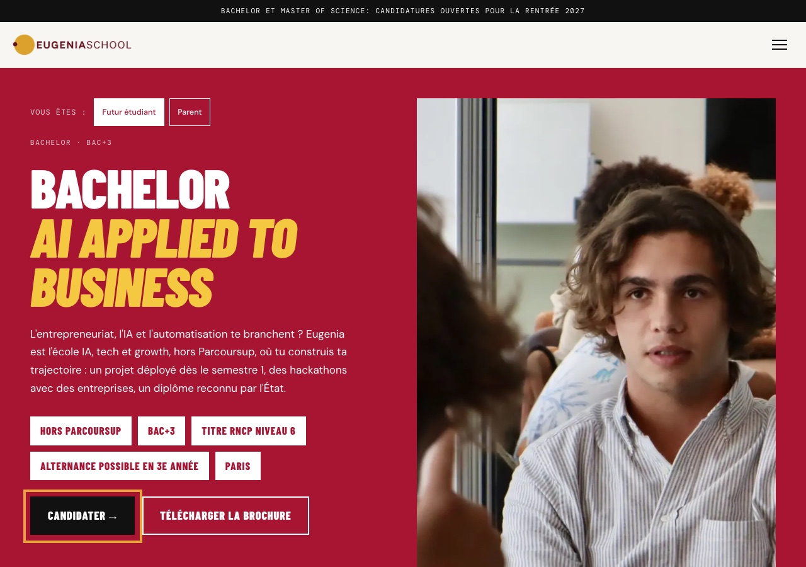
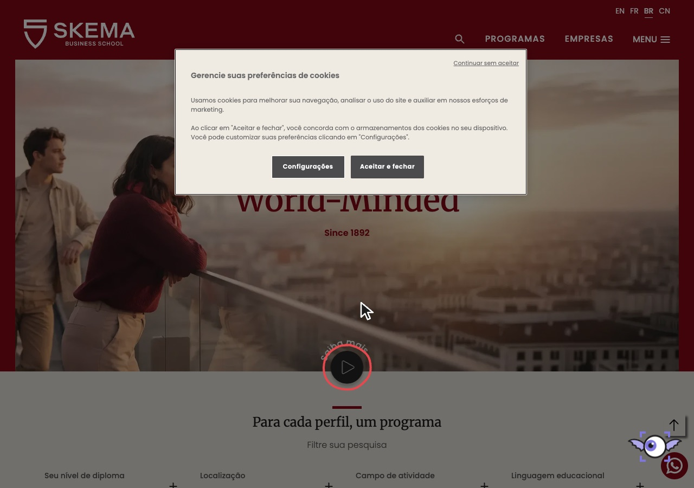
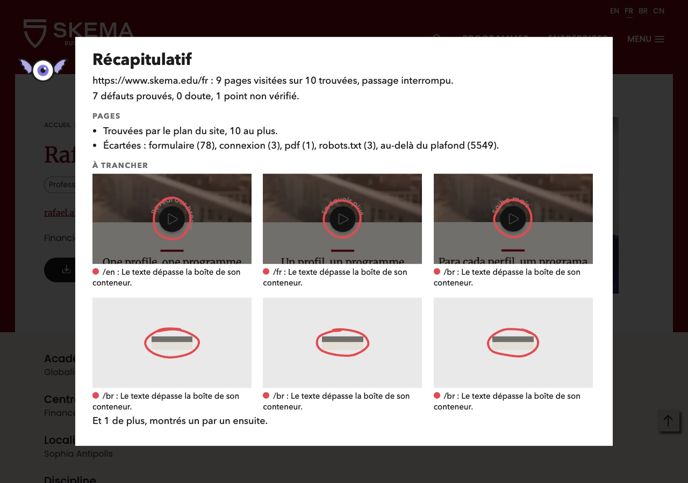
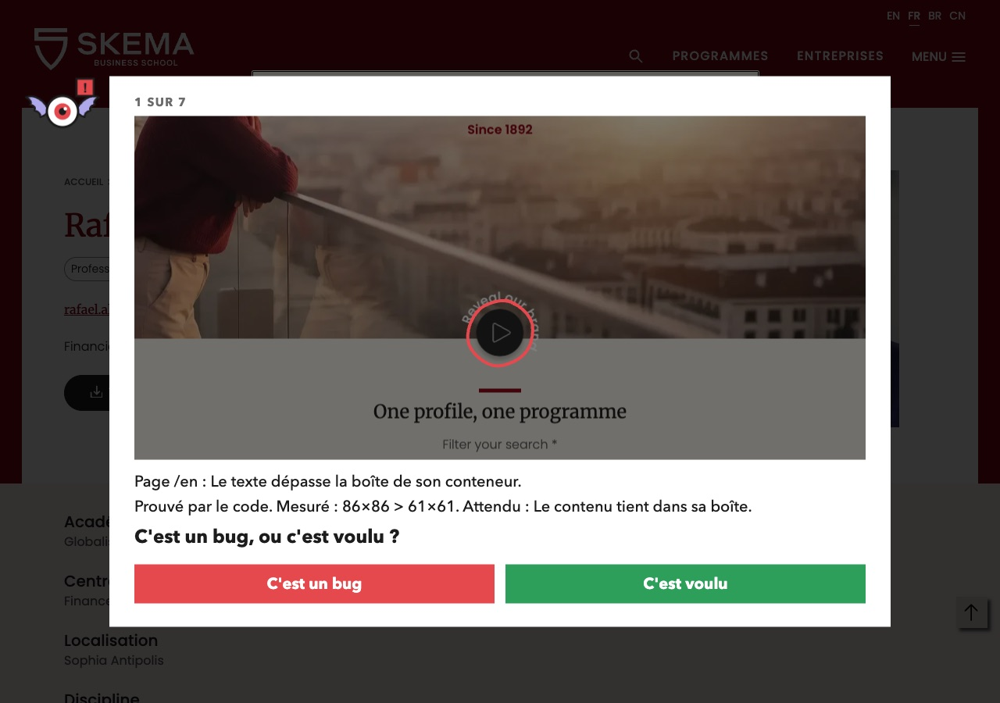
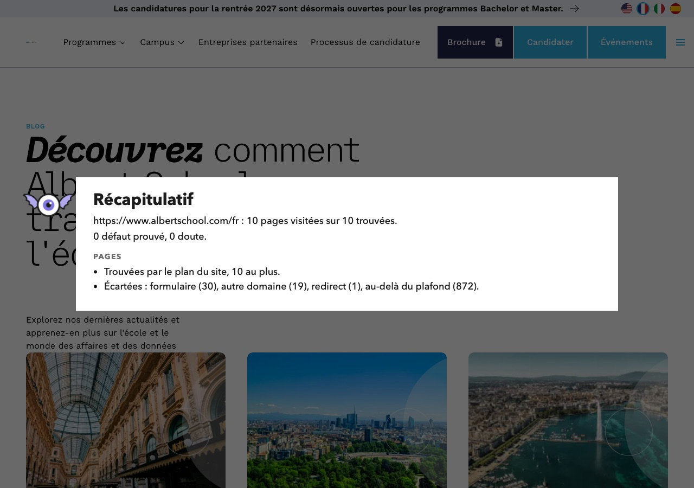

# Note du passage dans le vault (issue #71, point 2) et scène sur deux sites du banc, 18 novembre 2026

Couloir Nathan. Sans l'agent H ni Holo : **aucun coût**. Tous les essais écrivent dans des copies du vault (`.orchestrateur/squelette/…/vault`), jamais dans `vault-horama/`. Les décisions des essais sont données par `--choix` et portent le nom par défaut (`--par`, « Nathan ») : ce ne sont pas des décisions de Nathan.

## 1. La note du passage

Le coureur écrit `<vault>/<logiciel>/passages/<id>.md` à la fin de la session H, avant tout choix de l'humain. Après les décisions, la scène (`automatisation/scene/note-passage.mjs`) y ajoute une section « Après le passage » :
- les tests rejoués et écartés, avec leurs raisons (mode dev) ; les pages visitées, non visitées et écartées à la découverte (mode grand public) ;
- chaque défaut prouvé et chaque doute, avec sa capture entourée (`passages/<id>/<constat>.png`) et la décision prise (lien vers le fichier de `decisions/`, statut de la correction de note) ;
- la PR qui a déclenché le passage (`--pr`).

Essai en mode dev, sur le site d'Eugenia en ligne, avec l'écart planté de la répétition :

```
node automatisation/demo/preparer-ecart.mjs .orchestrateur/squelette/2026-11-18-dev-note/vault
node automatisation/scene/parcours.mjs --sans-agent --sans-presentation --base-url https://www.eugeniaschool.com --logiciel eugenia --version 1 --reference 1 \
  --impact .orchestrateur/squelette/2026-11-18-dev-note/impact.json --choix bug --pr https://github.com/Hisseiny/Horama-/pull/80 \
  --vault .orchestrateur/squelette/2026-11-18-dev-note/vault --sortie .orchestrateur/squelette/2026-11-18-dev-note/passage --fermer-chrome
```

Code 0. La PR #80 sert seulement d'adresse d'essai pour `--pr`. La section écrite dans `eugenia/passages/2026-11-18-10h58-64e2.md` de la copie :

```
## Après le passage

Écrit par la scène après les choix de l'humain.

### Tests

- Rejoué : accueil-vers-bachelor (relève accueil)
- Écarté : bachelor-vers-msc (page non touchée)
- Écarté : tour-du-site (non jouable en scripté)

### Défauts et doutes

#### 1. doute : bachelor--defaut--visuel--1


Décision : **bug**, par Nathan, le 2026-11-18 : [2026-11-18-bachelor-candidater.md](../decisions/2026-11-18-bachelor-candidater.md).

### PR

- PR qui a déclenché le passage : https://github.com/Hisseiny/Horama-/pull/80
```

Depuis cet essai, quand `formuler` n'a ni annonce ni résultat distinct de la question, le résultat est écrit sous le titre du constat. Relancé avec le code commité (même commande sans `--pr`, code 0), le constat se lit : « Quelque chose a changé ici, autour de « CANDIDATER → ». », puis la capture et la décision. La capture entourée rangée avec la note :



## 2. La scène sur deux sites du banc (mode grand public)

Sites de l'issue #67, `--max 10`, 3 s avant et après chaque relevé :

```
node automatisation/scene/exploration.mjs --url https://www.albertschool.com/fr --max 10 --sans-agent --sans-holo --rythme 3 --choix bug,voulu,… \
  --vault <copie> --sortie <dossier>/sortie --temoins <dossier>/temoins --fermer-chrome
node automatisation/scene/exploration.mjs --url https://www.skema.edu/fr --max 10 (mêmes options)
```

| Site | Code | Pages | Constats | Durée |
|---|---|---|---|---|
| albertschool.com/fr | 0 | 10 trouvées, 10 visitées | aucun | 77 s |
| skema.edu/fr | 1 | 10 trouvées, 9 visitées | 7 `VERIFIED_FAIL` (`debordement`), 1 `INCONCLUSIVE` (page non visitée) | 186 s, questions comprises |

- **La scène tient ailleurs qu'Eugenia** : traits tracés en direct sur skema.edu, récapitulatif, sept questions, décisions écrites dans `skema-edu/decisions/` de la copie, note du passage complétée sur les deux sites. Rien de propre à un site n'a été ajouté.
- **Code 1 sur skema** : la cause est dans le moteur d'exploration, pas dans la scène. La page d'accueil `https://www.skema.edu/` est refusée par le relevé (« écran non atteint » : elle redirige) et marquée `non_visitee` ; le passage finit donc `interrompu`, et la scène sort en 1 comme prévu. Cas « redirection » de l'issue #67 (Ali).
- **Les 7 débordements de skema, relus à la main sur les captures : faux à mon avis.** C'est le texte décoratif écrit en arc autour du bouton de lecture de la vidéo (« Reveal our brand », mesuré 86 × 86 dans une boîte de 61 × 61), répété sur les pages `/en`, `/fr` et `/br`, et sur les cartes de la page `/br`. Ce sont des faux constats du contrôle `debordement` (issue #67, taux de faux constats).
- **Bannière de cookies non refusée** sur skema.edu : elle reste au-dessus de la page dans les captures (point « bannière de cookies » de l'issue #67).

| skema : le trait en direct | skema : récapitulatif | skema : question 1 | albertschool : récapitulatif |
|---|---|---|---|
|  |  |  |  |

## Ce qui n'est pas testé

- Aucun passage avec l'agent H ni avec Holo (dépense, accord de Nathan ; le banc avec H est à Ali, #67).
- kpmg.com et grantthornton.fr.
- Le lien vers la PR de documentation (`automatisation/pr-doc/`) : la scène n'appelle pas encore `ouvrirPrDoc`, la note ne porte que la PR passée par `--pr`.
- Le réveil (`automatisation/reveil/wake.mjs`) ne passe pas encore `--pr` à la scène.
