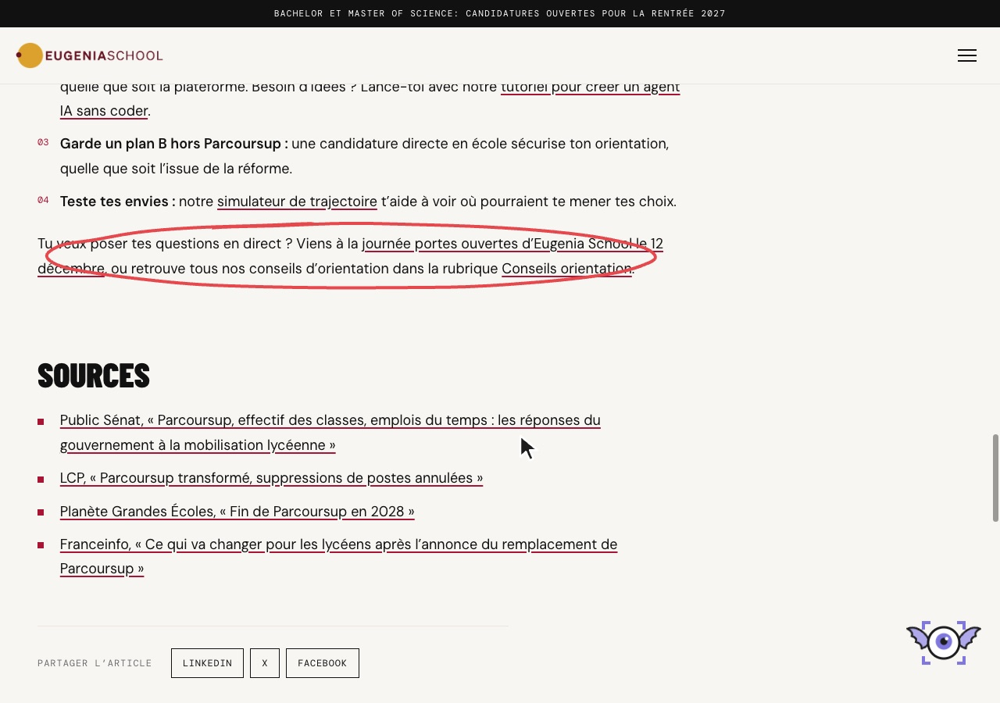
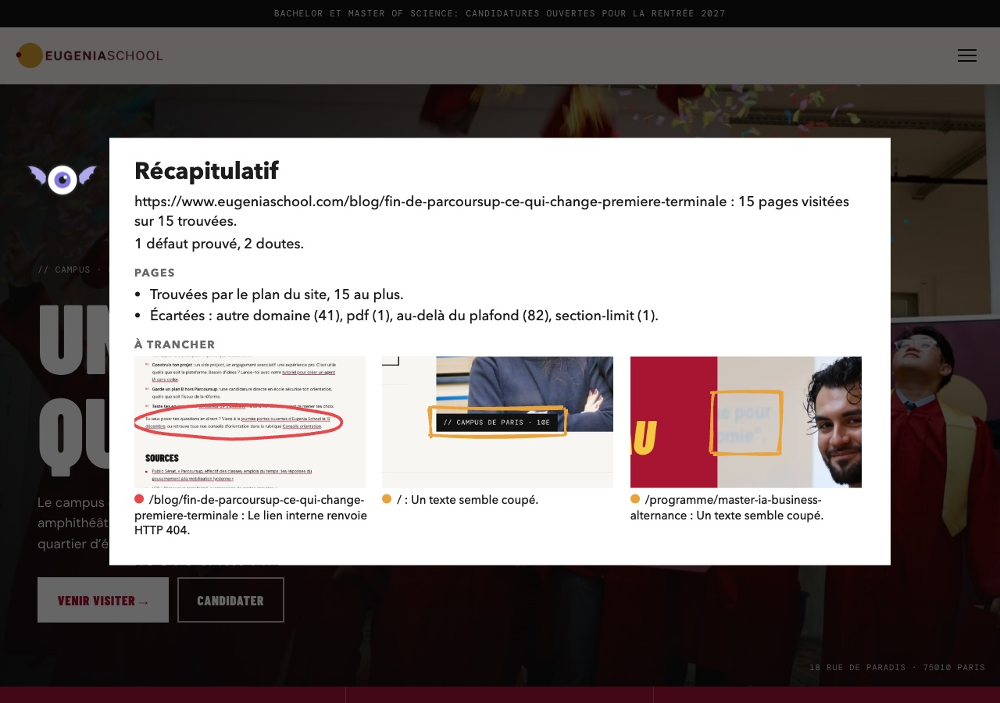
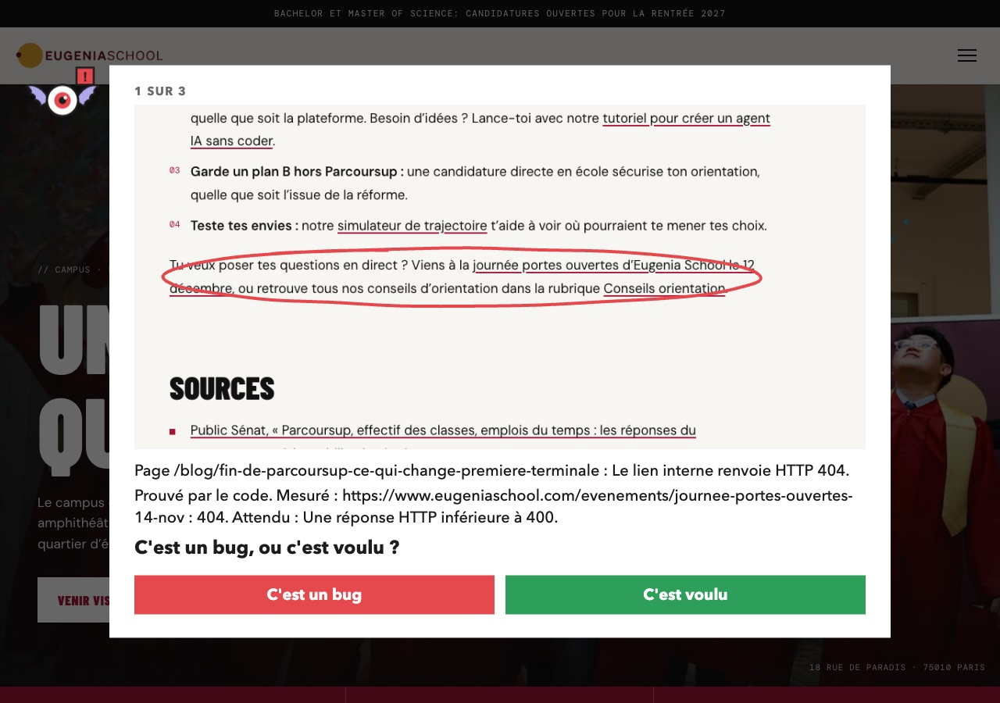
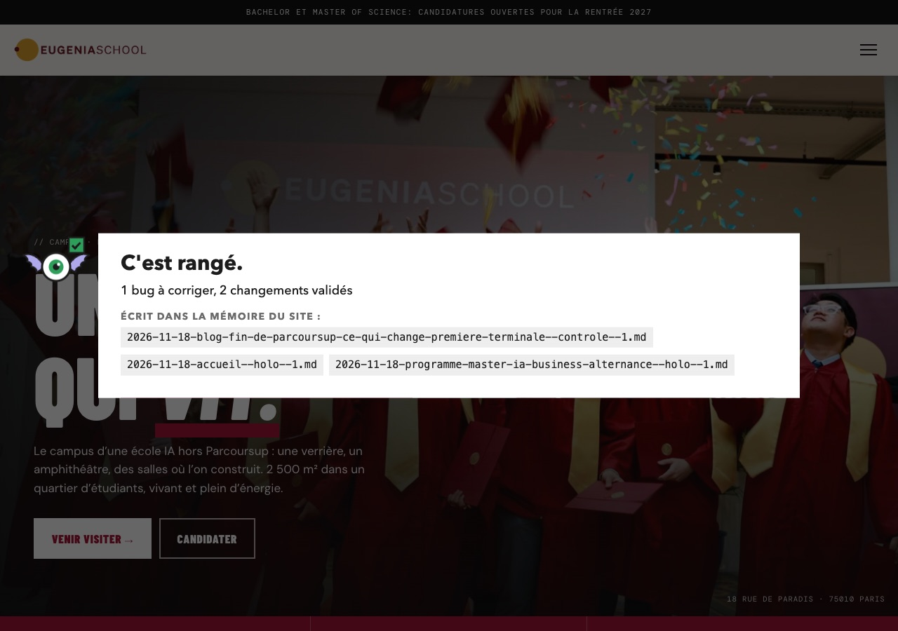
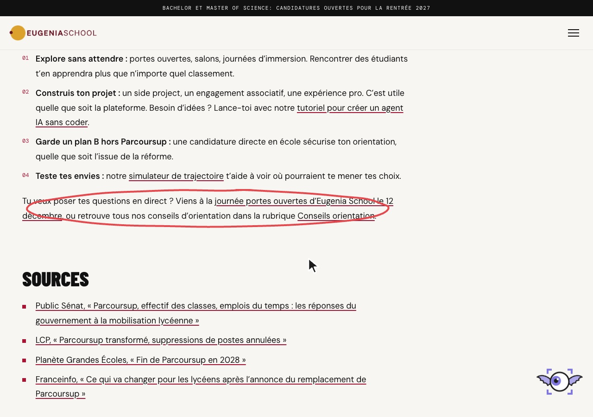

# Répétition réelle du mode grand public dans la scène, 18 novembre 2026, 11 h 45

Couloir Nathan. **Premier passage avec l'agent H et Holo de `automatisation/scene/exploration.mjs`.** Lancé sur le go de Nathan, tapé dans la session de l'orchestrateur. Code de `dev` fec4753 (PR #89 comprise).

## Ce qui a été lancé

```
bash automatisation/demo/passage-reel.sh
```

- Vérification d'avant-départ (`automatisation/demo/avant-depart.mjs`, sans coût) : « Prêt », 0 session H en cours pour l'organisation, pont holo présent, écran 2560 × 1440.
- Puis la scène, avec H et Holo, depuis https://www.eugeniaschool.com/blog/fin-de-parcoursup-ce-qui-change-premiere-terminale, 15 pages au plus, base en mémoire, sur une copie du vault (`.orchestrateur/demo/2026-11-18-11h45/`, hors Git).
- Les trois questions de la fin ont été tranchées par Nathan, à la souris.

## Ce qui en est sorti

- Code 0. 262 s de bout en bout, dont 235,4 s d'exploration. Coût rendu : **0,0827 $**. Une session H, état « fini », [replay](https://agp.eu.hcompany.ai/share/api/v1/trajectories/49596382-066a-4d9c-baa4-ac0714ca638c).
- 15 pages trouvées par le plan du site, 15 visitées : l'article en premier, puis `/`, `/programme/bachelor-ia-business`, `/notre-adn`, `/entreprises-partenaires`, `/processus-admission`, `/evenements`, `/tech-hub`, `/certification-architecte-ia`, `/carrieres`, `/recruter-nos-etudiants`, `/faq`, `/presse`, `/programme/master-ia-business-alternance`, `/campus/paris`. Écartées : autre domaine (41), pdf (1), au-delà du plafond (82), « section-limit » (1).

| Constat | Source | Relu à la main | Décision de Nathan |
|---|---|---|---|
| Lien « journée portes ouvertes » de l'article : HTTP 404 (`/evenements/journee-portes-ouvertes-14-nov`) | contrôle, prouvé | **vrai** | bug |
| Accueil : « Le texte du badge "Campus de Paris" est coupé à droite » | Holo, doute | **faux** : le badge « // CAMPUS DE PARIS · 10E » est entier (même faux constat que le 17/11) | voulu |
| Master : « texte en arrière-plan partiellement masqué par la photo » | Holo, doute | **faux** : diapositive floue dans la photo d'un intervenant, voulue | voulu |

1 constat vrai sur 3 ; les 2 faux viennent de Holo et sont restés des doutes. Le chapô coupé du 17/11 n'est pas attendu ici : sa page n'est pas parmi les 15.

- Pendant la visite : la page de l'article a défilé jusqu'au lien, que le cercle rouge a entouré en direct, sans texte. Les deux doutes ont reçu leur cadre orangé. Au récapitulatif, la vignette du 404 est centrée et entourée, sans curseur ni mascotte.
- Écrit : 3 décisions dans la mémoire du site de la copie (`eugeniaschool-com/decisions/`) et la note du passage complétée (`eugeniaschool-com/passages/2026-11-18-10h45-8eb8.md`).

| Le 404 en direct | Un doute en direct | Récapitulatif | Question 1 | Fin |
|---|---|---|---|---|
|  |  |  |  |  |

## Défauts relevés

- Le curseur de l'agent reste immobile au centre tout le passage : H n'ouvre les pages que par `go_to`, sans clic (scène).
- « section-limit » s'affiche tel quel dans les raisons d'exclusion (moteur).
- L'identifiant du passage est à l'heure UTC (10h45), le dossier à l'heure de Paris (11h45) (moteur).

## Corrections de la scène après la répétition (même jour, essai scripté, 0 $)

Diagnostic, tiré des journaux de ce passage : l'agent H n'a fait **aucun clic, aucun défilement, aucune frappe**. Le pont a reçu 15 `goto`, 16 `observation_bundle`, 15 `current_url` et 1 `destroy`. L'écart entre deux `goto` va de 9 à 22 s (médiane 11 s). Les défilements visibles venaient du code, et seulement sur l'article :
- le saut aller-retour de `captureZone` jusqu'au lien, puis retour ;
- puis le défilement doux de la couche pour tracer le cercle.

Au démarrage, la page restait blanche environ 21 s :
- 2 s pour trouver les pages ;
- 1 s pour démarrer le pont ;
- 10,1 s jusqu'à la première observation de H ;
- 7,3 s jusqu'à son premier `goto`.

Corrections dans la scène :
1. La page de départ est ouverte dès le lancement, la mascotte en lecture ; elle n'est plus remplacée par une page blanche avant la session H.
2. `captureZone` : un seul défilement doux jusqu'au défaut, capture à cet endroit, couche masquée pour la capture seulement, puis la page reste là et le cercle s'y trace. Plus d'aller-retour.

Le test `capture-zone.test.mjs` passe. Il échoue bien si le défilement redevient instantané. L'essai scripté depuis l'article (`--sans-agent --sans-holo --rythme 3`) a rendu le code 0 en 161 s, avec l'article visité en premier, le 404 entouré à l'endroit où la page s'est arrêtée et une vignette centrée (zone y 422 à 478).



La partie « computer use » (des défilements et des clics faits par H) relève de la consigne du moteur : issue #91 (Ali).

## Branchement de la PR #93 d'Ali (#91) dans la scène (essai scripté, 0 $)

- `exploration.mjs --pages-cliquees N` est passé au moteur ; `automatisation/demo/passage-reel.sh` lance désormais `--max 8 --pages-cliquees 4 --vitrine`.
- Worktree jetable : `dev` (3683b45), `a-91-visite` (6c7bfc1) et la branche de la scène. Depuis l'article, `--max 8 --pages-cliquees 4 --sans-agent --sans-holo` : code 0, 8 pages sur 8, le 404 entouré. Journal du moteur : « 0 pages par clic, 7 par adresse ; 0 clics, 0 défilements, 8 go_to » (normal : en scripté, le script ouvre les pages par leur adresse).
- Le champ `arrivee` n'est pas encore écrit dans `exploration.json` par la PR #93 : le récapitulatif ne l'affiche donc pas. Essai d'affichage avec une modification **locale, non commitée** du moteur, qui recopie dans la page le mode qu'il note déjà dans son journal (4 pages) : la question du 404 se lit « Page /blog/… (page de départ) : Le lien interne renvoie HTTP 404. », et la note du passage « Visitée : / (ouverte par son adresse) ».
