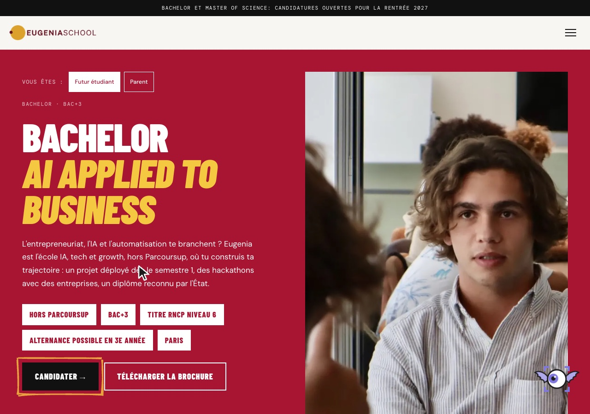
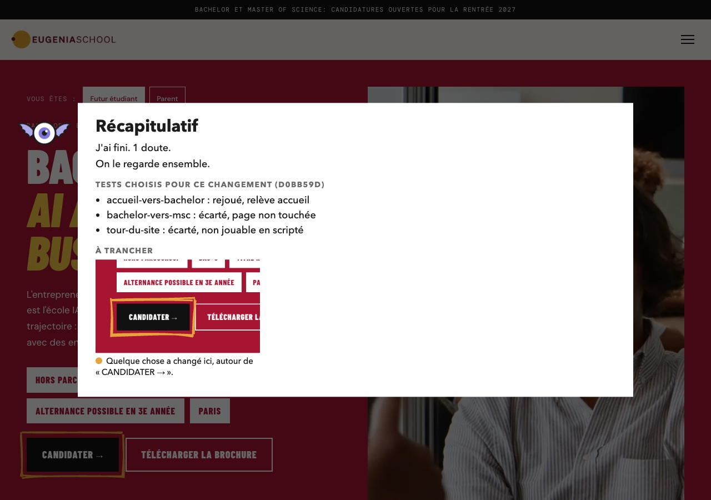
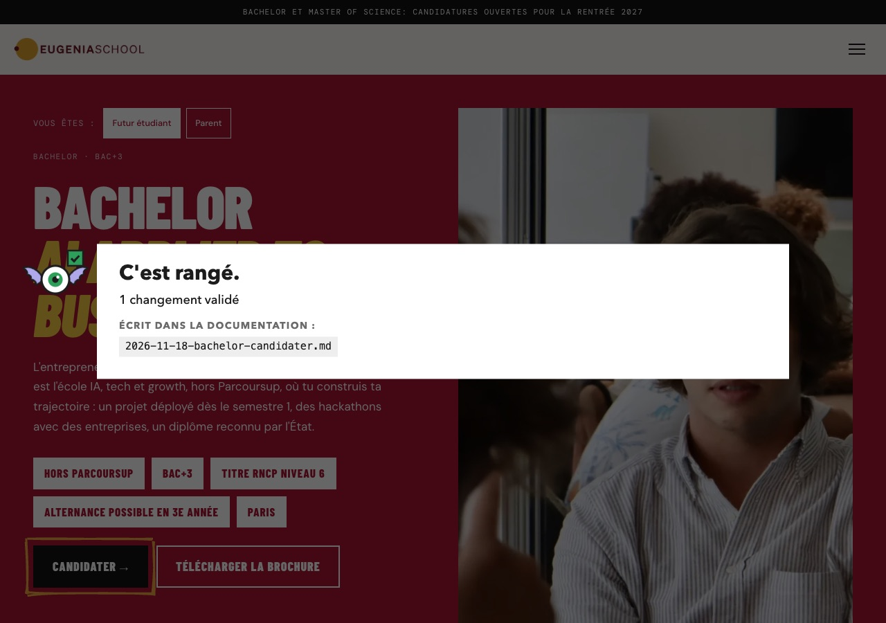
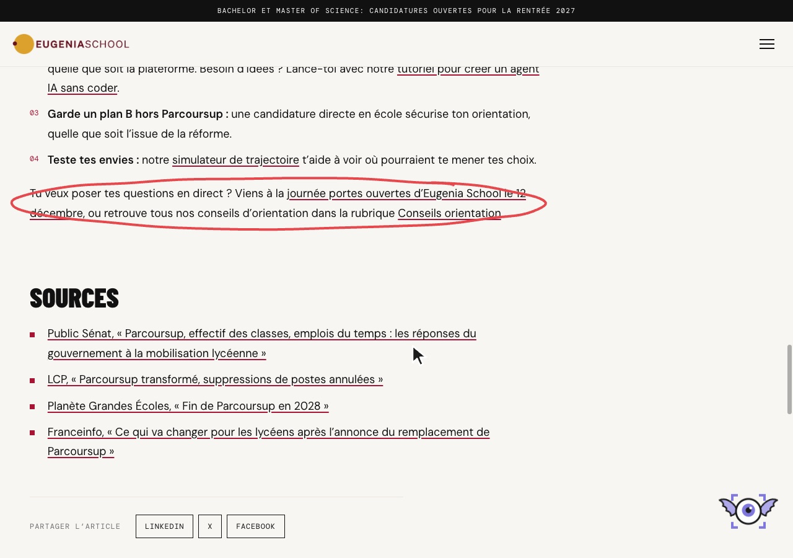
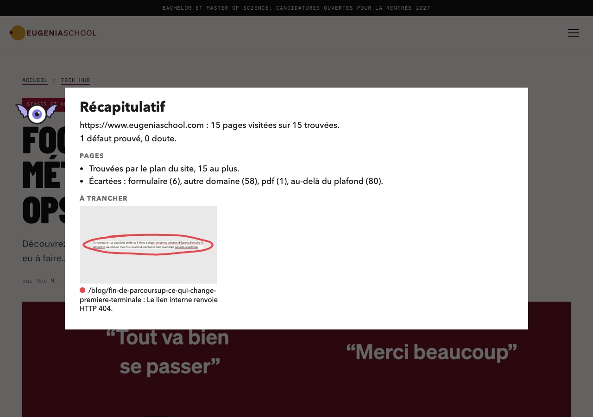
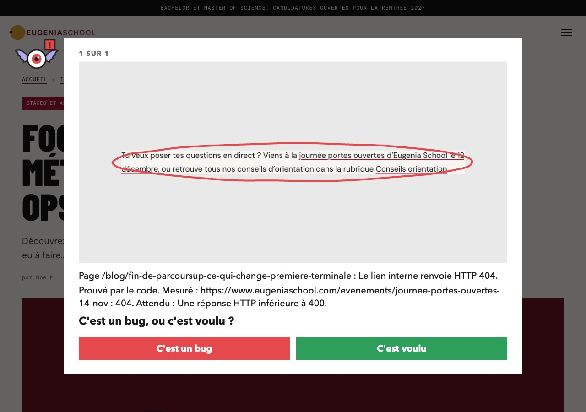
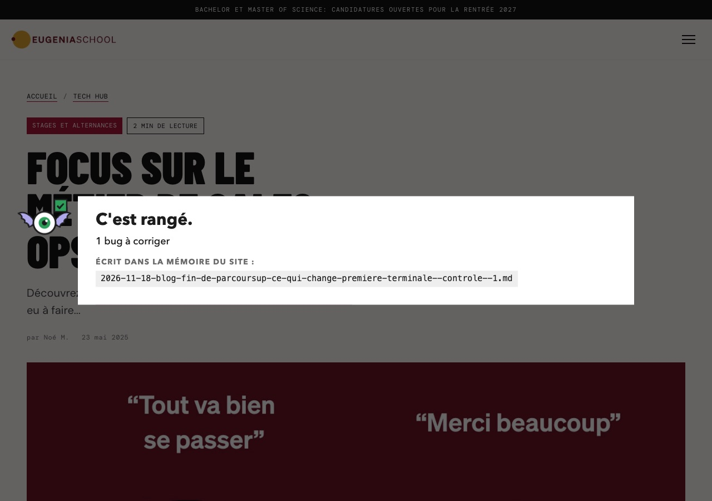

# Squelette de la scène épurée (issue #69), 18 novembre 2026

Couloir Nathan. Ce qui a été lancé et ce qui en est sorti, sur le Mac de Nathan, sans l'agent H (clics et ouvertures de page par le script) et sans Holo : **aucun coût**. Le squelette est à valider par Nathan avant toute direction artistique.

## Ce qui change à l'écran

- **Pendant le parcours** : le site, le curseur, la mascotte (qui change de tête) et un trait tracé comme à la main au moment où un défaut est trouvé : cercle rouge pour un défaut prouvé, cadre orangé pour un doute. Plus de bandeau, de compteurs, d'annonce de la sélection, de numéros ni de tampons sur la page.
- **À la fin** : un panneau porte tout le texte. Il montre d'abord le récapitulatif : le bilan, la sélection des tests (mode dev) ou les pages trouvées et écartées (mode grand public), et chaque défaut ou doute en vignette, avec sa capture entourée. Ensuite, chaque constat en grand avec sa question bug ou voulu. Puis ce qui a été écrit.
- Couleurs provisoires et neutres. La mascotte de la CDO est gardée telle quelle en attendant la direction artistique.

## 1. Mode dev, site d'Eugenia en ligne (parcours scripté)

Copie du vault avec l'écart planté de la répétition (référence du Bachelor repeinte), sélection de la répétition du 18/11 à 9 h 10 :

```
node automatisation/demo/preparer-ecart.mjs .orchestrateur/squelette/2026-11-18-dev/vault
node automatisation/scene/parcours.mjs --sans-agent --base-url https://www.eugeniaschool.com --logiciel eugenia --version 1 --reference 1 \
  --impact .orchestrateur/squelette/2026-11-18-dev/impact.json --choix voulu --correction-choix accepter \
  --vault .orchestrateur/squelette/2026-11-18-dev/vault --sortie .orchestrateur/squelette/2026-11-18-dev/passage \
  --temoins .orchestrateur/squelette/2026-11-18-dev/temoins --film .orchestrateur/squelette/2026-11-18-dev/film --fermer-chrome
```

- Code de sortie 0. 2 relevés sur 2, 1 clic, 1 doute (`bachelor--defaut--visuel--1`, SUSPECTED, 10 183 px), comme la répétition de la veille. Réponse « voulu » par `--choix`, 1 décision écrite dans la copie, base en mémoire passée à `verifie`. Fin du parcours (du dernier relevé à l'écran de fin) : 29,0 s au premier essai.
- Pas de correction de note proposée : lancé sans `--env-file`, le modèle de correction répond HTTP 401. Le repli prévu s'est affiché (témoin `correction-absente`).
- **Captures de vérification** comparées pixel par pixel à celles de la répétition du 17/11 à 19 h 14, faite avec l'ancienne couche : Bachelor 0 pixel d'écart. Accueil : 252 128 pixels d'écart, tous dans le rectangle (680, 167) à (1239, 726), qui est exactement la zone ignorée déclarée dans la note de l'accueil (la photo qui change à chaque visite) ; 0 pixel hors de cette zone. La couche est bien masquée au moment des captures.
- Clip du parcours et du récapitulatif (film de 42 s, une image toutes les 200 ms) : [squelette-mode-dev.mp4](captures/2026-11-18-squelette-scene/squelette-mode-dev.mp4).

| Pendant le parcours | Le doute tracé | Récapitulatif | Question | Fin |
|---|---|---|---|---|
|  |  |  |  |  |

## 2. Mode grand public, eugeniaschool.com (exploration scriptée)

Le moteur d'exploration d'Ali (`agent/src/exploration/explorer.ts`) dans la scène (`automatisation/scene/exploration.mjs`), sur une copie du vault :

```
cp -R vault-horama .orchestrateur/squelette/2026-11-18-gp-eugenia/vault
node automatisation/scene/exploration.mjs --url https://www.eugeniaschool.com --sans-agent --sans-holo --rythme 3 --choix bug,bug,bug,bug,bug,bug \
  --vault .orchestrateur/squelette/2026-11-18-gp-eugenia/vault --sortie .orchestrateur/squelette/2026-11-18-gp-eugenia/sortie \
  --temoins .orchestrateur/squelette/2026-11-18-gp-eugenia/temoins --fermer-chrome
```

- Code de sortie 0. 15 pages trouvées par le plan du site, 15 visitées en 110 s (3 s avant et après chaque relevé, pour approcher le rythme de H). Écartées : formulaire (6), autre domaine (58), pdf (1), au-delà du plafond (80).
- 1 défaut prouvé par le code : le lien « journée portes ouvertes » de `/blog/fin-de-parcoursup-ce-qui-change-premiere-terminale` renvoie HTTP 404 (`/evenements/journee-portes-ouvertes-14-nov`), le défaut déjà trouvé le 17/11. Le trait a été tracé **sur la page en direct**, pendant le passage : la page défile jusqu'au lien, en bas de l'article, et un cercle rouge l'entoure, sans texte. Au récapitulatif : sa capture entourée et la preuve en clair (« Mesuré : … : 404. Attendu : une réponse HTTP inférieure à 400. »). Réponse « bug » par `--choix`, 1 décision écrite dans la mémoire du site de la copie (`eugeniaschool-com/decisions/`).
- Holo n'a pas été appelé (`--sans-holo`). Le chapô coupé, trouvé par Holo le 17/11, n'est donc pas attendu ici.
- Rien n'est propre à eugeniaschool.com dans `exploration.mjs` ni dans la couche : le site n'est connu que par `--url`.

| Le trait en direct | Récapitulatif | Question | Fin |
|---|---|---|---|
|  |  |  |  |

## Ce qui n'est pas testé

- **Aucun passage avec l'agent H** dans l'une ou l'autre entrée, ni avec Holo. Un passage H réel du mode grand public coûte (sessions H, Holo) : il attend l'accord de Nathan.
- Un autre site du banc que eugeniaschool.com : les quatre sites de Nathan sont attendus sur l'issue #67.
- Une vraie souris sur les boutons du panneau : les choix sont passés par `--choix`.
- La correction de note avec le modèle (lancé sans `--env-file`).
- L'exploration à trois agents : la scène ne dépend pas du nombre d'agents, mais elle ne dessine que dans l'onglet qu'elle tient.
