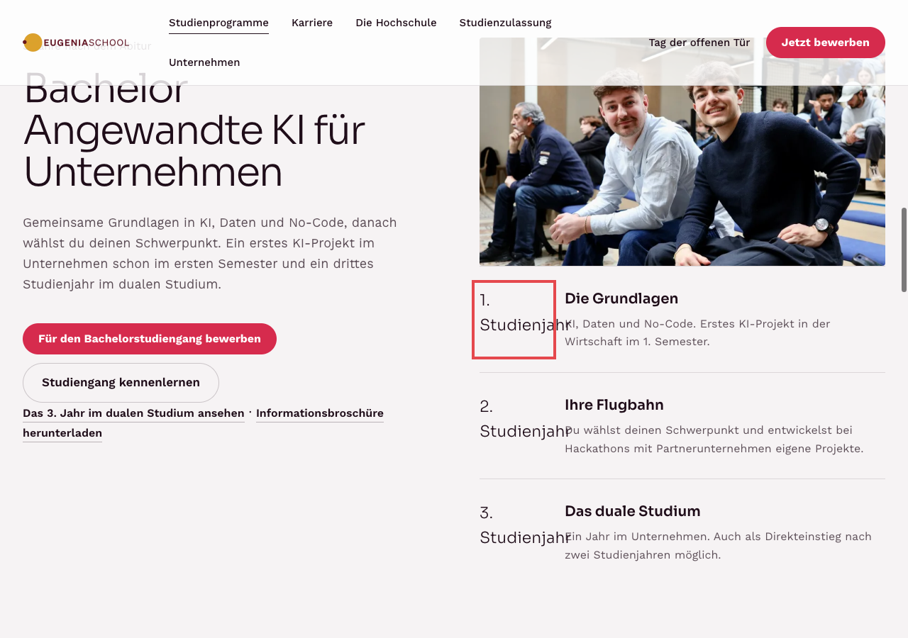
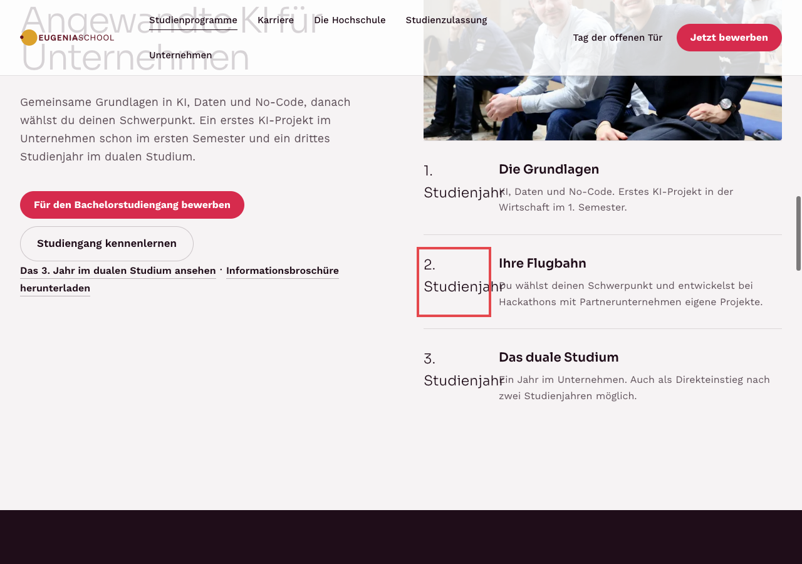
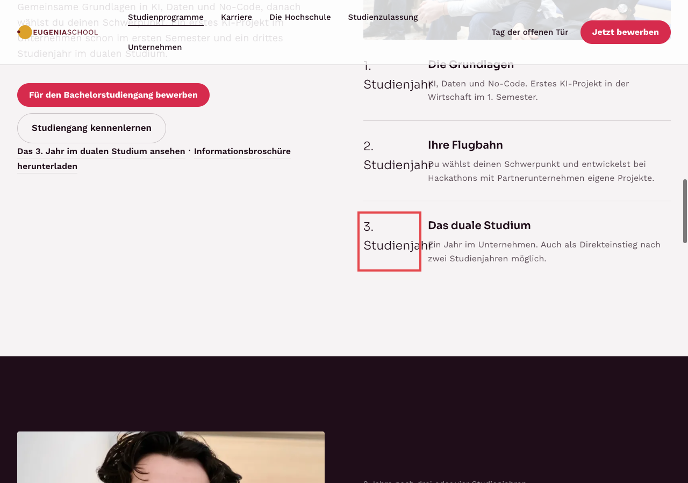
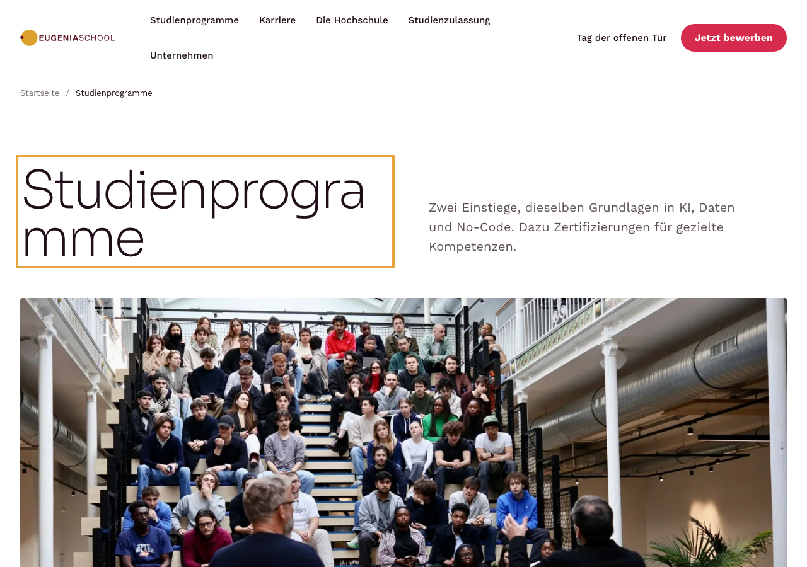

# Passage 2026-11-18-23h05-0ed5

Version testée : 1. Version de référence : 1.
Tests joués : 8. Réussites : 5 (seuls les tests conformes comptent).
Durée : 2 min 28.632000000000005 s. Coût : 0.0658802 $.

| Statut | Tests |
|---|---|
| défaut prouvé (`VERIFIED_FAIL`) | 2 |
| suspect (`SUSPECTED`) | 1 |
| non concluant (`INCONCLUSIVE`) | 0 |
| conforme (`PASS`) | 5 |

## exploration--accueil : défaut prouvé

Session terminée : 2 min 28.632000000000005 s, 23 étapes, coût 0.0658802 $. Écrans relevés : accueil.

- Statut : défaut prouvé (`VERIFIED_FAIL`), niveau de preuve : releve.
- Règle : aucune
- Valeurs : accueil.debordement 1 = 158×35 > 120×35
- Calcul : Le texte dépasse la boîte de son conteneur.
- Écarts visuels : aucun
- Replay : [session H](https://agp.eu.hcompany.ai/share/api/v1/trajectories/3c188e25-93b2-47a5-a6a1-91b7aaf7438f)

## exploration--programmes : défaut prouvé

Session terminée : 2 min 28.632000000000005 s, 23 étapes, coût 0.0658802 $. Écrans relevés : programmes.

- Statut : défaut prouvé (`VERIFIED_FAIL`), niveau de preuve : releve.
- Règle : aucune
- Valeurs : programmes.debordement 1 = 129×89 > 96×89 ; programmes.debordement 2 = 129×89 > 96×89 ; programmes.debordement 3 = 129×89 > 96×89
- Calcul : Le texte dépasse la boîte de son conteneur. ; Le texte dépasse la boîte de son conteneur. ; Le texte dépasse la boîte de son conteneur.
- Écart visuel programmes--holo--1 (programmes, vue defaut) : Un texte semble coupé.. Zone de 578 × 157 px en x = 36, y = 257, à trancher (`SUSPECTED`).
- Replay : [session H](https://agp.eu.hcompany.ai/share/api/v1/trajectories/3c188e25-93b2-47a5-a6a1-91b7aaf7438f)

## exploration--admissions : suspect

Session terminée : 2 min 28.632000000000005 s, 23 étapes, coût 0.0658802 $. Écrans relevés : admissions.

- Statut : suspect (`SUSPECTED`), niveau de preuve : aucun.
- Règle : aucune
- Valeurs : aucune
- Calcul : 
- Écart visuel admissions--holo--1 (admissions, vue defaut) : Un texte semble coupé.. Zone de 595 × 162 px en x = 32, y = 261, à trancher (`SUSPECTED`).
- Replay : [session H](https://agp.eu.hcompany.ai/share/api/v1/trajectories/3c188e25-93b2-47a5-a6a1-91b7aaf7438f)

## exploration--entreprises : conforme

Session terminée : 2 min 28.632000000000005 s, 23 étapes, coût 0.0658802 $. Écrans relevés : entreprises.

- Statut : conforme (`PASS`), niveau de preuve : aucun.
- Règle : aucune
- Valeurs : aucune
- Calcul : 
- Écarts visuels : aucun
- Replay : [session H](https://agp.eu.hcompany.ai/share/api/v1/trajectories/3c188e25-93b2-47a5-a6a1-91b7aaf7438f)

## exploration--carrieres : conforme

Session terminée : 2 min 28.632000000000005 s, 23 étapes, coût 0.0658802 $. Écrans relevés : carrieres.

- Statut : conforme (`PASS`), niveau de preuve : aucun.
- Règle : aucune
- Valeurs : aucune
- Calcul : 
- Écarts visuels : aucun
- Replay : [session H](https://agp.eu.hcompany.ai/share/api/v1/trajectories/3c188e25-93b2-47a5-a6a1-91b7aaf7438f)

## exploration--ecole : conforme

Session terminée : 2 min 28.632000000000005 s, 23 étapes, coût 0.0658802 $. Écrans relevés : ecole.

- Statut : conforme (`PASS`), niveau de preuve : aucun.
- Règle : aucune
- Valeurs : aucune
- Calcul : 
- Écarts visuels : aucun
- Replay : [session H](https://agp.eu.hcompany.ai/share/api/v1/trajectories/3c188e25-93b2-47a5-a6a1-91b7aaf7438f)

## exploration--evenements : conforme

Session terminée : 2 min 28.632000000000005 s, 23 étapes, coût 0.0658802 $. Écrans relevés : evenements.

- Statut : conforme (`PASS`), niveau de preuve : aucun.
- Règle : aucune
- Valeurs : aucune
- Calcul : 
- Écarts visuels : aucun
- Replay : [session H](https://agp.eu.hcompany.ai/share/api/v1/trajectories/3c188e25-93b2-47a5-a6a1-91b7aaf7438f)

## exploration--programme-bachelor-ia-business : conforme

Session terminée : 2 min 28.632000000000005 s, 23 étapes, coût 0.0658802 $. Écrans relevés : programme-bachelor-ia-business.

- Statut : conforme (`PASS`), niveau de preuve : aucun.
- Règle : aucune
- Valeurs : aucune
- Calcul : 
- Écarts visuels : aucun
- Replay : [session H](https://agp.eu.hcompany.ai/share/api/v1/trajectories/3c188e25-93b2-47a5-a6a1-91b7aaf7438f)
## Après le passage

Écrit par la scène après les choix de l'humain.

### Pages

- Visitée : / (page de départ)
- Visitée : /programmes (atteinte par un clic de l'agent)
- Visitée : /entreprises (atteinte par un clic de l'agent)
- Visitée : /carrieres (atteinte par un clic de l'agent)
- Visitée : /admissions (atteinte par un clic de l'agent)
- Visitée : /ecole (ouverte par son adresse)
- Visitée : /evenements (ouverte par son adresse)
- Visitée : /programme/bachelor-ia-business (ouverte par son adresse)
- Écartées à la découverte : autre domaine (3), scheme (4), au-delà du plafond (25)

### Défauts et doutes

#### 1. défaut prouvé : accueil--controle--1

Page / (page de départ) : Le texte dépasse la boîte de son conteneur.

Prouvé par le code. Mesuré : 158×35 > 120×35. Attendu : Le contenu tient dans sa boîte.

Décision : **bug**, par Nathan, le 2026-11-18 : [2026-11-18-accueil--controle--1.md](../decisions/2026-11-18-accueil--controle--1.md).

#### 2. défaut prouvé : programmes--controle--1

Page /programmes (atteinte par un clic de l'agent) : Le texte dépasse la boîte de son conteneur.

Prouvé par le code. Mesuré : 129×89 > 96×89. Attendu : Le contenu tient dans sa boîte.

Décision : **bug**, par Nathan, le 2026-11-18 : [2026-11-18-programmes--controle--1.md](../decisions/2026-11-18-programmes--controle--1.md).

#### 3. défaut prouvé : programmes--controle--2

Page /programmes (atteinte par un clic de l'agent) : Le texte dépasse la boîte de son conteneur.

Prouvé par le code. Mesuré : 129×89 > 96×89. Attendu : Le contenu tient dans sa boîte.

Décision : **bug**, par Nathan, le 2026-11-18 : [2026-11-18-programmes--controle--2.md](../decisions/2026-11-18-programmes--controle--2.md).

#### 4. défaut prouvé : programmes--controle--3

Page /programmes (atteinte par un clic de l'agent) : Le texte dépasse la boîte de son conteneur.

Prouvé par le code. Mesuré : 129×89 > 96×89. Attendu : Le contenu tient dans sa boîte.

Décision : **bug**, par Nathan, le 2026-11-18 : [2026-11-18-programmes--controle--3.md](../decisions/2026-11-18-programmes--controle--3.md).

#### 5. doute : programmes--holo--1

Page /programmes (atteinte par un clic de l'agent) : Un texte semble coupé.

Doute du regard de Holo, le modèle visuel de H : rien n'est prouvé.

Décision : **bug**, par Nathan, le 2026-11-18 : [2026-11-18-programmes--holo--1.md](../decisions/2026-11-18-programmes--holo--1.md).

#### 6. doute : admissions--holo--1

Page /admissions (atteinte par un clic de l'agent) : Un texte semble coupé.

Doute du regard de Holo, le modèle visuel de H : rien n'est prouvé.

Décision : **bug**, par Nathan, le 2026-11-18 : [2026-11-18-admissions--holo--1.md](../decisions/2026-11-18-admissions--holo--1.md).

### PR

- Aucune.
